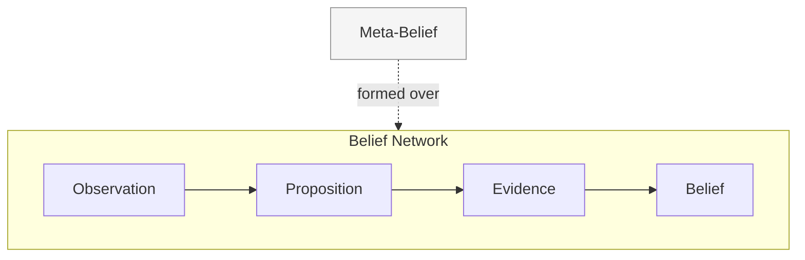

# RFC-0001: Computational Epistemology

> **Cortex RFC Series**
> Defines the epistemological foundation upon which every subsequent Cortex RFC depends.

| Property | Value |
|----------|-------|
| **RFC** | RFC-0001 |
| **Title** | Computational Epistemology |
| **Version** | 0.5 |
| **Status** | Draft |
| **Author** | Nick Davidson |
| **Depends On** | [RFC-0000: Cortex Documentation Standard](./RFC-0000_Cortex_Specification_Standard.md) |
| **Referenced By** | RFC-0002, RFC-0003, RFC-0004, RFC-0005 |

---

## Table of Contents

1. [Why](#1-why)
2. [Axioms](#2-axioms)
3. [Objects](#3-objects)
   - [3.1 Observation](#31-observation)
   - [3.2 Proposition](#32-proposition)
   - [3.3 Evidence](#33-evidence)
   - [3.4 Belief](#34-belief)
   - [3.5 Meta-Belief](#35-meta-belief)
   - [3.6 A Note on Structure](#36-a-note-on-structure)
4. [Relationships](#4-relationships)
5. [Behavior](#5-behavior)
   - [5.1 Confidence](#51-confidence)
   - [5.2 Provenance](#52-provenance)
   - [5.3 Learning](#53-learning)
   - [5.4 Coherence](#54-coherence)
   - [5.5 Tensions](#55-tensions)
6. [Boundaries](#6-boundaries)
   - [6.1 Belief Categories](#61-belief-categories)
   - [6.2 Historical Memory](#62-historical-memory)
7. [Ownership](#7-ownership)
8. [Language Notes](#8-language-notes)
9. [Closing Principle](#closing-principle)

---

# 1. Why

Traditional software stores state. Humans maintain beliefs.

A traditional system records what was entered. A human mind maintains an evolving, uncertain, revisable model of what is true. These are not the same activity, and software that wants to understand a person over time cannot rely on the first to approximate the second.

Cortex attempts to bridge that gap.

This RFC does not describe Cortex's storage, algorithms, or implementation. It describes what it means for Cortex to know something at all. Every subsequent RFC should be able to say "according to Computational Epistemology..." the way a systems paper might invoke a standard it implements.

The question this document answers is narrow and singular:

> [!IMPORTANT]
> **Core Question**
>
> **How does Cortex know anything?**

Not how knowledge is stored. Not how it is computed. Not how it is queried. Only what it means for Cortex to hold knowledge in the first place. Storage, computation, and querying are downstream concerns, addressed in later RFCs, and they derive their legitimacy from the answer given here.

> [!NOTE]
> **Philosophy**
>
> Cortex does not seek to determine objective truth. It seeks to maintain the most coherent and explainable model possible given the evidence currently available. Everything that follows — confidence, provenance, contradiction, coherence, learning, historical memory — is a consequence of that single commitment.

---

# 2. Axioms

Computational Epistemology rests on a small set of foundational axioms. Nothing below this point is justified further; everything past this point is derived from it. These are not hypotheses pending validation — they are the starting truths of this epistemology, the same way a geometric axiom is not proven within the system it grounds.

> [!IMPORTANT]
> **Foundational Principles**
>
> 1. Truth is unknowable to the system. Only evidence is observable.
> 2. Beliefs are temporary models, not permanent records.
> 3. Confidence is epistemic — a property of the model's relationship to its evidence, not a property of reality.
> 4. History matters. What was once believed remains meaningful even after belief changes.
> 5. Revision is expected, not exceptional.
> 6. Contradiction is information, not failure.

These axioms are not claims about human cognition, consciousness, or general intelligence. Computational Epistemology does not model emotion, subjective experience, or free will. It is a framework for managing uncertain knowledge about a person and their world. Nothing more, nothing less.

> [!NOTE]
> **Why Knowledge was removed**
>
> Knowledge was previously defined here as a sixth object and a seventh axiom. It is removed. The definition was self-contradictory as written — stated to be "not an object" while occupying the object list — and it had no field, table, dataclass, query function, or test in any downstream RFC; nothing consumed it. The commitment it gestured at, that understanding is continuously re-derived rather than stored, is already carried by Axioms 1 and 2 as they now stand. A future read-only layer may expose a view over how the belief network's current interpretation coheres; RFC-0005, not this document, would own defining and naming it. No such view is defined here, and this is not a reintroduction of Knowledge under another name.

---

# 3. Objects

Computational Epistemology defines five objects. Each is defined exactly once. Later sections and later RFCs must reference these definitions rather than introduce synonyms — a Belief is never called a "fact," a "memory," or an "assertion" elsewhere in the Cortex specification.

Each object is defined by its purpose, its properties, and its relationships to other objects. No algorithms are specified here; that is the province of [RFC-0002: Belief-State Substrate](#7-ownership).

## 3.1 Observation

> The lowest-level epistemic object. A record that something was observed.

**Purpose**

The lowest-level epistemic object. A record that something was observed.

**Properties**

An Observation carries no interpretation, no confidence, and no claim about truth. It simply records that something was perceived — deliberately not that something "occurred," since Computational Epistemology makes no claim about events independent of their observation.

**Relationships**

Observations are append-only and immutable. They are never rewritten, only superseded in interpretation by new Observations. An Observation may give rise to a [Proposition](#32-proposition), but does not itself support or contradict anything — interpretation is a separate act performed downstream.

## 3.2 Proposition

> A structured claim that may be supported or contradicted by Evidence.

**Purpose**

A structured claim that may be supported or contradicted by Evidence.

**Properties**

A Proposition is not yet a Belief. It carries no confidence and makes no claim to being currently held — it is a possible explanation, a shape that Evidence can attach to in order to be evaluated against rivals.

**Relationships**

A Proposition is formed from one or more [Observations](#31-observation). Evidence does not merely "bear on" something abstract; [Evidence](#33-evidence) is attached to a Proposition. A Proposition with sufficient attached Evidence may give rise to a [Belief](#34-belief); a Proposition with no attached Evidence, or only weak Evidence, remains a candidate indefinitely. Multiple competing Propositions may coexist for the same Observation or Evidence — a Proposition is a hypothesis, not a conclusion, and the existence of one Proposition does not preclude a rival. This is what separates a Proposition from a Belief: a Belief is the system's current most coherent answer among the field of competing Propositions, while a Proposition is merely a candidate entry in that field.

**Rationale**

Proposition generation is intentionally non-deterministic. An Observation does not uniquely determine a Proposition — the same Observation may reasonably give rise to several different possible explanations, and a system that forces a single Proposition per Observation is not being more rigorous, only prematurely narrowing the field. This is not a limitation to be engineered away. It is the reason Proposition exists as a distinct object at all: without room for multiple candidate explanations to coexist before evidence accumulates, there would be nothing for Belief to be selected from.

## 3.3 Evidence

> An Observation interpreted as support, or contradiction, attached to a Proposition.

**Purpose**

An Observation interpreted as support, or contradiction, attached to a Proposition.

**Properties**

Evidence carries provenance, a reliability characteristic, and a support characteristic (the degree to which it favors or disfavors the Proposition it is attached to). Evidence is append-only, mirroring the immutability of the Observations beneath it — when an extraction or interpretation is later judged wrong, new Evidence is added to contradict it; nothing is deleted or rewritten.

**Relationships**

Evidence is produced from one or more [Observations](#31-observation) and attaches to a [Proposition](#32-proposition). Evidence is not yet knowledge — it is the material from which Belief is formed, and a single piece of Evidence is rarely sufficient to constitute one.

## 3.4 Belief

> The current most coherent explanation supported by accumulated Evidence.

**Purpose**

The current most coherent explanation supported by accumulated Evidence.

**Properties**

A Belief is probabilistic, never binary. It carries a confidence characteristic, reflecting the current strength of its supporting Evidence, and it is explainable: a Belief must be able to answer what Evidence supports it, what Evidence contradicts it, how confident the system currently is, and where that Evidence originated.

**Relationships**

A Belief is formed from accumulated [Evidence](#33-evidence) and may strengthen, weaken, or be superseded as further Evidence arrives. A Belief that loses support does not disappear; it transitions toward dormancy rather than deletion (see [Historical Memory](#62-historical-memory)).

## 3.5 Meta-Belief

> A belief whose subject is another belief, or a relationship among beliefs.

**Purpose**

A belief whose subject is another belief, or a relationship among beliefs.

**Properties**

A Meta-Belief inherits every property of an ordinary Belief — it has Evidence, confidence, provenance, and history, and it can be contradicted. The only thing that distinguishes a Meta-Belief from a Belief is its domain: an ordinary Belief is about the world or the person; a Meta-Belief is about the relationship between two or more Beliefs.

**Examples**

- A pattern across Beliefs.
- A correlation between an Operational Belief and an Identity Belief.
- A predictive relationship — periods of elevated curiosity preceding new project creation.
- A behavioral tendency inferred from repeated co-occurrence of other Beliefs.

**Relationships**

A Meta-Belief is formed from Evidence about Beliefs, in the same way an ordinary Belief is formed from Evidence about Propositions. It is not a separate kind of object with separate rules — it is a Belief whose subject happens to be the belief network itself. Meta-Beliefs are recursively subject to Computational Epistemology: a Meta-Belief may itself become the subject of a higher-order Meta-Belief. Nothing in this RFC requires that recursion be implemented, but the theory does not forbid it.

**Rationale**

Meta-Beliefs may influence future inference in the same manner as ordinary Beliefs — a Meta-Belief is not merely a description of a pattern already observed, it is a standing expectation that the pattern will continue, and as such it is properly predictive rather than purely retrospective. This does not make Meta-Beliefs the only objects capable of informing inference — an ordinary Belief already does that, by definition, whenever Confidence is consulted to decide what the system should currently rely on. What distinguishes a Meta-Belief is the character of what it predicts: an ordinary Belief informs inference about its own subject, while a Meta-Belief informs inference about how other Beliefs are likely to move.

## 3.6 A Note on Structure

The objects defined above are not five items of equal kind. Read together, they form three distinct cognitive layers, though no single object declares itself as belonging to one:

| Layer | Objects |
|-------|---------|
| **Perception** | Observation, Proposition, Evidence |
| **Understanding** | Belief, Meta-Belief |
| **Interpretation** | Coherence, Tensions |

Perception is concerned with what was seen and what might explain it. Understanding is concerned with what is currently held to be so, at both the level of individual claims and the level of pattern. Interpretation is concerned with how the held claims fit together, and where they don't.

> [!NOTE]
>
> This RFC does not formally separate these as architectural layers — that would risk implying a pipeline between them, which [Relationships](#4-relationships) explicitly rejects — but naming them here is meant to make visible a structure that the objects already exhibit, so that downstream RFCs do not need to rediscover it independently.

> [!TIP]
> **Future RFC**
>
> A later RFC may eventually formalize Interpretation further, since guidance — a fourth, not-yet-defined layer — would sit naturally above it.

---

# 4. Relationships

The objects defined above do not form a simple pipeline. Observation, Proposition, and Evidence do form a strict chain — nothing downstream of Evidence can exist without it. But Belief and Meta-Belief do not sit in a line after that chain; they describe the same belief network at increasing levels of abstraction, observed simultaneously rather than sequentially.

Meta-Beliefs do not happen *after* Beliefs. They happen *over* Beliefs — they are formed from Evidence about the Belief Network itself, and they can change without any underlying Belief changing, simply because a new pattern across existing Beliefs has been recognized.

> [!IMPORTANT]
> **Specification**
>
> What remains strictly ordered is **provenance**, not process: no Belief may exist without a Proposition behind it, no Proposition without Evidence eventually attached, no Evidence without an Observation beneath it. This is the operational meaning of the first [Axiom](#2-axioms) above — nothing is known that did not originate in something observed.
>
> It does not mean the system computes a Meta-Belief only after the Beliefs it references are settled; it means a Meta-Belief can never point to support that does not, somewhere beneath it, terminate in an Observation.

---

# 5. Behavior

## 5.1 Confidence

Confidence is not truth probability. Cortex does not claim to know the likelihood that a Belief is true in the world. Confidence is **model confidence**:

> If Cortex had to make a decision today, how strongly should it rely on this belief?

This is an operational question, not a metaphysical one. Confidence answers what the system should currently *do* with a Belief, not what the universe is actually like. This distinction matters because it permits high confidence in beliefs that later prove wrong — confidence was warranted given the evidence available at the time — without requiring Computational Epistemology to claim a correspondence theory of truth it cannot support.

## 5.2 Provenance

Every object except Observation inherits provenance — the record of where it came from. Provenance enables explanation, debugging, trust, and revision. An object without provenance is opaque, and opaque knowledge cannot be trusted regardless of its confidence.

## 5.3 Learning

Learning is the process by which new Observations propagate through the belief network — forming new Propositions, attaching new Evidence, and from there strengthening a Belief, weakening it, creating a new one, retiring one toward dormancy, reactivating a dormant one, or exposing a Tension.

> [!IMPORTANT]
> **Specification**
>
> Learning may never skip the provenance chain described in [§4 Relationships](#4-relationships) — a Belief may not be altered except through Evidence, Evidence may not be attached except to a Proposition, and a Proposition may not be asserted except from Observation. No shortcut exists.

## 5.4 Coherence

Coherence is the degree to which the current belief network provides a consistent explanation of observed evidence.

Coherence is not the absence of contradiction. A network with an unexplained contradiction is incoherent; a network with an explained contradiction — one for which a Tension has been correctly identified and understood — is coherent despite the incompatibility.

> [!NOTE]
>
> This definition is conceptual only. How coherence is computed, scored, or acted upon belongs to [RFC-0005: Coherence Engine](#7-ownership).

## 5.5 Tensions

A Tension is a meaningful incompatibility between two interpretations of the belief network that requires resolution but does not itself constitute a Belief.

It is tempting to locate a Tension between two individual Beliefs, but that is not quite where it lives. A Tension more often arises between [Belief Categories](#61-belief-categories) — a Goal Belief and an Identity Belief, an Operational pattern and a declared Preference — where each category, read on its own, offers a coherent interpretation, and the incompatibility only appears once both interpretations are held at once. A declared Goal in incompatibility with observed Operational behavior is not really a conflict between one Belief and another; it is an unresolved incompatibility between the story the Goal category tells and the story the Operational category tells.

> [!IMPORTANT]
> **Foundational Principle**
>
> The distinction between a Belief and a Tension is fundamental: a Belief describes some aspect of reality or the person; a Tension describes a problem in the current interpretation of reality — specifically, a place where two otherwise-coherent readings of the belief network do not agree. Tensions are not failures of the model. Like contradiction at the Belief level, a Tension is information, marking a place where the network's current interpretation is not yet settled.

---

# 6. Boundaries

Computational Epistemology distinguishes Belief Categories rather than separating beliefs into distinct graphs. There is one connected belief network; many ontologies operate within it.

## 6.1 Belief Categories

| Category | Description |
|----------|-------------|
| **Operational** | Current external state — projects, tasks, files. |
| **Identity** | Relatively stable characteristics — values, habits, motivations. |
| **Goal** | Declared intentions with progress. |
| **Preference** | Stated or inferred preference. |
| **Relationship** | Beliefs about relationships between people, entities, or other Beliefs. |
| **Meta** | As defined in [§3.5 Meta-Belief](#35-meta-belief). |
| **Historical** | Dormant, not deleted. |

This list is non-exhaustive; further categories may be introduced without amending this RFC, provided they do not redefine an existing category's meaning.

> [!NOTE]
> **Philosophy**
>
> **Goal** warrants a specific note. An ordinary Belief is a claim of the form "I think X" — a truth-claim, however uncertain. A Goal is closer to a claim of the form "I desire X," which is not epistemically equivalent: wanting something is not believing something is true.
>
> Computational Epistemology nonetheless models Goals as a Belief Category rather than introducing a separate primitive, for a specific reason — what a Goal actually needs from this framework is exactly what Belief already provides: provenance (where did this intention come from), evidence (what supports the claim that this is still desired), confidence (how strongly is this intention currently held), and revisability (intentions change, and should be allowed to weaken or strengthen the same way a Belief does). Recasting "I desire X" as a Belief about the proposition "X is a current goal" lets the existing machinery carry it without distortion.
>
> What it does not do is claim that a Goal's confidence is evidence toward X being true — only evidence toward X being currently *wanted*. This RFC treats that distinction as intentional rather than a recognized gap, but flags Goal as the one category where the Belief frame is doing more interpretive work than for the others, and a future RFC may yet warrant a dedicated primitive if that interpretive strain proves costly downstream — particularly in [RFC-0005](#7-ownership), which will need to avoid treating goal-confidence and truth-confidence as the same kind of number.

The inference rules governing how Beliefs in each category form, decay, and resolve contradiction may differ by category. The storage and representation of a Belief does not differ by category.

> [!IMPORTANT]
> **Specification**
>
> This is a deliberate boundary: category is a property of inference policy, not of object type, and it is what allows a Meta-Belief to relate an Operational Belief to an Identity Belief without crossing into a separate data model.

## 6.2 Historical Memory

Computational Epistemology rejects deletion as the primary mechanism of forgetting.

History is not retained as a record of what was once true, kept out of completeness or nostalgia. History is dormant explanatory power. A Belief that has lost support is retained because it may become explanatory again — because the pattern it once described may recur, and because a system that deletes its past beliefs cannot recognize their return. This is the operational justification for retaining dormant Beliefs rather than simply pruning low-confidence ones: dormancy is a bet that the future may resemble the past.

Historical Beliefs continue to participate in explanation but not necessarily in prediction. A dormant Belief may be cited to make sense of a present pattern — "this resembles a period when X was also believed" — without that dormant Belief being weighted as though it were currently held. Allowing Historical Beliefs to explain without allowing them to predict prevents the past from quietly biasing forward-looking inference simply because it is available to be retrieved.

> [!NOTE]
>
> A Historical Belief may, however, *prime* observation without *biasing* inference. The two are distinct: biasing inference means letting a dormant Belief shape conclusions before new Evidence justifies it; priming observation means the system is more sensitive to Evidence that would support reactivation, without that sensitivity altering confidence on its own. A dormant Belief about past interest in a topic does not raise the system's confidence that the interest has returned — but it may lower the evidentiary bar at which returning Evidence is recognized as relevant.

---

# 7. Ownership

This RFC establishes a strict division of ownership across the Cortex specification. Each subsequent RFC implements a portion of the epistemology defined here; none may redefine a term this RFC has already defined.

| RFC | Component | Owns |
|:----|:----------|:-----|
| **RFC-0001** | Computational Epistemology | Observation, Proposition, Evidence, Belief, Meta-Belief, Confidence (definition), Provenance, Coherence (definition), and Tensions (definition). |
| **RFC-0002** | Belief-State Substrate | Belief storage, belief update mechanics, decay, confidence calculation, promotion, and suppression. |
| **RFC-0003** | Boundary Layer | Translation of unstructured input into candidate Evidence. |
| **RFC-0004** | Observation Layer | Observation, introspection, explanation, and history reconstruction of the belief network. |
| **RFC-0005** | Coherence Engine | Coherence computation, Tension detection, and coherence assessment. |

> [!IMPORTANT]
> **Implementation Note**
>
> RFC-0005 is intentionally limited to assessing the coherence of the belief network. It does **not** determine what the system should do in response. Recommendation, guidance generation, and prioritization belong to a downstream **Guidance Engine**, which consumes coherence assessments but remains outside the scope of Computational Epistemology.
>
> Should RFC-0005 eventually introduce a Guidance Engine, it must do so as a **distinct consumer** of Coherence Engine output rather than as an extension of the Coherence Engine itself. The deliverable of RFC-0005 is an assessment of the model's current state — not a decision about the person's next action.

Where a downstream RFC requires a concept not yet defined here, it must either request an amendment to this RFC or explicitly scope its own provisional definition as subordinate and revisable.

> [!TIP]
> **Future RFC**
>
> The Guidance Engine referenced above is one such case: it is named here because the Coherence Engine's boundary requires somewhere for recommendation to live, but no RFC yet owns it, and none should claim it implicitly. A future **RFC-0006**, or an expanded **RFC-0005**, may take on that ownership explicitly.

---

# 8. Language Notes

This document defines concepts; it never implements them. It contains no dataclasses, no schemas, no storage formats, no algorithms. Those belong to the RFCs listed under [§7 Ownership](#7-ownership).

Each term in this document is defined exactly once, in the section above where it is introduced. No later section, and no later RFC, may introduce a synonym for a term already defined here.

> [!NOTE]
> **Philosophy**
>
> This document is comfortable making philosophical claims where the framework requires them — for example, that Beliefs are temporary models rather than permanent records ([Axiom 2](#2-axioms)). Such claims are not implementation detail. They are the intellectual foundation the rest of Cortex is built on, and they should be argued with directly if a future revision wishes to change them, rather than quietly contradicted by downstream specification.

---

# Closing Principle

> [!IMPORTANT]
>
> Traditional software stores data.
>
> Cortex maintains beliefs.
>
> The distinction is subtle but fundamental. Data records what happened. Beliefs represent what the system currently understands. Understanding is never static. It is an ongoing process of observing, interpreting, believing, doubting, and becoming increasingly coherent over time.
>
> The purpose of Computational Epistemology is not to model reality itself, but to model the system's evolving understanding of reality.