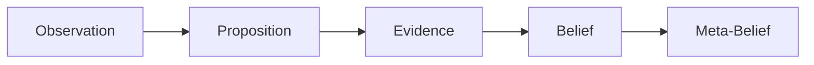
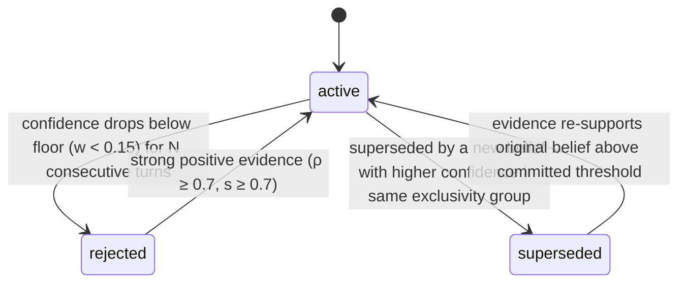
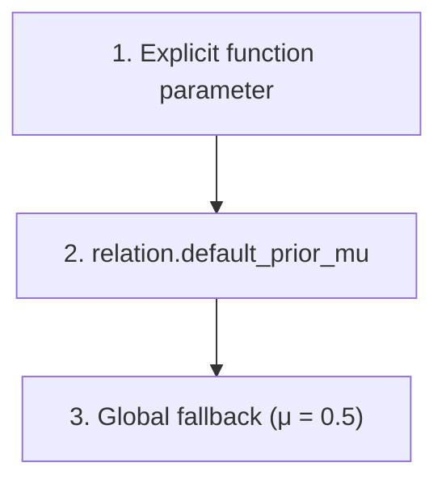
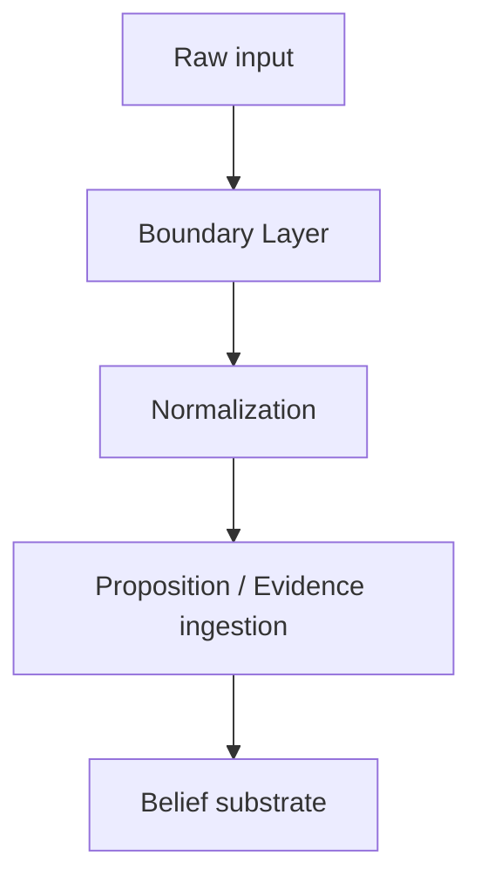

# RFC-0002: Belief-State Substrate

> **Cortex RFC Series**
> The reference implementation of the objects and dynamics defined by RFC-0001: Computational Epistemology.

| Property | Value |
|----------|-------|
| **RFC** | RFC-0002 |
| **Title** | Belief-State Substrate |
| **Version** | 4.0 |
| **Status** | Draft |
| **Implements** | [RFC-0001: Computational Epistemology](#) |
| **Depends On** | RFC-0001 |
| **Referenced By** | RFC-0003, RFC-0005 |

---

## Table of Contents

**[Part I — Architecture](#part-i--architecture)**
- [1. Purpose](#1-purpose)
- [2. MVP Success Criteria](#2-mvp-success-criteria)

**[Part II — Data Model](#part-ii--data-model)**
- [3. Core Concepts](#3-core-concepts)
  - [3.1 Entity](#31-entity)
  - [3.2 Proposition](#32-proposition)
  - [3.3 Evidence](#33-evidence)
  - [3.4 Belief](#34-belief)
  - [3.4a Belief Category](#34a-belief-category)
  - [3.5 Meta-Belief](#35-meta-belief)
  - [3.6 Relation](#36-relation)

**[Part III — Dynamics](#part-iii--dynamics)**
- [3.7 Belief Status Transitions](#37-belief-status-transitions)
- [3.8 Evidence Ingestion Interface](#38-evidence-ingestion-interface)
- [3.9 Priors (μ)](#39-priors-μ)
- [4. Update Engine](#4-dynamics-update-engine)
  - [4.1 Update Rule (Smoothing)](#41-update-rule-smoothing)
  - [4.2 Lazy Decay](#42-lazy-decay)
  - [4.3 Exclusivity (Mutual Exclusion Groups)](#43-exclusivity-mutual-exclusion-groups)
  - [4.4 Source Credibility Tracking](#44-source-credibility-tracking)
  - [4.5 Provenance Retention](#45-provenance-retention)
- [5. MVP Relations (Canonical Seed List)](#5-mvp-relations-canonical-seed-list)

**[Part IV — Storage](#part-iv--storage)**
- [6. Storage (MVP)](#6-storage-mvp)
- [7. Belief Identity (MVP)](#7-belief-identity-mvp)

**[Part V — Interfaces](#part-v--interfaces)**

- [8. Retrieval (Belief Neighborhood)](#8-retrieval-belief-neighborhood)
- [9. Interface to Coherence Engine](#9-interface-to-coherence-engine)

**[Part VI — Validation & Boundaries](#part-vi--validation--boundaries)**

- [10. Contradiction Metrics](#10-contradiction-metrics)
- [11. Toy World (Validation Scenario)](#11-toy-world-validation-scenario--option-a-places)
- [12. Non-Goals (Forward-Compatible)](#12-non-goals-forward-compatible)
- [13. Open Questions / Phase 2](#13-open-questions--phase-2)
- [14. Episodic / Meaning Layer — Removed From This Document](#14-episodic--meaning-layer--removed-from-this-document)
- [15. Implementation Corrections / Architecture Hardening](#15-implementation-corrections--architecture-hardening)
- [16. Ownership](#16-ownership)

---

# Part I — Architecture

> This Part establishes what the substrate is for, what it explicitly excludes, and the bar by which its MVP implementation is judged complete. Everything in Parts II–VI exists in service of the scope drawn here.

## 1. Purpose

The substrate is the reference implementation of the objects and dynamics defined in [RFC-0001](#). It is responsible for:

- Representing the epistemic objects defined by RFC-0001: Observation, Proposition, Evidence, Belief, and Meta-Belief.
- Maintaining belief state, including formation, strengthening, weakening, supersession, and dormancy.
- Updating confidence according to the operational definition given in RFC-0001.
- Preserving and propagating provenance across the object chain.
- Supporting retrieval of belief neighborhoods for downstream consumers.
- Exposing model state — beliefs, meta-beliefs, evidence, provenance, confidence, and history — to higher layers.

> [!NOTE]
>
> The substrate is **not** responsible for:
>
> | Concern | Owner |
> |---|---|
> | Coherence assessment | RFC-0005 |
> | Tension detection | RFC-0005 |
> | Guidance generation or recommendation | Guidance Engine (not yet owned by any RFC) |
> | Planning or action selection | Out of scope for the epistemology entirely |

### 1.1 Implementation Philosophy

RFC-0002 is the canonical implementation of the concepts defined in RFC-0001. It specifies one reference representation of Computational Epistemology but does not claim to be the only valid implementation. Alternative storage models, update rules, or persistence mechanisms are permissible provided they preserve the behavioral guarantees established by RFC-0001.

> [!IMPORTANT]
>
> Where this document explains *why* the substrate behaves a certain way, that explanation is implementation rationale, not epistemology — RFC-0001 owns the underlying philosophy, and this document should be read as one faithful expression of it rather than a competing account.

## 2. MVP Success Criteria

The MVP is successful if the system satisfies all of the following:

| Criterion | Requirement |
|---|---|
| **Persistence** | Beliefs survive process restarts (SQLite store working). |
| **Proposition storage** | Propositions are stored independently of Belief, per RFC-0001's distinction between a candidate explanation and a currently-held claim. |
| **Structured beliefs** | Claims are stored as `(subject, relation, object/value)` plus confidence, timestamps, status, and provenance links, and reference the Proposition they derive from. |
| **Meta-Belief storage** | Meta-Beliefs are stored using the same representation as ordinary Beliefs, distinguished only by their subject referencing other Beliefs rather than a Proposition about the world. |
| **Belief Categories** | Beliefs carry a `belief_category` field per RFC-0001's Boundaries section (Operational, Identity, Goal, Preference, Relationship, Meta, Historical). |
| **Evidence ingestion** | Accept evidence via the [Evidence Ingestion Interface](#38-evidence-ingestion-interface) as `(proposition reference + support s ∈ [-1,1] + reliability ρ ∈ [0,1] + source)`. |
| **Belief dynamics** | Update rule, lazy decay, and bounded exclusivity normalization are implemented for flagged relations. |
| **Contradiction surfacing** | The system reports both hard contradictions and soft ambiguity separately (see [§10](#10-contradiction-metrics)). |
| **Neighborhood retrieval** | Given an entity, return top-K beliefs ranked by confidence and recency (0-hop + optional 1-hop expansion). |
| **Source credibility tracking** | Each source maintains a running reliability estimate updated from observed evidence. |
| **Provenance propagation** | Provenance is preserved as a reference chain — Observation → Proposition → Evidence → Belief → Meta-Belief — with no copying of provenance data between stages. |
| **Toy demo** | A scripted environment with a noise phase demonstrates belief formation, contradiction and recovery under noisy evidence, reinforcement-driven stabilization, decay behavior, and the metrics defined in [§11](#11-toy-world-validation-scenario--option-a-places). |

---

# Part II — Data Model

> This Part defines the implementation-level representation of every RFC-0001 object the substrate stores. RFC-0001 owns what these objects *mean*; this Part owns how they are *stored*. Each subsection follows a consistent template — Purpose, Fields, Constraints, Design Rationale/Notes — so that any object's storage contract can be located the same way every time.

## 3. Core Concepts

Per RFC-0001, the substrate's object chain is:



### 3.1 Entity

> Represents a persistent node in the belief graph.

**Purpose**

Represents a persistent node in the belief graph.

**Fields**

| Field | Type | Description |
|---|---|---|
| `entity_id` | uuid/int | Primary key. |
| `canonical_name` | string | The entity's canonical display name. |
| `type` | enum | One of the MVP Entity Types below. |
| `aliases` | optional | Separate table or JSON list. |
| `created_at` | timestamp | Creation time. |
| `updated_at` | timestamp | Last modification time. |

**MVP Entity Types**

| Type |
|---|
| person |
| organization |
| project |
| place |
| artifact |
| concept |

**Design Notes**

- Entity types are informational only (not behavior-defining).
- Relation semantics determine exclusivity behavior.
- Additional types may be added in v2 without schema redesign.

### 3.2 Proposition

> A structured claim that may be supported or contradicted by Evidence — a possible explanation, not yet a Belief.

**Purpose**

Per RFC-0001, a Proposition is a structured claim that may be supported or contradicted by Evidence — a possible explanation, not yet a Belief.

**Fields**

| Field | Type | Description |
|---|---|---|
| `proposition_id` | id | Primary key. |
| `subject_entity_id` | FK → entities | The claim's subject. |
| `relation_id` | FK → relations | The claim's relation. |
| `object_entity_id` | FK → entities, nullable | The claim's object, if an entity. |
| `object_value` | nullable | Literal string/number/bool, stored as text for MVP. |
| `belief_category` | enum | See [§3.4a](#34a-belief-category); the category a Belief derived from this Proposition would carry. |
| `observation_id` | FK → observations, **NOT NULL** | The Observation that created this Proposition. See [§6](#6-storage-mvp). |
| `valid_from` | timestamp/turn, **NOT NULL** | The point at which this Proposition is asserted to hold; defaults to the originating Observation's `captured_at`. Set once at creation; never altered afterward. See [Temporal Scope](#temporal-scope-on-proposition-identity) below. |
| `created_at` | timestamp | Creation time. |
| `status` | enum | `candidate` \| `promoted` \| `dormant` |

**Constraints**

- Exactly one of (`object_entity_id`, `object_value`) must be non-null.
- A Proposition exists independently of any Belief. It may accumulate Evidence and never be promoted; this is expected behavior, not a failure state.
- `observation_id` is mandatory. There is no path that creates a Proposition without a real, persisted Observation behind it — see [§6](#6-storage-mvp)'s Observation Storage rule. A caller supplying only `subject`/`relation`/`object` to [`ingest_evidence`](#38-evidence-ingestion-interface) is understood to be asserting a manual Observation, not bypassing one.
- `origin` (present in earlier drafts of this document) is removed. Nothing downstream consumed it as a distinct signal from `observation_id`. Its removal rationale is not that `observations.source` replaces it — `observations.source` answers a different question than `origin`'s examples (`boundary_layer`, `manual`, `observation_layer`) were pointed at. Content source and transformation provenance are two distinct questions: `observations.source` ([§6](#6-storage-mvp)) answers *what kind of perception this was* (`user_utterance`, `document`, `manual_entry`, `meta_inference`); *which subsystem produced this Evidence* is answered by `Evidence.source_name` resolving through the `sources` table ([§3.3](#33-evidence), [§4.4](#44-source-credibility-tracking)) — RFC-0003 §15 sets it to `"boundary_layer"` for everything the Boundary Layer submits. `origin` is removed because that second question already had an answer before `observation_id` existed; it was never covered by `observations.source`.

**Design Rationale**

> [!NOTE]
>
> Per RFC-0001, Proposition generation is intentionally non-deterministic: the same Observation may give rise to multiple competing Propositions. The substrate does not deduplicate Propositions that share a `(subject, relation, object)` tuple but originate from different Observations — each retains its own provenance — though it does treat Propositions with an identical tuple as the same candidate for the purpose of Evidence accumulation (see [§3.3](#33-evidence)).
>
> This prose and the `UNIQUE` constraint in [§7](#7-belief-identity-mvp) are already in tension as written — the former implies multiple Proposition rows may share a tuple across distinct Observations, the latter forbids more than one row per tuple. That tension predates this revision and is not resolved here; it is noted, not fixed.

**Notes**

- `status = promoted` indicates a Belief now exists derived from this Proposition. The Proposition record is retained, not deleted, when promotion occurs — this preserves the provenance chain RFC-0001 requires.
- `status = dormant` indicates the Proposition failed to accumulate sufficient Evidence and is not currently under active consideration. A dormant Proposition may later accumulate new Evidence and re-enter candidate status.

### 3.2a Temporal Scope on Proposition Identity

> `valid_from` is the point at which a Proposition is asserted to hold. It exists to distinguish two situations the bare `(subject, relation, object)` tuple cannot: a claim reasserted after a genuine gap, versus a claim continuously reinforced the whole time.

**Purpose**

Without a temporal component, a claim that goes dormant or is rejected and is later reasserted with the *same* object value is indistinguishable from one that was silently believed the entire time — the tuple is identical either way. `valid_from` closes that specific gap. It does not, by itself, change how differently-valued competing claims are scored against one another; see the note on scope below.

**Field**

`valid_from`, non-null, timestamp/turn, set once at Proposition creation and never modified afterward. Defaults to the originating Observation's `captured_at`.

**Resolution rule (governs `ingest_evidence`, [§3.8](#38-evidence-ingestion-interface))**

> [!WARNING]
> **Two objects, two enums — do not test one against the other's values**
>
> `Proposition.status` ([§3.2](#32-proposition)) is `candidate | promoted | dormant`. `Belief.status` ([§3.7](#37-belief-status-transitions)) is `active | superseded | rejected`. These are disjoint: `dormant` is never a value `Belief.status` can hold, and `rejected` is never a value `Proposition.status` can hold. A resolution predicate that says "the claim is neither dormant nor rejected" without saying *which object* it means is not a predicate — it's two different, incompatible tests wearing one sentence, and depending on which object a reader mentally applies it to, it produces different answers for the same real state. The rule below names the object explicitly at every step.

**Two tiers.** Every existing Proposition for a `(subject, relation, object)` tuple is in exactly one of two tiers, and the resolution rule tests a different object's status depending on which:

| Tier | Condition | Object tested | What "alive" means | What "dead" means |
|---|---|---|---|---|
| **Pre-Belief** | `Proposition.status ∈ {candidate, dormant}` — no Belief has ever been promoted from it | The **Proposition** | `status ∈ {candidate, dormant}` — both. A dormant Proposition is stale, not settled; nothing has ever concluded it's false, so it stays revivable by ordinary evidence, per [§3.2](#32-proposition)'s existing account of dormant Propositions re-entering `candidate` status. | Never reached in this tier. There is no "dead" pre-Belief state — see the dormancy transition rule below for why. |
| **Promoted** | `Proposition.status = promoted` — permanent once set; a promoted Proposition's own status never reverts, so this tier is tracked through its **Belief** from here on | The **Belief** | `Belief.status ∈ {active, superseded}`. `superseded` means a rival claim in the same exclusivity group currently has higher confidence ([§4.3](#43-exclusivity-mutual-exclusion-groups), [§3.7](#37-belief-status-transitions)) — it is a live rivalry, not a settled conclusion, and [§3.7](#37-belief-status-transitions)'s own state diagram already specifies `superseded → active` as an ordinary evidence-driven transition. | `Belief.status = rejected` — an explicit, evidence-driven negative conclusion ([§3.7](#37-belief-status-transitions)). |

At most one Proposition per tuple is ever "alive" at a time — `new_episode` below only ever mints a second one once the first is dead, so there is never a live rivalry between two Propositions sharing a bare tuple, only between distinct tuples (that's ordinary exclusivity, [§4.3](#43-exclusivity-mutual-exclusion-groups)). When a tuple has both a dead, older episode and a live, newer one (via a prior `new_episode` call), resolution acts on the live one; the dead one is history and does not participate.

> [!IMPORTANT]
> **Reuse before create**
>
> When resolving a Proposition for an incoming tuple, the substrate **MUST** first look for the tuple's current episode (highest `valid_from`) and classify it per the table above. `valid_from` is **not** part of this lookup key for ordinary reinforcement — the classification above is what governs reuse, not timing. A new Proposition (with a fresh `valid_from`) is minted only when either: (a) no Proposition exists yet for the tuple, or (b) the tuple's current episode is dead — `Belief.status = rejected` — and the caller explicitly requests a new episode via `resolution_mode = "new_episode"` ([§3.8](#38-evidence-ingestion-interface)) rather than reactivation of the existing one.
>
> Without this rule, every reinforcing Evidence call would mint a new Proposition merely because it arrived on a later turn, fragmenting ordinary evidence accumulation. This would break, among other things, [§11](#11-toy-world-validation-scenario--option-a-places) Phase 1, whose repeated reinforcement of one claim across several turns depends on landing on one Proposition throughout.

> [!IMPORTANT]
> **`resolution_mode` — object tested and accepted values, per mode**
>
> [§3.8](#38-evidence-ingestion-interface)'s `resolution_mode` parameter selects which of three behaviors applies to the tuple's current episode:
>
> | `resolution_mode` | Object tested | Accepted for this mode's success | Behavior |
> |---|---|---|---|
> | `reinforce` (default) | **Belief**, if the current episode is promoted; otherwise the **Proposition** itself | `Belief.status ∈ {active, superseded}`, or (pre-Belief) `Proposition.status ∈ {candidate, dormant}` | Attach Evidence to the current episode. If it is a `dormant` Proposition, it transitions to `candidate` as part of this call (the dormancy transition rule below). **MUST fail** if the current episode is promoted with `Belief.status = rejected` — that is the one dead state, and reinforcing it silently is not this mode's job. This is the only mode RFC-0003 Phase 1 ever passes. |
> | `reactivate` | **Belief** only — this mode has no pre-Belief meaning, since the pre-Belief tier has no dead state for it to resume | `Belief.status = rejected` | Attach Evidence to the rejected Belief, enabling [§3.7](#37-belief-status-transitions)'s existing `rejected → active` transition to fire if the evidence is strong enough. **MUST fail** if the current episode is not a rejected Belief — `active`/`superseded`/pre-Belief cases have nothing to reactivate; use `reinforce`. |
> | `new_episode` | **Belief** only, same reason as `reactivate` | `Belief.status = rejected` | Mint a fresh Proposition with a fresh `valid_from` (from [§3.8](#38-evidence-ingestion-interface)'s `valid_from` parameter if supplied, else the Observation's `captured_at`), leaving the rejected Proposition and Belief exactly as they are. **MUST fail** — reject the call rather than silently falling back to `reinforce` — if the current episode is not a rejected Belief. A live rivalry (`active`/`superseded`) or an unpromoted candidate is not grounds for a new episode; use `reinforce`. |
>
> `reactivate` and `new_episode` share a precondition and differ only in action: `reactivate` resumes continuity with the rejected claim's history; `new_episode` deliberately starts a new one, leaving the old rejected Proposition as an inert historical record. Neither mode ever tests `Proposition.status` — by the time a Proposition is promoted, `Proposition.status` is permanently `promoted` and carries no further information about whether the claim is currently live.

**Proposition dormancy — what transitions it, since nothing did before**

[§3.2](#32-proposition)'s `status = dormant` is a documented state with, until now, no documented way to enter it: [§3.7](#37-belief-status-transitions) specifies Belief transitions only, and nothing else in this RFC ever set `Proposition.status = dormant`. That left the pre-Belief branch of the table above unreachable independent of the object/enum problem this section otherwise fixes. Closing it requires one new tunable parameter, since a transition needs a threshold to fire on:

| Parameter | Symbol | Default | Description |
|---|---|---|---|
| Turns to Proposition dormancy | `N_prop` | 5 | Consecutive turns with no new Evidence before a `candidate` Proposition transitions to `dormant`. |

> [!IMPORTANT]
> **Transition rule**
>
> A `candidate` Proposition transitions to `dormant` when more than `N_prop` turns have elapsed since its most recent Evidence (`MAX(evidence.observed_at)` for that `proposition_id`), or since `created_at` if it has none. This is evaluated lazily, the same way [§4.2](#42-lazy-decay)'s decay is — there is no scheduled sweep. A `dormant` Proposition transitions back to `candidate` the moment `resolution_mode = "reinforce"` attaches new Evidence to it, per the table above.
>
> `N_prop` is a distinct parameter from [§3.7](#37-belief-status-transitions)'s `N` (turns to Belief rejection) even though both default to 5 — they count different things (turns since last Evidence, versus consecutive turns below the confidence floor) and are not the same knob wearing two names.

**Worked example — verifying the rule against a specific case**

A Belief is `superseded`: a rival claim in the same exclusivity group currently holds higher confidence. Later, the original tuple is reasserted with fresh Evidence, `resolution_mode` unspecified (the default, `reinforce`).

- **Tier:** Promoted — a Belief exists.
- **Object tested:** the Belief. `Belief.status = superseded`.
- **`reinforce`:** accepts `Belief.status ∈ {active, superseded}` — `superseded` is in that set. **Opens.** The Evidence attaches to the existing Belief, and [§3.7](#37-belief-status-transitions)'s already-specified `superseded → active` transition may fire if the reasserted evidence is strong enough to clear the committed threshold again.
- **`new_episode`, if attempted instead:** requires `Belief.status = rejected`. The Belief is `superseded`, not `rejected`. **Fails**, deliberately — a live rivalry is not grounds for a third entrant into the exclusivity group, and forking here would fragment the very evidence history that lets `superseded → active` mean anything.

Exactly one path opens, for a stated reason tied to an object and a value that object can actually hold — not, as before, an accident of a predicate that happened to evaluate `true` while asking the wrong question of the wrong object.

**Scope of this field — what it does not do**

`valid_from` makes "asserted then, asserted differently now" *representable* at the identity layer. It does not, on its own, change [§4.3](#43-exclusivity-mutual-exclusion-groups)'s normalization math or which Beliefs compete as hard contradictions or soft ambiguities — see the advisory dormancy-candidate note added to [§3.7](#37-belief-status-transitions). Extending it to a general-purpose context or scope field is explicitly out of scope: it carries only a point in time, nothing else.

**Consequences for §7 and §13**

[§7](#7-belief-identity-mvp)'s `UNIQUE` constraint is extended to include `valid_from` — see that section. [§13](#13-open-questions--phase-2)'s open question on "contradiction detection beyond exclusivity groups (e.g., logical or temporal inconsistencies)" is partially addressed on its temporal half by this field; the logical half, and the question of how exclusivity should *consume* `valid_from` beyond the advisory §3.7 note, remain open.

> [!WARNING]
> **Known Limitation — Phase 1 cannot populate this field meaningfully for retrospective claims**
>
> `valid_from` defaults to the originating Observation's `captured_at` ([§6](#6-storage-mvp)) whenever a caller does not supply an explicit override via [§3.8](#38-evidence-ingestion-interface)'s `valid_from` parameter. RFC-0003's Phase 1 boundary layer, being rule-based extraction with no semantic understanding, never supplies that override — every Proposition it creates gets `valid_from` = capture time, whether the source text asserts a current state or a past one. Two retrospective assertions about different real-world periods that happen to share a `(subject, relation, object)` tuple will therefore merge into one Proposition under the reuse-before-create rule above, rather than being represented as two distinct episodes. This is a named, accepted Phase 1 limitation, routed to Phase 2 extraction (RFC-0003 §8, §18), not a defect in this rule. It does not motivate adding `valid_to` or an unknown/underspecified validity representation — Phase 1 cannot populate either any more reliably than it can populate a correct `valid_from`, which is exactly why the full-interval model was not adopted here.

### 3.3 Evidence

> A graded support signal for a Proposition.

**Purpose**

Evidence represents a graded support signal for a Proposition.

**Fields**

| Field | Type | Description |
|---|---|---|
| `evidence_id` | id | Primary key. |
| `proposition_id` | FK → propositions | The Proposition this Evidence supports or contradicts. |
| `observation_id` | FK → observations, **NOT NULL** | The Observation this specific Evidence was produced from. See [§6](#6-storage-mvp). |
| `support` | float, `s ∈ [-1,1]` | Positive = supports; negative = contradicts. |
| `reliability` | float, `ρ ∈ [0,1]` | How trustworthy this piece of Evidence is. |
| `source_id` | FK → sources | The originating source. |
| `observed_at` | timestamp | Observation time. |
| `notes` | optional | Free text. |

**Design Rationale**

> [!NOTE]
>
> Evidence references a Proposition directly via `proposition_id`, rather than identifying a candidate belief by its `(subject, relation, object)` tuple. This is a deliberate change from earlier substrate versions: Evidence no longer carries denormalized subject/relation/object fields of its own, because the Proposition it references already carries that identity. This mirrors RFC-0001's distinction — Evidence is attached *to* a Proposition, not merely correlated with one by matching tuples.

> [!IMPORTANT]
> **Evidence carries its own Observation link**
>
> A Proposition's `observation_id` ([§3.2](#32-proposition)) records only the Observation that *created* it. Because a Proposition commonly accumulates many Evidence records over time from many distinct Observations, each Evidence record carries its own `observation_id`, independently NOT NULL. This is what makes RFC-0001 §4's provenance requirement — that a Belief's support terminate in an Observation — true at the level of every individual Evidence record, not merely at the level of the Proposition as a whole. RFC-0001 §3.2's "formed from one or more Observations" is satisfied in aggregate: the full set of Observations behind a Proposition is the union of `observation_id` across its own creation and every Evidence record attached to it, reachable via `evidence.proposition_id → evidence.observation_id` — with no junction table required.

**Mapping to Target Confidence**

Every piece of Evidence implies a target confidence value — what the Belief's confidence would equal if this Evidence were taken at face value. That target, $\hat{w}$, rescales support $s$ from its $[-1, 1]$ range onto the $[0, 1]$ confidence range:

$$
\hat{w} = \frac{1 + s}{2}
$$

This mapping is used by the [Update Rule](#41-update-rule-smoothing) in Part III.

### 3.4 Belief

> The current most coherent explanation supported by accumulated Evidence on a Proposition.

**Purpose**

A Belief is the current most coherent explanation supported by accumulated Evidence on a Proposition, per RFC-0001.

**Fields**

| Field | Type | Description |
|---|---|---|
| `belief_id` | id | Primary key. |
| `proposition_id` | FK → propositions | The Proposition this Belief derives from. |
| `subject_entity_id` | FK → entities | Denormalized from Proposition; see Design Rationale below. |
| `relation_id` | FK → relations | Denormalized from Proposition. |
| `object_entity_id` | FK → entities, nullable | Denormalized from Proposition. |
| `object_value` | nullable | Denormalized from Proposition; literal stored as text for MVP. |
| `belief_category` | enum | See [§3.4a](#34a-belief-category). |
| `confidence` | float, `w ∈ [0,1]` | Current confidence. |
| `created_at` | timestamp | Creation time. |
| `updated_at` | timestamp | Last modification time. |
| `last_seen_at` | timestamp/turn | Used for lazy decay computation; updated on every access or evidence event. |
| `status` | enum | `active` \| `superseded` \| `rejected` |
| `exclusivity_key` | nullable | Used only when `relation.is_exclusive = true`. |

**Design Rationale**

> [!NOTE]
> **Denormalization**
>
> `subject_entity_id`, `relation_id`, `object_entity_id`, and `object_value` are denormalized onto Belief from its Proposition for query convenience — retrieval and exclusivity normalization ([Part III §4.3](#43-exclusivity-mutual-exclusion-groups), [Part V §8](#8-retrieval-belief-neighborhood)) operate over Beliefs directly and would otherwise require a join on every access. The Proposition remains canonical; these fields must always agree with the Proposition referenced by `proposition_id`, and are not independently editable.

**Constraints**

- Exactly one of (`object_entity_id`, `object_value`) must be non-null.
- If `relation.is_exclusive = true`, the exclusivity key is computed deterministically from the subject and relation so that all competing Beliefs about the same subject/relation pair land in the same group:

$$
\text{exclusivity\_key} = \text{hash}(\text{subject\_entity\_id} + \text{relation\_id})
$$

  Otherwise, `exclusivity_key` is `null`.

**Belief Status Semantics**

Status transitions are governed by explicit rules (see [§3.7](#37-belief-status-transitions)). This lifecycle implements the conceptual lifecycle defined by RFC-0001.

| Status | Meaning |
|---|---|
| `active` | Part of the belief state (with varying confidence). |
| `superseded` | Replaced by a newer belief (kept for history/provenance). |
| `rejected` | Explicitly disconfirmed. |

**Confidence Bands (MVP)**

Development is represented by confidence bands rather than a separate status field:

| Band | Condition |
|---|---|
| emerging | `w < 0.35` |
| uncertain | `0.35 ≤ w < 0.65` |
| committed | `w ≥ 0.65` |

> [!TIP]
>
> Thresholds are tunable.

### 3.4a Belief Category

> The ontology a Belief belongs to, distinct from its relation class.

**Purpose**

Per RFC-0001's Boundaries section, Computational Epistemology maintains one connected belief network with many ontologies operating within it — category is a property of inference policy, not of object type or storage location.

**Fields**

| Field | Type | Description |
|---|---|---|
| `belief_category` | enum | Present on both Proposition and Belief. |

**MVP Categories**

| Category |
|---|
| `operational` |
| `identity` |
| `goal` |
| `preference` |
| `relationship` |
| `meta` |
| `historical` |

**Design Notes**

> [!NOTE]
> **Category vs. Relation Class**
>
> This is `belief_category`, distinct from `relation_class` ([§3.6](#36-relation)). A relation's class (identity/state/preference/activity/general) governs decay-prior behavior; a belief's category governs which higher-level ontology it belongs to for purposes of Tension detection (RFC-0005) and category-specific inference policy. The two are related but not identical — for example, a `working_on` relation (`relation_class = activity`) might back a Belief categorized as `operational`.

- `historical` is not assigned at creation; it is the category a Belief's `belief_category` is set to (or a parallel flag is raised) once it transitions to dormancy. The exact mechanics of this transition are left to [§3.7](#37-belief-status-transitions).

> [!IMPORTANT]
> **Goal Category**
>
> Per RFC-0001, Goal is modeled as a Belief Category rather than a separate primitive, on the understanding that a Goal's confidence reflects how strongly an intention is currently held, not evidence toward the goal's underlying proposition being true. The substrate does not distinguish goal-confidence from other confidence numerically — they share the same update mathematics — but `belief_category = goal` is the marker downstream consumers (notably RFC-0005) must check before interpreting confidence as desire-strength rather than truth-strength.

> [!TIP]
> **Future Extension**
>
> Inference-rule differences between categories (e.g., different decay behavior for `identity` vs `operational`) are not yet specified at the category level in this MVP; only `relation_class` currently drives decay-prior selection ([§3.7](#37-belief-status-transitions)). Category-level inference policy is an open question for Phase 2 ([§13](#13-open-questions--phase-2)).

### 3.5 Meta-Belief

> A Belief whose subject is another Belief or a relationship among Beliefs.

**Purpose**

A Meta-Belief is a Belief whose subject is another Belief or a relationship among Beliefs, per RFC-0001.

**Fields**

| Field | Type | Description |
|---|---|---|
| `meta_belief_id` | id | Primary key. |
| `referenced_belief_ids` | array of FK → beliefs | The Belief(s) this Meta-Belief is about. |
| `relation_id` | FK → relations | Describes the nature of the relationship among referenced beliefs, e.g. `precedes`, `correlates_with`. |
| `belief_category` | fixed = `meta` | Always `meta`. |
| `confidence` | float, `w ∈ [0,1]` | Current confidence. |
| `created_at` | timestamp | Creation time. |
| `updated_at` | timestamp | Last modification time. |
| `last_seen_at` | timestamp/turn | As with Belief. |
| `status` | enum | `active` \| `superseded` \| `rejected` |
| *(provenance fields)* | — | See [§3.5a](#35a-provenance-on-meta-belief). |

**Design Notes**

- A Meta-Belief inherits every behavior of an ordinary Belief: it accumulates Evidence, decays, can be contradicted, and transitions through the same status lifecycle ([§3.7](#37-belief-status-transitions)). It is not a separate kind of object with separate update rules — implementation-wise, Meta-Belief is best understood as a Belief whose subject is a reference to other Beliefs rather than an Entity.
- Because a Meta-Belief's subject is a set of Beliefs rather than a single Entity, `referenced_belief_ids` replaces `subject_entity_id` — there is no meaningful single-entity subject for most Meta-Beliefs (e.g. "periods of elevated curiosity precede new project creation" references at least two Beliefs).
- Meta-Beliefs participate in confidence dynamics ([Part III](#part-iii--dynamics)) identically to ordinary Beliefs unless explicitly overridden. No override is specified in this MVP.
- Per RFC-0001, Meta-Beliefs are recursively subject to Computational Epistemology — nothing in this MVP schema prevents `referenced_belief_ids` from including a `meta_belief_id` in a future revision, but the MVP does not implement that recursion; `referenced_belief_ids` references the `beliefs` table only.

#### 3.5a Provenance on Meta-Belief

Meta-Belief provenance works the same way as ordinary Belief provenance ([§4.5](#45-provenance-retention)), except the evidence it accumulates is Evidence about the referenced Beliefs' joint behavior over time, not Evidence about a single Proposition.

> [!NOTE]
> **MVP Simplification**
>
> The substrate represents this by allowing Evidence's `proposition_id` to optionally reference a synthetic Proposition generated to represent the meta-claim — e.g., "Nick's curiosity beliefs precede his project-creation beliefs" — so that Meta-Belief evidence ingestion can reuse the existing [Evidence Ingestion Interface](#38-evidence-ingestion-interface) without a parallel interface. This is an MVP simplification; Phase 2 ([§13](#13-open-questions--phase-2)) may introduce a more direct Meta-Belief evidence pathway.

### 3.6 Relation

> First-class objects that define behavioral rules for the Beliefs and Propositions that reference them.

**Purpose**

Relations are first-class objects stored in the `relations` table. Relation semantics define behavioral rules.

**Fields**

| Field | Type | Description |
|---|---|---|
| `relation_id` | id | Primary key. |
| `name` | string | Relation name. |
| `is_exclusive` | bool, default `false` | Whether Beliefs sharing this relation and subject compete. |
| `relation_class` | enum | `identity` \| `state` \| `preference` \| `activity` \| `general` |
| `default_prior_mu` | float | Decay target for this relation class. |
| `notes` | text | Free text. |

**Default Prior Values**

| Relation Class | `default_prior_mu` |
|---|---:|
| identity | 0.50 |
| state | 0.50 |
| preference | 0.50 |
| activity | 0.00 |
| general | 0.50 |

**Design Notes**

- Different relation classes may decay toward different priors.
- Prior behavior is relation policy, not global system policy.
- Additional relation classes may be added in future versions without schema redesign.
- `relation_class` is unrelated to `belief_category` ([§3.4a](#34a-belief-category)); see that section for the distinction.

**Design Rationale**

Not all beliefs behave identically over time. Stable world-state beliefs decay toward uncertainty:


Transient activity beliefs decay toward absence:


---

# Part III — Dynamics

> This Part owns the mathematics that govern how confidence moves: how new Evidence updates a Belief, how unattended Beliefs decay, how mutually exclusive Beliefs compete, and how source credibility evolves. It does not own what those numbers *mean* (RFC-0001) or how they get *consumed downstream* (Part V); it owns only how they change.

## 3.7 Belief Status Transitions

Status transitions are governed by the following rules. Implementers must not assign status arbitrarily. This lifecycle implements the conceptual lifecycle defined by RFC-0001 — `active`, `superseded`, and `rejected` are the implementation-level realization of RFC-0001's account of Belief formation, supersession, and dormancy.



| Parameter | Value | Description |
|---|---:|---|
| Floor threshold (`w_floor`) | 0.15 | Tunable. |
| Consecutive turns to rejection (`N`) | 5 | Tunable. |

> [!IMPORTANT]
> **Implementation Rule**
>
> Superseded and rejected beliefs are retained in the database for provenance and audit. Only `active` beliefs participate in exclusivity normalization and retrieval.

A Belief whose status has been `superseded` or `rejected` for longer than a configurable retention window may additionally have its `belief_category` set to `historical`, per RFC-0001's Historical Memory model. This is a category reassignment, not a status change — `historical` Beliefs may still carry `status = superseded` or `status = rejected` underneath.

> [!NOTE]
>
> Per RFC-0001, a `historical` Belief continues to participate in explanation but not prediction; this MVP does not yet implement a mechanism enforcing that distinction at query time (see [§13, Open Questions](#13-open-questions--phase-2)).

> [!NOTE]
> **Advisory dormancy candidate from temporal supersession (§3.2a)**
>
> When a Proposition in the same exclusivity group as an existing `active` Belief has a strictly later `valid_from` **and its own Belief has itself reached `active` status**, the earlier Belief **MAY** be flagged as an advisory dormancy candidate for a human or a future policy layer to act on. This is advisory only — it is never automatic dormancy, and it does not itself move a Belief's status. The condition is deliberately narrow: flagging requires the later claim to have actually reached `active`, not merely to have arrived. This is what keeps [§11](#11-toy-world-validation-scenario--option-a-places) Phase 2 unaffected — injected noise arrives with a later `valid_from` but is designed never to reach `active`, so it never raises this flag, and confidence-based competition in [§4.3](#43-exclusivity-mutual-exclusion-groups) continues to suppress it exactly as before. This note does not change [§4.3](#43-exclusivity-mutual-exclusion-groups)'s normalization math, hard-contradiction, or soft-ambiguity computation in any way.
>
> **"Dormancy" here names no status `Belief.status` can hold** — that enum is `active | superseded | rejected`; there is no `Belief.status = dormant`. The flag means the earlier Belief is a candidate for this section's own `belief_category = historical` reassignment (above), ahead of the ordinary superseded/rejected retention-window timer, because a later, now-active claim for the same relation is stronger evidence of staleness than mere elapsed time. It does not mean, and is not needed to produce, `Belief.status = superseded` — the earlier Belief already becomes `superseded` on its own, through ordinary exclusivity competition ([§4.3](#43-exclusivity-mutual-exclusion-groups)) and this section's state diagram above, the moment the later claim's confidence overtakes it. The flag is downstream of that, not a substitute for it.

## 3.8 Evidence Ingestion Interface

The Evidence Ingestion Interface is the boundary at which external observations enter the belief system. For MVP, evidence arrives pre-formed — the caller is responsible for assigning `s` and `ρ`, and for supplying or resolving a Proposition reference.

> [!NOTE]
>
> NLP-based automatic extraction is a non-goal (see [§12](#12-non-goals-forward-compatible)).

**Python interface (MVP):**

```python
def ingest_evidence(
    proposition_id: str | None,   # existing proposition, or None to create one
    subject: str | None,          # canonical entity name (required if proposition_id is None)
    relation: str | None,         # relation name (required if proposition_id is None)
    object_entity: str | None,    # canonical entity name, or None if literal
    object_value: str | None,     # literal value, or None if entity
    support: float,               # s ∈ [-1, 1]
    reliability: float,           # ρ ∈ [0, 1]; if None, use source.reliability_estimate
    source_name: str,             # canonical source name (sources table; reliability tracking, §4.4)
    observation_id: str | None,           # existing Observation, or None to construct one
    observation_raw_text: str | None,     # required if observation_id is None
    observation_source: str | None,       # required if observation_id is None — e.g. user_utterance,
                                           #   document, manual_entry, meta_inference (§6)
    observation_session_id: str | None = None,
    valid_from: str | int | None = None,  # None: derive from the Observation's captured_at (§3.2a).
                                           #   Non-None: only meaningful together with
                                           #   resolution_mode="new_episode"; see below.
    resolution_mode: str = "reinforce",   # "reinforce" | "reactivate" | "new_episode" — governs which
                                           #   branch of §3.2a's reuse-before-create rule this call takes.
                                           #   "reinforce" is the only value Phase 1 (RFC-0003) ever passes.
    belief_category: str | None = None,  # required when creating a new proposition
    notes: str | None = None
) -> EvidenceResult:
    ...
```

> [!IMPORTANT]
> **Every call constructs or references a real Observation**
>
> `observation_id` and `observation_raw_text`/`observation_source` follow the same either/or pattern as `proposition_id` and `subject`/`relation`/`object_*`: a caller either references an existing, already-persisted Observation, or supplies enough to construct one. There is no third path that omits an Observation. This parameter is not optional in spirit — the Observation it identifies or constructs is used both as the Proposition's `observation_id` (when this call creates a new Proposition) and as the Evidence record's own `observation_id` (always, per [§3.3](#33-evidence)). `source_name` above is unrelated: it identifies a row in `sources` for reliability tracking, not the Observation's `source` field, which records what kind of perception this was.
>
> `valid_from` only has an effect when this call creates a new Proposition — an existing Proposition's `valid_from` is fixed at its own creation and is never altered by later calls, per [§3.2a](#32a-temporal-scope-on-proposition-identity)'s reuse-before-create rule. With `resolution_mode="reinforce"` (the default, and the only mode Phase 1 ever passes), a non-`None` `valid_from` has no effect beyond what the default already produces: reinforcement resolves to the tuple's current episode whenever it is alive, falls through to creation only when none exists yet, and **fails outright** (creates nothing) when the current episode is a promoted Proposition with `Belief.status = rejected` — it does not silently create a second Proposition in that case. `valid_from` becomes load-bearing only under `resolution_mode="new_episode"`, whose sole precondition is that same rejected-Belief state: see [§3.2a](#32a-temporal-scope-on-proposition-identity) for the full mode table, the object/enum each mode tests, and the worked example verifying it.

> [!NOTE]
> **Design Rationale**
>
> Callers may either reference an existing `proposition_id` directly, or supply `subject`/`relation`/`object_entity`/`object_value` to have the interface resolve or create a matching Proposition, per the reuse-before-create rule of [§3.2a](#32a-temporal-scope-on-proposition-identity). This preserves backward-compatible call ergonomics for the toy demo and manual MVP use, while making Proposition the canonical identity underneath.

**Assignment guidance for manual MVP use:**

| Scenario | `s` | `ρ` |
|---|---|---|
| Direct assertion from trusted source | 0.8 – 1.0 | 0.8 – 1.0 |
| Indirect inference | 0.4 – 0.7 | 0.5 – 0.7 |
| Contradicting evidence, trusted source | -0.8 – -1.0 | 0.8 – 1.0 |
| Noisy or uncertain observation | any | 0.2 – 0.5 |

For the toy demo, `s` and `ρ` are assigned manually by the script author.

> [!NOTE]
>
> Coherence assessment is intentionally outside the scope of RFC-0002. In future versions, an LLM-based extraction stub may assign `s`/`ρ` values with explicit uncertainty penalties — that extraction work belongs to the **Boundary Layer (RFC-0003)**, not this substrate.

## 3.9 Priors (μ)

Relation-level priors are active substrate behavior.

**Resolution order:**



**Default priors:**

| Relation Class | `default_prior_mu` |
|---|---:|
| identity | 0.50 |
| state | 0.50 |
| preference | 0.50 |
| activity | 0.00 |
| general | 0.50 |

**Design Rationale**

Stable world-state beliefs decay toward uncertainty. Transient activity beliefs decay toward absence.

## 4. Dynamics (Update Engine)

> [!NOTE]
>
> The update mathematics in this section are unchanged from prior substrate versions. Meta-Beliefs participate in all dynamics below identically to ordinary Beliefs unless explicitly overridden; no override is specified in this MVP (see [§3.5](#35-meta-belief)).

### Parameters (MVP Defaults)

| Parameter | Symbol | Default | Notes |
|---|---|---|---|
| Learning rate | α | 0.3 | Scales evidence impact |
| Decay rate per turn | λ | 0.002 | Applied lazily on access |
| Global prior | μ | 0.5 | Decay target |
| Exclusivity epsilon | ε | 1×10⁻⁶ | Prevents division by zero |
| Confidence floor | w_floor | 0.15 | Triggers rejection |
| Turns to rejection | N | 5 | Consecutive sub-floor turns |
| Turns to Proposition dormancy | N_prop | 5 | Turns since last Evidence, not consecutive sub-floor turns — see [§3.2a](#32a-temporal-scope-on-proposition-identity), a distinct parameter from `N` above despite the same default |
| Retrieval k | k | 0.05 | Recency decay in scoring |
| Retrieval p | p | 2.0 | Confidence emphasis |
| Top-K retrieval | K | 20 | Max beliefs returned |

> [!NOTE]
> **Turn Definition**
>
> A "turn" = one user–assistant interaction (conversation turn).

### 4.1 Update Rule (Smoothing)

> [!WARNING]
> **Executable prototype — dynamics under revision**
>
> This section specifies the executable prototype's update mathematics. It is not settled epistemic mathematics: RFC-0002A (Belief Dynamics Revision, **Review** status) proposes a replacement, and RFC-0002A §2.3 states that RFC-0002's confidence dynamics **MUST NOT** be described as settled epistemic mathematics until a replacement is accepted and implemented. Implementations **SHOULD NOT** harden interfaces around these specifics — the smoothing rule, its parameters, and its guarantees are subject to change on RFC-0002A's acceptance.

This rule blends a Belief's current confidence with the target confidence implied by a new piece of Evidence, weighted by how reliable that Evidence is. The goal is to let strong, reliable Evidence move confidence quickly while letting weak or unreliable Evidence move it only slightly.

Given current confidence $w$ and incoming evidence with support $s$ and reliability $\rho$:

$$
\hat{w} = \frac{1 + s}{2}
$$

$$
\eta = \alpha \cdot \rho
$$

$$
w_{\text{new}} = (1 - \eta)\, w + \eta\, \hat{w}
$$

Here, $\hat{w}$ is the target confidence implied by this Evidence alone (from [§3.3](#33-evidence)); $\eta$ is the effective step size, scaled by both the learning rate $\alpha$ and the Evidence's reliability $\rho$; and $w_{\text{new}}$ is the resulting confidence after blending the old value toward the target by that step size.

This ensures:
- Smooth belief evolution
- Resistance to single noisy updates
- Convergence under repeated consistent evidence

### 4.2 Lazy Decay

> [!WARNING]
> **Executable prototype — dynamics under revision**
>
> This section specifies the executable prototype's decay mathematics. It is not settled epistemic mathematics: RFC-0002A (Belief Dynamics Revision, **Review** status) proposes a replacement, and RFC-0002A §2.3 states that RFC-0002's confidence dynamics **MUST NOT** be described as settled epistemic mathematics until a replacement is accepted and implemented. Implementations **SHOULD NOT** harden interfaces around these specifics. (The read/write split below is a separate, already-adopted correction — see the RFC-0002A §4.4 consequence note further down this section — and is not itself provisional in the way the decay formula's parameters are.)

> [!IMPORTANT]
> **Implementation Rule**
>
> Decay is not applied globally on each turn. It is computed on-demand. This prevents silent erosion of high-confidence beliefs that have not been recently touched and is compatible with sparse systems containing many beliefs. As of this revision, "on-demand" means **on evidence ingestion only**, not on every read — see the two-operation split below.

This rule pulls a Belief's confidence toward its relation's prior $\mu_r$ in proportion to how long it has gone unobserved, so that beliefs which haven't been reinforced gradually lose certainty rather than remaining frozen at their last-updated value.

Let $\Delta t$ be the number of conversation turns elapsed since `last_seen_at`, and let $\mu_r$ be the relation's default prior:

$$
\mu_r = relation.default\_prior\_mu
$$

$$
w_{\text{decay}} = (1 - \lambda \Delta t)\, w_{\text{new}} + (\lambda \Delta t)\, \mu_r
$$

The term $\lambda \Delta t$ acts as a decay weight: the longer a Belief has gone unseen, the more its confidence is pulled toward $\mu_r$ rather than retaining $w_{\text{new}}$.

> [!IMPORTANT]
> **Two distinct operations**
>
> Computing this value and persisting it are separate concerns. Prior versions of this document conflated them under one `apply_lazy_decay` function that both computed and wrote back on every access — including reads that had no business mutating stored state. They are now two functions:
>
> - `compute_decayed_confidence` — **pure, non-mutating.** Computes and returns the decay-adjusted confidence. Writes nothing. Safe to call any number of times; the same inputs always return the same output.
> - `apply_lazy_decay` — **mutating.** Calls `compute_decayed_confidence`, then persists the result and sets `belief.last_seen_at = current_turn`.
>
> **Every caller must use exactly one, and the choice is not free:**
>
> | Caller | Uses |
> |---|---|
> | Evidence ingestion ([§3.8](#38-evidence-ingestion-interface)) touching an existing Belief | `apply_lazy_decay` (mutating) |
> | Retrieval ([§8](#8-retrieval-belief-neighborhood)) | `compute_decayed_confidence` (non-mutating) — retrieval is a read, not an evidence event |
> | The Observation & Introspection Layer (RFC-0004), all `observe_*`/`trace_*`/`report_*`/`get_neighborhood_snapshot` functions | `compute_decayed_confidence` (non-mutating), exclusively |
>
> Only evidence ingestion updates `last_seen_at`. Nothing else does — merely retrieving, ranking, or observing a Belief never mutates it.

**Implementation:**

```python
def compute_decayed_confidence(
    belief: Belief,
    current_turn: int,
    mu_override: float | None = None
) -> float:
    """Pure. No side effects. Does not read or write last_seen_at
    beyond using its current stored value to compute delta_t."""

    relation_mu = (
        mu_override
        if mu_override is not None
        else belief.relation.default_prior_mu
        if belief.relation.default_prior_mu is not None
        else GLOBAL_MU
    )

    delta_t = current_turn - belief.last_seen_at_turn
    lam = min(lambda_ * delta_t, 1.0)

    return (
        (1 - lam) * belief.confidence
        + lam * relation_mu
    )


def apply_lazy_decay(
    belief: Belief,
    current_turn: int,
    mu_override: float | None = None
) -> float:
    """Mutating. Computes via compute_decayed_confidence, then persists
    the new confidence and advances last_seen_at. Used only by evidence
    ingestion — never by retrieval or by RFC-0004's observation layer."""

    new_w = compute_decayed_confidence(belief, current_turn, mu_override)
    belief.confidence = new_w
    belief.last_seen_at_turn = current_turn
    persist(belief)
    return new_w
```

> [!NOTE]
>
> $\lambda \Delta t$ is clamped to $[0, 1]$ to prevent confidence from overshooting $\mu$.

> [!NOTE]
> **Consequence for RFC-0002A §4.4 (flagged, not edited here)**
>
> With `last_seen_at` now advanced only by evidence ingestion, $\Delta t$ becomes turns-since-last-evidence rather than turns-since-last-access. Decay is therefore a pure function of the evidence timeline alone — reading a Belief any number of times between evidence events can no longer change what it decays to. This retires the read-frequency path-dependence RFC-0002A §4.4 diagnoses (its own semigroup counterexample is built by varying *how often the belief is read* between two decay applications of the same total elapsed time). This is noted here for whoever owns RFC-0002A's four-week validation timebox to assess; RFC-0002A itself is not edited as part of this change.

### 4.3 Exclusivity (Mutual Exclusion Groups)

> [!WARNING]
> **Executable prototype — dynamics under revision**
>
> This section specifies the executable prototype's exclusivity mathematics. It is not settled epistemic mathematics: RFC-0002A (Belief Dynamics Revision, **Review** status) proposes a replacement, and RFC-0002A §2.3 states that RFC-0002's confidence dynamics **MUST NOT** be described as settled epistemic mathematics until a replacement is accepted and implemented. Implementations **SHOULD NOT** harden interfaces around these specifics — in particular, RFC-0002A diagnoses that bounded normalization as specified here makes the hard-contradiction predicate in [§10](#10-contradiction-metrics) unreachable, which bears directly on how this section's output should be read.

Beliefs compete when they share `(subject, relation)` but differ in object, and the relation is flagged `is_exclusive = true`.

**Exclusivity key (canonical definition):**

The exclusivity key groups all Beliefs that compete with one another — every Belief sharing the same subject and relation lands in the same group, regardless of object:

$$
\text{exclusivity\_key} = \text{hash}(\text{subject\_entity\_id} \mathbin\| \text{relation\_id})
$$

**Bounded normalization:**

> [!NOTE]
> **Design Rationale**
>
> Normalization is applied only when the sum of confidences in the group exceeds 1.0. This prevents weak fringe candidates from diluting a dominant well-established belief.

Let $B = \{b_1, \ldots, b_n\}$ be all `active` beliefs in an exclusivity group, and let $S$ be the sum of their confidences:

$$
S = \sum_{j} w_j
$$

Each Belief's confidence is then rescaled only if that sum exceeds 1 — otherwise it is left untouched:

$$
w_i \leftarrow
\begin{cases}
\dfrac{w_i}{S + \varepsilon} & \text{if } S > 1.0 \\
w_i & \text{otherwise}
\end{cases}
$$

> [!IMPORTANT]
> **Implementation Rule**
>
> Only beliefs with $w > 0.1$ are included in the normalization sum. Beliefs below this floor are excluded from competition but remain `active` until they fall below `w_floor`.

### 4.4 Source Credibility Tracking

Each source maintains a running estimate of reliability updated from observed evidence. This allows provenance queries to reflect whether a source has historically been accurate.

**Sources table additions:**

| Field | Type | Default |
|---|---|---|
| `reliability_estimate` | float | 0.7 |
| `evidence_count` | int | 0 |

**Update rule (incremental mean):**

This rule updates a source's running reliability estimate using an online (incremental) mean, so the full evidence history never needs to be re-averaged from scratch:

$$
\hat{\rho}_{\text{new}} = \hat{\rho}_{\text{old}} + \frac{\rho_{\text{observed}} - \hat{\rho}_{\text{old}}}{n + 1}
$$

where $n$ = `evidence_count` prior to this update. The update nudges the running estimate toward the newly observed reliability, with the size of the nudge shrinking as more evidence accumulates.

> [!NOTE]
>
> If `reliability` is not explicitly provided at ingestion, `source.reliability_estimate` is used as the default $\rho$.

### 4.5 Provenance Retention

Per RFC-0001, provenance propagates as a reference chain rather than copied data:


No stage copies the data of the stage beneath it; each stage references the one before it by foreign key, and the chain can always be walked backward to an Observation.

> [!IMPORTANT]
> **Implementation Rule**
>
> For each Belief:
> - Store last $N = 10$ evidence links (via the Proposition the Belief references)
> - Enable "why do we believe this?" queries
>
> Evidence table remains append-only.

## 5. MVP Relations (Canonical Seed List)

This section is the single source of truth for seeded relation definitions used by both the Belief Substrate and Boundary Layer.

| Relation | Class | Exclusive | μ |
|---|---|---:|---:|
| is_a | general | No | 0.50 |
| related_to | general | No | 0.50 |
| part_of | general | No | 0.50 |
| depends_on | general | No | 0.50 |
| works_for_current | identity | Yes | 0.50 |
| worked_for | identity | No | 0.50 |
| role_on | identity | No | 0.50 |
| lives_in | identity | Yes | 0.50 |
| born_in | identity | Yes | 0.50 |
| owns | state | No | 0.50 |
| offers | state | No | 0.50 |
| located_in | state | No | 0.50 |
| implements | general | No | 0.50 |
| documents | general | No | 0.50 |
| uses | activity | No | 0.00 |
| is_learning | activity | No | 0.00 |
| working_on | activity | No | 0.00 |
| wants_to_build | activity | No | 0.00 |
| capital_of | identity | Yes | 0.50 |

**Design rule:** Activity relations decay toward absence. Identity, state, preference, and general relations decay toward uncertainty.

---

# Part IV — Storage

> This Part owns the physical representation of the data model: which engine holds it, how tables are organized, what indexes exist, and what global identity constraint governs the belief graph. It does not own update mechanics (Part III) or how that storage is queried for retrieval (Part V).

## 6. Storage (MVP)

SQLite as system of record.

**Tables:**

| Table |
|---|
| entities |
| observations |
| propositions |
| beliefs |
| meta_beliefs |
| relations |
| sources |
| evidence |

> [!IMPORTANT]
> **Observation Storage (MUST)**
>
> Per RFC-0001 §3.1 and §4, no Proposition may exist without an originating Observation, and no Evidence may exist without an Observation beneath it. `observations` is therefore a required table, not an optional or forward-compatible one. An implementation that does not persist Observation rows does not conform to this RFC — this is a MUST, not a SHOULD, because an optional terminal object leaves Axiom 1 unenforceable: there would be no schema constraint capable of detecting a Belief whose provenance fails to reach an Observation. See [§3.2](#32-proposition) and [§3.3](#33-evidence).

**`observations` fields:**

| Field | Type | Description |
|---|---|---|
| `observation_id` | id | Primary key. |
| `raw_text` | string, nullable | Unmodified source text, where retained. |
| `source` | string | Origin of the perception — e.g. `user_utterance`, `document`, `manual_entry`, `meta_inference`. |
| `captured_at_turn` | int | Turn at which this Observation was recorded. |
| `captured_at_timestamp` | timestamp | Wall-clock time of capture, per the dual time tracking rule of [§15.1](#151-dual-time-tracking). |
| `session_id` | optional | Conversation context, if applicable. |

> [!NOTE]
> **No exemptions**
>
> Every Observation-requiring path constructs a real Observation row. A manually-entered claim is itself perceived by the system — `source = "manual_entry"`, `raw_text` = what the operator typed. A Meta-Belief's synthetic Proposition ([§3.5a](#35a-provenance-on-meta-belief)) is backed by a real Observation as well — `source = "meta_inference"`, `raw_text` = the introspection output that triggered it. RFC-0001 §3.5 treats the belief network itself as a legitimate subject of belief; if it is observable, an observation of it is a real Observation, not a workaround. No ingestion path is exempt from the MUST above.

**Indexes:**

| Index |
|---|
| `propositions(subject_entity_id, relation_id)` |
| `propositions(observation_id)` |
| `beliefs(subject_entity_id, relation_id)` |
| `beliefs(exclusivity_key)` |
| `beliefs(last_seen_at)` |
| `beliefs(proposition_id)` |
| `meta_beliefs(last_seen_at)` |
| `entities(canonical_name)` |
| `observations(captured_at_timestamp)` |
| `evidence(observed_at)` |
| `evidence(proposition_id)` |
| `evidence(observation_id)` |

> [!NOTE]
> **Design Note**
>
> `belief_evidence_link` is removed from this version; Evidence now references its Proposition directly via `proposition_id` ([§3.3](#33-evidence)), and a Belief's evidence history is reached by following `belief.proposition_id → evidence.proposition_id`. A future `belief_relationships` table (for relationships between Beliefs that fall short of a full Meta-Belief) is a Phase 2 candidate ([§13](#13-open-questions--phase-2)) and is not part of this MVP.

## 7. Belief Identity (MVP)

Proposition identity is now canonical; Belief derives from Proposition.

A Proposition is uniquely identified by:

$$
(\text{subject\_entity\_id},\ \text{relation\_id},\ \text{object\_entity\_id} / \text{object\_value},\ \text{valid\_from})
$$

Database constraint on `propositions`:

$$
\text{UNIQUE}(\text{subject\_entity\_id},\ \text{relation\_id},\ \text{object\_entity\_id},\ \text{object\_value},\ \text{valid\_from})
$$

> [!NOTE]
> **`valid_from` in identity, `observation_id` not in identity**
>
> `valid_from` ([§3.2a](#32a-temporal-scope-on-proposition-identity)) is part of Proposition identity because it is what lets the same `(subject, relation, object)` tuple be asserted again as a genuinely new episode after a gap, rather than silently reinforcing a Proposition whose Belief had gone dormant or been rejected. `observation_id` ([§3.2](#32-proposition)) is not part of identity — it is mandatory provenance, not a distinguishing characteristic of the claim.

> [!WARNING]
> **This constraint component is mechanically reachable but currently unexercised**
>
> [§3.2a](#32a-temporal-scope-on-proposition-identity)'s `resolution_mode="new_episode"` is what makes `valid_from` actually vary across two rows sharing a tuple — without a caller invoking it, every Proposition for a given tuple is created through branch (a) (no existing row) and then only ever reinforced, never re-created, so at most one distinct `valid_from` value is ever observed per tuple in practice. RFC-0003, the only caller in this RFC set, always passes `resolution_mode="reinforce"` ([§15](#15-integration-interface), [§8](#8-phase-1-extraction-mechanism) of that document) and never `new_episode`. So while the `UNIQUE` constraint's inclusion of `valid_from` is no longer inert as a *mechanism* — the interface to exercise it exists — it remains inert *in practice* until a caller other than Phase 1 RFC-0003 actually requests a new episode. Do not read multiple `valid_from` values per tuple in current data as expected; under today's only caller, that would indicate a bug, not intended use.

> [!IMPORTANT]
> **Implementation Rule**
>
> A Belief's identity is its `proposition_id` — at most one active Belief exists per Proposition at a time. The denormalized `(subject, relation, object)` fields on Belief ([§3.4](#34-belief)) are derived from this relationship and are not an independent identity; the `UNIQUE` constraint governing belief identity lives on `propositions`, not on `beliefs`.

Forward-compatible with future belief instances via `belief_group_id`, as in prior versions.

---

# Part V — Interfaces

> This Part owns the substrate's external boundaries: how Beliefs are ranked and surfaced to a consumer asking about an entity, and what state the substrate exposes to RFC-0005's Coherence Engine. It does not own what a consumer does with that state once received.

## 8. Retrieval (Belief Neighborhood)

> [!IMPORTANT]
> **Retrieval is non-mutating**
>
> Retrieval reads confidence via `compute_decayed_confidence` ([§4.2](#42-lazy-decay)), never `apply_lazy_decay`. Ranking a Belief, or returning it in a neighborhood, never advances its `last_seen_at` or persists a recomputed confidence value. This holds for every caller of retrieval, not only calls made through RFC-0004 — there is one retrieval entry point and it is non-mutating everywhere it is used.

### Ranking Formula

Given an entity, the substrate ranks candidate Beliefs by combining confidence, recency, and graph distance into a single score.

**Recency weight** decays exponentially with the Belief's age in turns:

$$
\text{recency\_weight} = e^{-k \cdot \text{age\_in\_turns}}, \quad k = 0.05
$$

**Hop penalty** discounts Beliefs reached via a graph traversal rather than directly attached to the queried entity:

$$
\text{hop\_penalty} =
\begin{cases}
1.0 & \text{(0-hop)} \\
0.7 & \text{(1-hop)}
\end{cases}
$$

**Final score** combines confidence (raised to a power to emphasize high-confidence beliefs), recency, and hop distance:

$$
\text{score} = w^p \cdot \text{recency\_weight} \cdot \text{hop\_penalty}, \quad p = 2.0
$$

Return top $K = 20$ beliefs.

> [!NOTE]
> **Recency vs. confidence tradeoff**
>
> With default parameters, a well-established belief ($w = 0.9$) last seen 100 turns ago scores approximately $0.005$, while a freshly ingested belief ($w = 0.4$) scores $0.16$. This reflects an intentional recency bias. Adjust $k$ to reduce recency emphasis if long-term stability is preferred over freshness.

> [!TIP]
> **Future Extension**
>
> Belief Category ([§3.4a](#34a-belief-category)) may in future inform retrieval policy — for example, weighting `identity` beliefs differently from `operational` beliefs when assembling a neighborhood for a particular downstream use. No such category-aware retrieval logic is implemented in this MVP; the ranking formula above applies uniformly across categories.

## 9. Interface to Coherence Engine

This section replaces the substrate-internal Coherence Engine Layer present in earlier versions.

> [!NOTE]
>
> Coherence assessment, Tension detection, and guidance are RFC-0005's responsibility, not the substrate's ([§1](#1-purpose)). The substrate's obligation is limited to exposing the state RFC-0005 needs.

The substrate exposes:

| Exposed State | Description |
|---|---|
| Beliefs | active, superseded, rejected, with confidence and status |
| Meta-Beliefs | with their referenced Belief sets |
| Evidence | via Proposition reference, append-only |
| Provenance | the full Observation → Proposition → Evidence → Belief → Meta-Belief reference chain for any given Belief or Meta-Belief |
| Confidence | current value and, where available, recent history |
| History | status transitions, supersession events, decay-driven changes |

> [!NOTE]
>
> Nothing further is specified here. How RFC-0005 consumes this state to compute coherence or detect Tensions is out of scope for this document.

---

# Part VI — Validation & Boundaries

> This Part owns proof that the substrate behaves as specified (the toy world and its metrics), the explicit list of what the MVP deliberately excludes, and the open questions deferred to later phases. It also documents architectural decisions and risk mitigations that don't fit cleanly elsewhere, and closes with the cross-RFC ownership map.

## 10. Contradiction Metrics

> [!WARNING]
> **Executable prototype — dynamics under revision**
>
> This section specifies the executable prototype's contradiction mathematics, built directly on [§4.3](#43-exclusivity-mutual-exclusion-groups)'s bounded normalization. It is not settled epistemic mathematics: RFC-0002A (Belief Dynamics Revision, **Review** status) proposes a replacement, and RFC-0002A §2.3 states plainly that RFC-0002's confidence dynamics **MUST NOT** be described as settled epistemic mathematics, **and that its zero-hard-contradiction simulation result MUST NOT be cited as validation**. Under bounded normalization, two alternatives cannot both reach the 0.65 committed threshold, so `hard_contradiction` as defined below is unreachable by construction — a reported rate of zero reflects that structural fact, not evidence that contradiction was handled. Implementations **SHOULD NOT** harden interfaces around these specifics.

> [!NOTE]
>
> Two distinct metrics are tracked separately. They have different diagnostic meanings and should not be collapsed into a single rate.

This section covers contradiction at the Belief level only — two or more committed Beliefs in the same exclusivity group.

> [!NOTE]
> **Out of Scope**
>
> This section does not cover Tension, which RFC-0001 defines as an incompatibility between interpretations spanning Belief Categories, and which is the responsibility of RFC-0005's Coherence Engine, not this substrate. The boundary is intentional: contradiction is a substrate-level, single-exclusivity-group phenomenon; Tension is a cross-category, interpretive phenomenon.

### Hard Contradiction

Two or more beliefs in the same exclusivity group with $w \geq 0.65$ (committed threshold):

$$
\text{hard\_contradiction} = \bigl|\{b \in \text{excl. group} : w_b \geq 0.65\}\bigr| \geq 2
$$

This condition counts how many Beliefs in a single exclusivity group have reached the committed band; a count of two or more indicates the system holds two committed, mutually exclusive beliefs simultaneously. High severity.

### Soft Ambiguity

Two or more beliefs in the same exclusivity group where the top two confidences are within $\Delta = 0.10$ of each other, and neither has reached the committed threshold:

$$
\text{soft\_ambiguity} = (w_1 - w_2 \leq 0.10) \land (w_1 < 0.65)
$$

This condition checks whether the two leading candidates in a group are close enough in confidence, and low enough in absolute terms, that neither has yet won out — indicating the system is undecided between competing candidates. Low-to-medium severity; expected during early belief formation.

> [!IMPORTANT]
> **Implementation Rule**
>
> Both rates are reported at each step in the toy demo and in any production monitoring context.

## 11. Toy World (Validation Scenario) — Option A: Places

### Ground Truth

| City | Capital Of |
|---|---|
| Paris | France |
| Rome | Italy |
| Berlin | Germany |

### Phase 1: Belief Formation

Inject clean, consistent evidence for each ground truth pair. Verify:
- Confidence reaches committed threshold ($w \geq 0.65$) within expected turns
- No hard contradictions
- Soft ambiguity resolves as evidence accumulates

### Phase 2: Noise Injection

After Phase 1 stabilizes, inject 3 rounds of contradicting evidence for one pair (e.g., Paris → Germany) with $s = 0.6$, $\rho = 0.5$.

Verify:
- Paris → France confidence decreases but does not immediately collapse
- Paris → Germany confidence rises but does not surpass Paris → France if ground truth evidence resumes
- Soft ambiguity rate spikes during injection then resolves

> [!NOTE]
> **Prototype characterization, not a validation criterion**
>
> The hard contradiction rate will also read 0 throughout this phase, because bounded normalization structurally prevents two beliefs in one exclusivity group from both reaching the 0.65 committed threshold ([§10](#10-contradiction-metrics), [§4.3](#43-exclusivity-mutual-exclusion-groups)). Per RFC-0002A §2.3, this zero rate MUST NOT be cited as validation that contradiction was correctly handled — it is a mechanical consequence of normalization, observable regardless of whether the noise injection is realistic, mild, or absent, and it would read the same if noise injection were removed from this phase entirely. Recording it here characterizes what the prototype does, not what the architecture should be judged against.

### Phase 3: Recovery

Resume correct evidence. Verify belief returns to committed threshold and soft ambiguity resolves.

### Metrics (each step)

| Metric | Description |
|---|---|
| Belief accuracy | $\arg\max_w(\text{capital\_of})$ matches ground truth |
| Hard contradiction rate | Fraction of exclusivity groups with ≥2 committed beliefs |
| Soft ambiguity rate | Fraction of exclusivity groups in soft ambiguity state |
| Turns to commitment | Turns required to reach $w \geq 0.65$ from initialization |
| Recovery turns | Turns required to re-stabilize after noise injection |

> [!NOTE]
>
> Hard contradiction rate is tracked here as a prototype characterization metric — see [§10](#10-contradiction-metrics)'s warning and the note in Phase 2 above; a value of 0 across this entire toy world is structural, not a passed test. Soft ambiguity rate carries no such caveat — it is reachable and diagnostic as specified.

## 12. Non-Goals (Forward-Compatible)

Excluded from MVP but architecturally supported:

| Non-Goal |
|---|
| No NLP-based automatic evidence extraction (s and ρ assigned manually or by caller) |
| No embeddings in retrieval |
| No graph database backend |
| No learned update parameters |
| No wall-clock-time decay (turn-based only) |
| No UI beyond CLI/testing scripts |
| No agentic planning loop |
| No multi-dimensional confidence |
| No temporal validity intervals beyond timestamps |

> [!NOTE]
> **Ownership Boundaries**
>
> | Concern | Owner |
> |---|---|
> | Extraction mechanisms (including LLM-assisted extraction) | **RFC-0003 (Boundary Layer)** — intentionally outside the substrate scope |
> | Coherence assessment | **RFC-0005** |
> | Tension detection | **RFC-0005** |
> | Guidance generation | A future **Guidance Engine**, not yet assigned to an RFC |
> | Action selection | Out of scope for the substrate and for the epistemology generally |

## 13. Open Questions / Phase 2

| Open Question |
|---|
| Improved entity resolution |
| Contradiction detection beyond exclusivity groups (logical inconsistencies remain fully open; the temporal half is partially addressed by `valid_from`, [§3.2a](#32a-temporal-scope-on-proposition-identity) — identity-level reassertion-after-a-gap is representable, but how exclusivity normalization should *consume* `valid_from` beyond the advisory note in [§3.7](#37-belief-status-transitions) is still undecided) |
| Relation canonicalization |
| Embedding-based retrieval |
| Learned reliability estimation |
| LLM-based evidence extraction with uncertainty penalties |
| Wall-clock-time decay |
| Multi-dimensional confidence vectors |
| Meta-belief graph (recursive Meta-Beliefs over Meta-Beliefs, per RFC-0001's recursion allowance) |
| Belief Categories: category-specific inference policy (decay, contradiction resolution) beyond the relation-class mechanism already in place |
| Graph optimization for Meta-Belief traversal as `referenced_belief_ids` arrays grow |
| A direct Meta-Belief evidence pathway, rather than the synthetic-Proposition workaround in [§3.5a](#35a-provenance-on-meta-belief) |
| Enforcement mechanism for "historical Beliefs explain but do not predict" (RFC-0001) at query time |

## 14. Episodic / Meaning Layer — Removed From This Document

The Episodic / Meaning Layer (Episode formation, importance weighting, the Episode → Belief extraction flow, and the Meaning Graph) is no longer part of the substrate specification. It does not implement an RFC-0001 object — Episode is not Observation, Proposition, Evidence, Belief, or Meta-Belief — and its purpose (compressing experience, weighting importance, detecting recurring patterns across time) is architecture sitting above the substrate, not the substrate itself.

> [!NOTE]
>
> This content has not been discarded; it is held outside this document pending a home, most likely as input to RFC-0005 or a successor RFC, since importance weighting and pattern detection over time are close to Tension detection and coherence assessment in spirit. Implementers should not assume Episode exists anywhere in the current RFC set until a future RFC explicitly claims it.

## 15. Implementation Corrections / Architecture Hardening

> [!NOTE]
>
> This section captures post-review architectural refinements and implementation risks identified during prior external critique. These remain valuable regardless of the Proposition/Meta-Belief changes above and are preserved unchanged except where the new object chain requires a cross-reference update.

### 15.1 Dual Time Tracking

Turn-based decay remains the MVP mechanism because it is deterministic and easy to simulate. However, all belief and proposition objects must also preserve wall-clock timestamps. Observation ([§6](#6-storage-mvp)) follows the same rule directly, carrying `captured_at_turn` and `captured_at_timestamp` from its first specification rather than as a retrofit.

**Additional fields:**

| Field |
|---|
| `created_at_timestamp` |
| `updated_at_timestamp` |
| `last_seen_timestamp` |
| `last_seen_turn` |

**Design Rationale**

Turn count is session-dependent and may distort persistence behavior across uneven usage patterns. Wall-clock data enables future migration toward hybrid or wall-clock decay without schema redesign.

> [!IMPORTANT]
> **Design Rule**
>
> Turn counts drive current behavior. Wall-clock timestamps preserve future optionality.

### 15.2 Literal Normalization Layer

`object_value` remains text for MVP simplicity but must pass through a canonical normalization layer before storage.

**Examples**

| Kind | Raw Inputs | Canonical |
|---|---|---|
| Boolean | `true`, `True`, `TRUE`, `1`, `yes` | `true` |
| Numeric | `42`, `42.0`, `0042` | canonical numeric representation |
| Date | `1/2/26`, `2026-01-02` | ISO representation |

**Future object metadata:**

| Field |
|---|
| `normalized_type` |
| `normalized_value` |

**Design Rationale**

Without normalization, semantically equivalent values become distinct beliefs.

**Normalization ownership**

Literal normalization occurs before evidence enters the substrate.



### 15.3 Retrieval Parameter Configuration

Retrieval parameters `k`, `p`, and `K` must be deployment configurable.

**Design Rationale**

Different environments require different memory behavior.

| Environment | Behavior |
|---|---|
| Personal assistant | Stronger persistence; weaker recency penalty |
| Rapid information environment | Stronger freshness weighting |
| Research environment | Confidence emphasis over recency |

> [!IMPORTANT]
> **Design Rule**
>
> Retrieval behavior is policy, not architecture.

### 15.4 Coherence Evaluation Cost Model — Removed From This Document

> [!NOTE]
>
> This subsection previously described operating modes (full, lightweight, risk-triggered, sampling) for evaluating candidate responses against belief state before output. That evaluation is coherence assessment, which [§9](#9-interface-to-coherence-engine) establishes as RFC-0005's responsibility. The cost-model thinking itself is not discarded — the tradeoff between coherence and latency will recur for RFC-0005 — but it does not belong in a substrate specification whose job is storage and update mechanics, not response shaping. It is held alongside the Episodic/Meaning Layer content ([§14](#14-episodic--meaning-layer--removed-from-this-document)) pending an RFC-0005 home.

### 15.5 Failure Mode Taxonomy

| Failure Class | Examples | Mitigation |
|---|---|---|
| **Entity Resolution Failures** | Multiple entities named Nick; duplicate organizations; alias mismatch | Confidence penalties; ambiguity surfacing; candidate entity selection |
| **Source Self-Contradiction** | Same source asserts `A → X`, later `A → not X` | Reduce source reliability estimate; preserve provenance history |
| **Retrieval Flooding** | Too many weak memories dominate retrieval | Confidence thresholds; importance weighting; top-K limits |
| **False Stabilization** | Repeated noisy evidence creates excessive confidence | Credibility weighting; contradiction tracking |
| **Stale Belief Persistence** | Old beliefs remain active after environment changes | Decay; contradiction evidence |
| **Proposition Proliferation** | Excessive competing Propositions for the same Observation, none ever accumulating enough Evidence to promote | Dormancy transition for low-evidence Propositions ([§3.2](#32-proposition)); origin-based deduplication heuristics (Phase 2, [§13](#13-open-questions--phase-2)) |

> [!NOTE]
>
> Previously, "episodic revision" was listed here as an additional mitigation for Stale Belief Persistence. It has been removed: episodic revision is no longer part of this document's mitigation vocabulary, since the Episodic/Meaning Layer is no longer part of the substrate — see [§14](#14-episodic--meaning-layer--removed-from-this-document). Stale belief persistence mitigation in this MVP relies on decay and contradiction evidence only.

### 15.6 Current Project Status

**Current state:** Solo prototype / architecture phase.

**Implementation target:**

| Target |
|---|
| Python |
| SQLite |
| Test harness |
| Scripted toy environments |

**Deferred:**

| Deferred Item |
|---|
| LLM extraction |
| UI |
| Production scaling |
| Distributed infrastructure |

> [!NOTE]
> **Design Goal**
>
> Build a measurable, testable substrate before adding higher-order intelligence layers.

### 15.7 Activity Relation Prior Rationale

Activity-class relations use `default_prior_mu = 0.0` because absence is the neutral prior for observed activity. If no evidence exists that a user visited, opened, clicked, viewed, edited, or otherwise interacted with an object, the system should decay toward "not observed," not toward uncertainty.

> [!NOTE]
>
> The canonical activity relation seed list is defined only in [§5](#5-mvp-relations-canonical-seed-list).

## 16. Ownership

This section makes the layering across the Cortex RFC set explicit, per RFC-0001's Ownership section.

| RFC | Role |
|---|---|
| **RFC-0001** | Defines Observation, Proposition, Evidence, Belief, Meta-Belief, Confidence (philosophical definition), Coherence (philosophical definition), Tensions (philosophical definition). |
| **RFC-0002** (this document) | Implements storage representation for all RFC-0001 objects; update rules (smoothing, decay, exclusivity normalization); confidence mechanics (the mathematics, not the philosophy); provenance propagation; retrieval; persistence. |
| **RFC-0005** (Coherence Engine) | Consumes the belief graph (Beliefs, Meta-Beliefs), confidence, and provenance. Produces Coherence assessments and Tensions. |

> [!NOTE]
>
> This document makes no claim about what RFC-0005 or a future Guidance Engine does with coherence assessments or Tensions once produced.