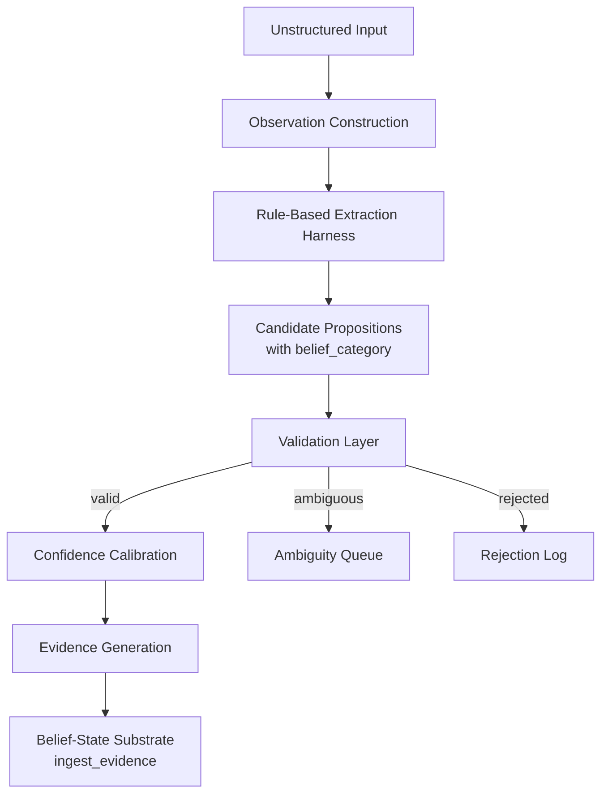
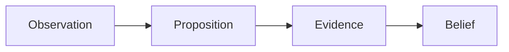
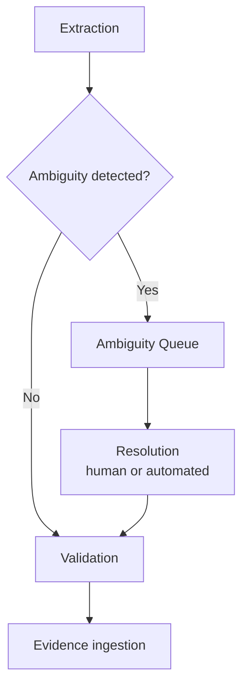

# RFC-0003: Boundary Layer

> **Cortex RFC Series**
> The translation layer between unstructured human input and the Belief-State Substrate — responsible for producing Observations, extracting Propositions, and generating Evidence payloads the substrate can ingest.

| Property | Value |
|----------|-------|
| **RFC** | RFC-0003 |
| **Title** | Boundary Layer |
| **Version** | 1.2 |
| **Status** | Draft |
| **Author** | Nick Davidson |
| **Implements** | [RFC-0001: Computational Epistemology](./RFC-0001_Computational_Epistemology.md) |
| **Depends On** | RFC-0001, [RFC-0002: Belief-State Substrate](./RFC-0002_Belief-State_Substrate.md) |
| **Referenced By** | RFC-0005 |

---

## Table of Contents

**[Part I — Purpose & Boundaries](#part-i--purpose--boundaries)**
- [1. Why](#1-why)
- [2. Core Design Rule](#2-core-design-rule)
- [3. Ownership](#3-ownership)
- [4. Goals](#4-goals)
- [5. Non-Goals](#5-non-goals)

**[Part II — Architecture](#part-ii--architecture)**
- [6. Pipeline Overview](#6-pipeline-overview)
- [7. Object Chain: Observation → Proposition → Evidence](#7-object-chain-observation--proposition--evidence)
  - [7.1 Observation](#71-observation)
  - [7.2 Proposition](#72-proposition)
  - [7.3 Evidence](#73-evidence)

**[Part III — Extraction](#part-iii--extraction)**
- [8. Phase 1 Extraction Mechanism](#8-phase-1-extraction-mechanism)
- [9. Relation Taxonomy](#9-relation-taxonomy)
- [10. Belief Category Assignment](#10-belief-category-assignment)

**[Part IV — Confidence & Validation](#part-iv--confidence--validation)**
- [11. Confidence Model](#11-confidence-model)
- [12. Uncertainty Penalties](#12-uncertainty-penalties)
- [13. Validation Rules](#13-validation-rules)
- [14. Ambiguity Handling](#14-ambiguity-handling)

**[Part V — Integration & Validation](#part-v--integration--validation)**
- [15. Integration Interface](#15-integration-interface)
- [16. Failure Taxonomy](#16-failure-taxonomy)
- [17. MVP Success Criteria](#17-mvp-success-criteria)
- [18. MVP Roadmap](#18-mvp-roadmap)
- [19. Design Principle](#19-design-principle)

---

# Part I — Purpose & Boundaries

> This Part establishes what the Boundary Layer is for, where its responsibilities end, and what it must never do. Every decision in Parts II–V is constrained by the scope drawn here.

## 1. Why

The Belief-State Substrate knows how to ingest Evidence and update Beliefs. It does not know where Evidence comes from, how to read a sentence, or how to decide that "I live in Worcester" is a claim worth believing. That gap is the problem the Boundary Layer exists to solve.

The Boundary Layer is a translator. Its input is unstructured human language. Its output is structured Evidence payloads conforming to the interface defined by RFC-0002. Everything in between — recognizing that a claim was made, deciding what kind of claim it is, estimating how confident to be about it, catching ambiguity before it corrupts the substrate — belongs to this layer and nowhere else.

The question this RFC answers is similarly narrow:

> [!IMPORTANT]
> **Core Question**
>
> **How does unstructured input become Evidence the substrate can act on?**

Not how Evidence is stored. Not how Beliefs form. Not whether the network is coherent. Only what it means for a piece of text to become a candidate for belief in the first place.

## 2. Core Design Rule

> [!IMPORTANT]
> **Design Rule**
>
> The Boundary Layer constructs candidate Evidence.
>
> The Belief-State Substrate determines state.

Boundary output is always uncertain. No extracted Proposition becomes canonical truth without passing through the substrate's Evidence ingestion, Belief update dynamics, and promotion logic.

The Boundary Layer may flag ambiguity at the extraction level. It does not evaluate belief-network coherence. Coherence assessment — contradiction detection, Tension evaluation, cross-category conflicts — belongs to the Coherence Engine (RFC-0005). The distinction is intentional and must not erode: the Boundary Layer knows about individual extractions; RFC-0005 knows about the network as a whole.

> [!NOTE]
> **Philosophy**
>
> A conservative extractor produces recoverable errors. A missing belief can be added later; a corrupted belief may persist indefinitely. The Boundary Layer is therefore designed to fail downward: reject or queue, never promote against uncertainty.

## 3. Ownership

RFC-0001 defines Observation, Proposition, and Evidence as objects. This RFC defines the layer that produces them from unstructured input. RFC-0002 defines the layer that ingests and acts on them.

| Layer | Owns |
|-------|------|
| **RFC-0001: Computational Epistemology** | Definitions of Observation, Proposition, Evidence, Belief, Confidence, Provenance. |
| **RFC-0002: Belief-State Substrate** | Evidence ingestion, Belief storage, update dynamics, confidence mechanics, decay, provenance propagation. |
| **RFC-0003: Boundary Layer** (this document) | Observation construction from raw input; Proposition extraction; `belief_category` assignment; uncertainty estimation; validation; ambiguity queue; provenance capture. |
| **RFC-0005: Coherence Engine** | Contradiction detection; Tension assessment; coherence scoring across the belief network. |

No layer may perform operations owned by another.

> [!IMPORTANT]
> **Boundary Enforcement**
>
> The Boundary Layer must not write to the substrate directly. It must not evaluate whether an extraction is consistent with existing beliefs. It must not assign confidence to beliefs — it assigns confidence to proposed Evidence, which the substrate then weighs through its own update dynamics. These are not implementation guidelines; they are ownership rules.

## 4. Goals

The Boundary Layer must:

- Construct an Observation from every piece of raw input it receives
- Extract candidate Propositions from Observations
- Assign `belief_category` to each Proposition prior to Evidence generation
- Estimate support and reliability with appropriate uncertainty
- Surface ambiguity rather than forcing resolution
- Validate structure before any Evidence payload reaches the substrate
- Preserve provenance at every stage of the chain
- Reject malformed, hallucinated, or over-inferred structures conservatively

## 5. Non-Goals

Version 1 intentionally excludes:

- Semantic embeddings
- Autonomous ontology or relation creation
- Automatic entity merging
- Episodic memory generation
- Learned calibration models
- Narrative understanding or multi-turn reasoning
- Belief-network coherence evaluation (owned by RFC-0005)
- Any direct substrate write operations

---

# Part II — Architecture

> This Part describes how the Boundary Layer is structured internally — the pipeline stages data passes through, and how the three RFC-0001 objects (Observation, Proposition, Evidence) map to those stages. It does not define how those objects are stored; that belongs to RFC-0002.

## 6. Pipeline Overview



Input does not pass directly to the substrate as evidence. Every piece of raw text enters as an Observation; Propositions are extracted from Observations; validated Propositions become Evidence payloads submitted through the RFC-0002 ingestion interface. Nothing bypasses this chain.

## 7. Object Chain: Observation → Proposition → Evidence

RFC-0001 defines the full epistemic chain:



The Boundary Layer owns the left side of this chain — from raw input through Evidence generation. The substrate owns everything from ingestion onward.

### 7.1 Observation

Per RFC-0001, an Observation is the lowest-level epistemic object. It records that something was perceived, without interpretation, confidence, or claim about truth.

The Boundary Layer is responsible for constructing an Observation from every piece of raw input it receives. An Observation is append-only and immutable once created — it records what was said, not what it means.

**Fields (Boundary Layer representation):**

| Field | Type | Description |
|-------|------|-------------|
| `observation_id` | id | Unique identifier. |
| `raw_text` | string | Unmodified source text. |
| `source` | string | Origin — e.g. `user_utterance`, `document`. |
| `captured_at` | timestamp | Wall-clock time of capture. |
| `session_id` | optional | Conversation context, if applicable. |

> [!NOTE]
>
> An Observation makes no claim about any Proposition. It simply records that something was said. Interpretation begins in [§7.2](#72-proposition). This separation is not ceremony — it preserves the provenance chain RFC-0001 requires and ensures that competing Propositions extracted from the same Observation share a common, auditable source.

### 7.2 Proposition

Per RFC-0001, a Proposition is a structured claim that may be supported or contradicted by Evidence — a possible explanation, not yet a Belief.

The Boundary Layer extracts one or more candidate Propositions from each Observation. A Proposition records what was asserted, not how confidently. Confidence belongs to Evidence, which is generated from a validated Proposition in [§7.3](#73-evidence).

**Fields (Boundary Layer representation):**

| Field | Type | Description |
|-------|------|-------------|
| `proposition_id` | id | Unique identifier. |
| `observation_id` | FK → observations, **NOT NULL** | The Observation this Proposition was extracted from. Mandatory per RFC-0002 §6. |
| `valid_from` | timestamp/turn | The point this Proposition is asserted to hold. In Phase 1, this always mirrors the Observation's `captured_at` — the Boundary Layer does not independently assert a different value. See [§8](#8-phase-1-extraction-mechanism) for why, and RFC-0002 §3.2a for the substrate-side rule this feeds. |
| `subject` | string | Canonical entity name. |
| `relation` | string | From the canonical vocabulary (see [§9](#9-relation-taxonomy)). |
| `object_entity` | string, nullable | Entity reference — XOR with `object_value`. |
| `object_value` | string, nullable | Literal value — XOR with `object_entity`. |
| `belief_category` | enum | Assigned by the extraction harness (see [§10](#10-belief-category-assignment)). |
| `validation_status` | enum | `pending` \| `valid` \| `rejected` \| `queued` |
| `extraction_method` | string | E.g. `regex`, `keyword`, `template`. |
| `ambiguity_score` | float, `[0,1]` | Degree of extraction ambiguity; informs routing to the ambiguity queue. |
| `notes` | optional | Free text. |

**Constraints:**

- Exactly one of (`object_entity`, `object_value`) must be non-null.
- `relation` must exist in the canonical vocabulary defined in [§9](#9-relation-taxonomy).
- `belief_category` must be assigned before Evidence generation.

> [!NOTE]
>
> The Boundary Layer does not resolve whether a new Proposition conflicts with an existing Belief. It does not know what the substrate currently holds. It extracts, validates, and submits. Conflict resolution belongs to RFC-0002's update dynamics and RFC-0005's Tension detection.

### 7.3 Evidence

Evidence is generated by combining a validated Proposition with the extraction metadata accumulated during confidence calibration. The resulting Evidence payload references exactly one Proposition and carries the support, reliability, source, and provenance necessary for RFC-0002's update engine to act on it.

This is the stage where confidence values enter the object chain. A Proposition records what was claimed; Evidence records how strongly the extraction process supports that claim. The separation is not incidental — it means the same Proposition can accumulate multiple Evidence records over time, each reflecting a separate extraction event, without any single event overwriting the claim itself.

**Fields (Evidence payload):**

| Field | Type | Description |
|-------|------|-------------|
| `proposition_id` | FK → propositions | The Proposition this Evidence supports or contradicts. |
| `observation_id` | FK → observations, **NOT NULL** | The Observation this Evidence was produced from — RFC-0002 §3.3 requires every Evidence record to carry its own, independent of the Proposition's own `observation_id`. |
| `support` | float, `s ∈ [-1,1]` | Strength of evidential support, after all uncertainty penalties have been applied. |
| `reliability` | float, `ρ ∈ [0,1]` | Quality of the extraction process that produced this Evidence. |
| `source_name` | string | Always `"boundary_layer"` for Evidence originating here. |
| `belief_category` | enum | Carried from the Proposition; required by RFC-0002's ingestion interface. |
| `notes` | optional | Free text. |

> [!NOTE]
>
> For a first extraction, the Evidence's `observation_id` and the Proposition's `observation_id` ([§7.2](#72-proposition)) are the same Observation — one raw input produced both. When a later extraction reinforces an *existing* Proposition (repeated `(subject, relation, object)` tuple, per RFC-0002 §3.2a's reuse-before-create rule), the new Evidence record's `observation_id` refers to that later Observation, while the Proposition's own `observation_id` continues to point at whichever Observation originally created it. The two fields answer different questions and are not expected to always match.

At the point Evidence is generated, ownership transfers to the substrate. The substrate determines whether a Belief exists for this Proposition, how to update confidence using the update rule defined in RFC-0002 §4.1, and whether the Evidence changes the belief network's state.

The Boundary Layer does not create Belief records. It creates Evidence.

---

# Part III — Extraction

> This Part defines what the extraction harness does in Phase 1: how relations are recognized, how `belief_category` is assigned, and what the harness's scope is. It is intentionally narrow — Phase 1 is a pipeline test harness, not a language understanding system.

## 8. Phase 1 Extraction Mechanism

Phase 1 exists to validate pipeline behavior end-to-end. It is not a general language understanding system.

> [!IMPORTANT]
> **Design Rule**
>
> Phase 1 is a pipeline test harness. Its purpose is correctness verification, not coverage. A Phase 1 system that correctly produces one valid Observation → Proposition → Evidence payload for one input is a success; a Phase 1 system that makes confident claims about most inputs is not.

**Mechanism:**

- Regex pattern matching against known input forms
- Keyword triggers for relation recognition
- Template extraction for structured patterns

**Phase 1 intentionally includes:**

- No inference engine
- No semantic understanding
- No embeddings
- No LLM

**Phase 1 examples:**

Input: `"I live in Worcester"`

```
Observation:  raw_text = "I live in Worcester"
Proposition:  subject = Nick, relation = lives_in, object_entity = Worcester
              belief_category = identity
```

Input: `"I'm working on Cortex"`

```
Observation:  raw_text = "I'm working on Cortex"
Proposition:  subject = Nick, relation = working_on, object_entity = Cortex
              belief_category = operational
```

Input: `"I maybe want to build a personal assistant"`

```
Observation:  raw_text = "I maybe want to build a personal assistant"
Proposition:  subject = Nick, relation = wants_to_build, object_entity = personal_assistant
              belief_category = goal
              [possibility language penalty applied — see §12]
```

> [!WARNING]
> **Known Limitation — retrospective assertions**
>
> Capture time is not assertion validity. `"I live in Worcester"` and `"I worked at Acme in 2020"` are structurally identical to Phase 1 — a `lives_in`/`worked_for` relation and an object — but the second sentence asserts a claim about a specific past period, not about now. Phase 1 has no semantic understanding (see above) and cannot recover an intended retrospective validity point from text; it sets `valid_from` to the Observation's `captured_at` in every case, regardless of tense or an explicit date mentioned in the source text.
>
> The consequence is concrete under RFC-0002 §3.2a's reuse-before-create rule: two retrospective assertions sharing a `(subject, relation, object)` tuple but describing two different real-world periods — e.g., `"I worked at Acme in 2015"` and, later, `"I worked at Acme in 2020"` — will merge into one Proposition rather than being recognized as two distinct episodes, because both land on a `valid_from` close to their respective capture times rather than on the periods actually asserted. This is a known Phase 1 limitation, not an accepted permanent behavior. It is routed to Phase 2 ([§18](#18-mvp-roadmap)), where semantic extraction could recover an asserted date or period and supply it as an explicit `valid_from` override (RFC-0002 §3.8). See RFC-0002 §3.2a for the matching note on the substrate side.
>
> RFC-0002 §3.8's `resolution_mode="new_episode"` exists precisely to represent a deliberately distinct episode instead of merging — but taking that branch requires recognizing that two assertions describe different periods, which is exactly the semantic judgment Phase 1 cannot make. Phase 1 therefore never passes anything but `resolution_mode="reinforce"` ([§15](#15-integration-interface), [§17](#17-mvp-success-criteria)); the merge behavior above is this limitation's direct consequence, not an independent gap. Phase 2 is where `new_episode` gets its first real caller.

## 9. Relation Taxonomy

Relations are drawn from the canonical MVP seed vocabulary defined in RFC-0002 §5. The Boundary Layer does not create new relations without human review.

> [!IMPORTANT]
> **Vocabulary Rule**
>
> Relations not in this vocabulary are rejected during validation. The Boundary Layer must not introduce synonyms or informal variants. If a reasonable extraction cannot be mapped to this vocabulary, the Proposition enters the ambiguity queue or is rejected — it does not pass through with an improvised relation.

**MVP canonical relations:**

| Relation | Class | Exclusive | `default_prior_mu` |
|----------|-------|:---------:|-------------------:|
| `is_a` | general | No | 0.50 |
| `related_to` | general | No | 0.50 |
| `part_of` | general | No | 0.50 |
| `depends_on` | general | No | 0.50 |
| `works_for_current` | identity | Yes | 0.50 |
| `worked_for` | identity | No | 0.50 |
| `role_on` | identity | No | 0.50 |
| `lives_in` | identity | Yes | 0.50 |
| `born_in` | identity | Yes | 0.50 |
| `owns` | state | No | 0.50 |
| `offers` | state | No | 0.50 |
| `located_in` | state | No | 0.50 |
| `implements` | general | No | 0.50 |
| `documents` | general | No | 0.50 |
| `uses` | activity | No | 0.00 |
| `is_learning` | activity | No | 0.00 |
| `working_on` | activity | No | 0.00 |
| `wants_to_build` | activity | No | 0.00 |
| `capital_of` | identity | Yes | 0.50 |

**Relation class priors:**

Activity-class relations decay toward absence (`μ = 0.00`) because an unobserved activity should be treated as not currently occurring. All other classes decay toward uncertainty (`μ = 0.50`). This is substrate behavior, specified here for reference. The authoritative definition lives in RFC-0002 §3.6 and §3.9.

> [!NOTE]
>
> `relation_class` governs decay-prior behavior in the substrate. `belief_category` governs inference policy and Tension detection in RFC-0005. They are related but not identical — for example, a `working_on` relation (class: `activity`) produces a Proposition with `belief_category = operational`. See [§10](#10-belief-category-assignment) for the assignment rules.

## 10. Belief Category Assignment

Per RFC-0001, Belief Categories are properties of inference policy, not storage location. The substrate stores `belief_category` on every Proposition and Belief it holds. The Boundary Layer is responsible for assigning `belief_category` to every Proposition before Evidence generation — the substrate should not be asked to infer it.

> [!IMPORTANT]
> **Assignment Rule**
>
> A Proposition without `belief_category` is invalid and must not be submitted to the substrate. The Boundary Layer must assign this field, not defer it.

**MVP categories, per RFC-0001 §6.1:**

| Category | Description |
|----------|-------------|
| `identity` | Relatively stable characteristics — location, organizational membership, role. |
| `operational` | Current external state — active projects, tools in use, ongoing activities. |
| `goal` | Declared intentions with expected future state. |
| `preference` | Stated or inferred stable dispositions. |
| `relationship` | Beliefs about connections between entities. |
| `meta` | Beliefs about other Beliefs; model self-knowledge. |
| `historical` | Dormant, not deleted. Assigned by the substrate on belief transition, not by the Boundary Layer at extraction time. |

> [!NOTE]
>
> `historical` is not an extraction-time category. The Boundary Layer does not assign it. It is set by the substrate when a Belief transitions to dormancy, per RFC-0002 §3.7. The Boundary Layer assigns the other six categories at extraction time.

**Default relation-to-category mappings (Phase 1):**

The extraction harness maps each relation to a default `belief_category`. These defaults may be overridden during validation if context warrants — but they must not be left unassigned.

| Relation | Default `belief_category` |
|----------|--------------------------|
| `lives_in` | `identity` |
| `born_in` | `identity` |
| `works_for_current` | `identity` |
| `worked_for` | `identity` |
| `role_on` | `identity` |
| `capital_of` | `identity` |
| `working_on` | `operational` |
| `is_learning` | `operational` |
| `uses` | `operational` |
| `wants_to_build` | `goal` |
| `owns` | `identity` |
| `offers` | `identity` |
| `located_in` | `identity` |
| `implements` | `operational` |
| `documents` | `operational` |
| `related_to` | `relationship` |
| `part_of` | `relationship` |
| `depends_on` | `relationship` |

---

# Part IV — Confidence & Validation

> This Part defines how the Boundary Layer estimates uncertainty, applies penalties, validates structure, and routes ambiguous extractions. These mechanisms determine what reaches the substrate and in what form.

## 11. Confidence Model

The Boundary Layer assigns two values to every Evidence payload it generates:

**Support (`s`):**

> How strongly does the source text support this Proposition?

Range: `s ∈ [-1, 1]`

Positive support indicates the text provides evidence toward the Proposition being true. Negative support indicates the text actively contradicts it. Support of zero is not the default — it indicates complete evidential neutrality, which is different from uncertainty about quality (captured by reliability).

**Reliability (`ρ`):**

> How trustworthy is the extraction process that produced this Proposition?

Range: `ρ ∈ [0, 1]`

Reliability is a property of the extraction itself, not the claim. A regex match on a direct assertion is high-reliability. An indirect inference from context is low-reliability. The substrate uses this to weight the update: unreliable Evidence moves confidence less.

> [!NOTE]
>
> The mapping from support to target confidence, and the update rule that uses reliability to weight the update step, are defined in RFC-0002 §3.3 and §4.1. The Boundary Layer assigns `s` and `ρ`; the substrate uses them. Neither layer should perform the other's computation.

## 12. Uncertainty Penalties

When source text contains hedging language, the Boundary Layer applies multiplicative penalties to support and reliability before Evidence generation. These penalties reduce the substrate's confidence response to uncertain input, without requiring the substrate to understand language.

**Possibility language:**

*Triggers:* `maybe`, `might`, `possibly`, `considering`

```
support     *= 0.75
reliability *= 0.75
```

**Weak certainty language:**

*Triggers:* `I think`, `I guess`, `probably`

```
support     *= 0.80
reliability *= 0.70
```

**Indirect inference:**

*Trigger:* the Proposition was not directly stated; it was inferred from context

```
support     *= 0.60
reliability *= 0.50
```

Penalties are multiplicative and apply in sequence when multiple triggers are present.

> [!IMPORTANT]
>
> Penalties are computed during extraction and applied before Evidence generation. The `support` and `reliability` values carried by an Evidence payload already reflect any applicable penalties — the substrate receives post-penalty values and does not re-apply them.

## 13. Validation Rules

A Proposition must pass every rule below before it becomes an Evidence payload. Failure at any rule halts promotion and routes the Proposition to rejection or the ambiguity queue.

| Rule | Requirement |
|------|-------------|
| **R1** | Subject must exist or be creatable in the substrate entity table. |
| **R2** | Relation must exist in the canonical vocabulary ([§9](#9-relation-taxonomy)). |
| **R3** | Exactly one of `object_entity` or `object_value` must be non-null. |
| **R4** | Evidence `support` must satisfy `-1 ≤ s ≤ 1` after penalty application. |
| **R5** | Evidence `reliability` must satisfy `0 ≤ ρ ≤ 1` after penalty application. |
| **R6** | No empty entity references. |
| **R7** | `belief_category` must be assigned from the canonical set ([§10](#10-belief-category-assignment)). |
| **R8** | Ambiguous entity references must enter the ambiguity queue before promotion. |

**Repeated Propositions:**

If the substrate already holds a Proposition with an identical `(subject, relation, object)` tuple, the Boundary Layer does not suppress the new extraction. It generates an additional Evidence payload, which the substrate ingests and merges through its update dynamics. Evidence accumulates; Beliefs update. The Boundary Layer does not attempt to deduplicate against existing substrate state — it does not know what the substrate holds, and should not.

## 14. Ambiguity Handling

Ambiguous extractions do not disappear. They do not block pipeline operation. They enter an ambiguity queue pending resolution.

**Ambiguity Queue schema:**

| Field | Description |
|-------|-------------|
| `queue_id` | Unique identifier. |
| `observation_id` | The source Observation. |
| `candidate_proposition` | The extracted Proposition, with `validation_status = queued`. |
| `candidate_entities` | Possible entity resolutions for ambiguous references. |
| `created_at` | Timestamp. |
| `resolution_status` | `pending` \| `resolved` \| `rejected` |
| `resolution_notes` | Free text. |



> [!NOTE]
>
> The Boundary Layer flags ambiguity at the extraction level only — it cannot determine whether an ambiguous entity creates a contradiction with existing Beliefs, because it does not hold or query belief state. If ambiguity exists at the entity level (e.g., two people named "Chris"), the queue holds the extraction until the ambiguity is resolved externally. The resolved Proposition then passes through normal validation. Contradiction detection, if any, happens afterward in RFC-0005.

---

# Part V — Integration & Validation

> This Part defines how validated Propositions become Evidence payloads, what failure modes the Boundary Layer must recognize and handle, and what the MVP must demonstrate to be considered complete.

## 15. Integration Interface

A validated Proposition becomes an Evidence payload submitted to the substrate through RFC-0002's `ingest_evidence` interface. The Boundary Layer is the caller; the substrate is the handler. All state changes from that point forward are owned by the substrate.

```python
ingest_evidence(
    proposition_id=None,          # or existing id if Proposition already registered
    subject=proposition.subject,
    relation=proposition.relation,
    object_entity=proposition.object_entity,   # XOR
    object_value=proposition.object_value,     # XOR
    support=evidence.support,                  # post-penalty; Evidence field, not Proposition
    reliability=evidence.reliability,          # post-penalty; Evidence field, not Proposition
    source_name="boundary_layer",
    observation_id=None,                       # or existing id if this Observation already registered
    observation_raw_text=observation.raw_text,
    observation_source=observation.source,     # e.g. user_utterance, document
    observation_session_id=observation.session_id,
    valid_from=None,                           # Phase 1 never supplies an override — see §8's
                                                #   Known Limitation; substrate derives it from
                                                #   the Observation's captured_at (RFC-0002 §3.2a)
    resolution_mode="reinforce",               # the only value Phase 1 ever passes — see §8
    belief_category=proposition.belief_category
)
```

> [!IMPORTANT]
>
> The Boundary Layer already constructs a real Observation for every piece of raw input it receives ([§7.1](#71-observation), [§4 Goals](#4-goals)). This call is where that Observation is registered with the substrate — RFC-0002 §6 requires it; there is no path through this interface that omits it.

> [!IMPORTANT]
>
> This interface signature is defined by RFC-0002 §3.8. The Boundary Layer must conform to it. If RFC-0002 revises the interface, RFC-0003 must update this section to match. RFC-0003 does not own this interface — it only specifies how the Boundary Layer calls it.

**No substrate changes are required for Boundary Layer integration.** The Boundary Layer submits Evidence through the existing interface and has no visibility into what the substrate does with it.

## 16. Failure Taxonomy

The following failure modes are recognized at the extraction level. They are not exhaustive; they define the cases the Phase 1 harness must be able to detect and handle.

**Hallucinated Relation**

```
Input:   "I enjoy robotics"
Bad:     owns(Nick, robotics)
Problem: Relation not licensed by source text.
Action:  Reject. Do not submit to substrate.
```

**Over-Inference**

```
Input:   "I'm reading about Vermont"
Bad:     lives_in(Nick, Vermont)
Problem: Text does not assert location; inference is not warranted.
Action:  Lower support and reliability substantially. Consider related_to.
```

**Entity Resolution Failure**

```
Input:   "I talked to Chris"
Problem: Two registered entities match "Chris."
Action:  Ambiguity queue. Do not promote until resolved.
```

**Extraction Drift**

```
Problem: Repeated extraction errors reinforce false Beliefs over time.
Action:  Confidence penalties on indirect inference; delayed promotion; 
         long-term pattern detection is out of scope for this RFC.
```

**Vocabulary Collapse**

```
Problem: Relation vocabulary expands informally, degrading consistency.
Action:  Strict vocabulary enforcement at validation. New relations 
         require human review and explicit addition to the seed list.
```

## 17. MVP Success Criteria

The Boundary Layer MVP is complete when the full object chain — Observation → Proposition → Evidence → substrate ingestion — functions correctly for representative inputs. The following scenarios define the validation bar.

---

**Scenario 1: Direct assertion, identity category**

Input:
```
"I live in Worcester"
```

Expected chain:

```python
# Observation
observation_id = "obs-001"
raw_text       = "I live in Worcester"
source         = "user_utterance"
captured_at    = turn 42

# Proposition
proposition_id    = "prop-001"
observation_id    = "obs-001"
valid_from        = turn 42   # mirrors the Observation's captured_at; Phase 1 asserts no override
subject           = "Nick"
relation          = "lives_in"
object_entity     = "Worcester"
object_value      = None
belief_category   = "identity"
validation_status = "valid"
extraction_method = "regex"
ambiguity_score   = 0.00

# Evidence (generated from validated Proposition)
evidence_support     = 0.90
evidence_reliability = 0.80

# Evidence payload submitted
ingest_evidence(
    proposition_id       = None,
    subject              = "Nick",
    relation             = "lives_in",
    object_entity        = "Worcester",
    object_value         = None,
    support              = 0.90,
    reliability          = 0.80,
    source_name          = "boundary_layer",
    observation_id       = None,
    observation_raw_text = "I live in Worcester",
    observation_source   = "user_utterance",
    observation_session_id = None,
    valid_from           = None,   # substrate derives turn 42 from the constructed Observation
    resolution_mode       = "reinforce",   # the only value Phase 1 ever passes — see §8
    belief_category      = "identity"
)
```

---

**Scenario 2: Hedged assertion, operational category**

Input:
```
"I'm probably working on Cortex"
```

Uncertainty penalty applied (weak certainty: `I'm probably`):

```
support     = 0.80 × 0.80 = 0.64
reliability = 0.80 × 0.70 = 0.56
```

Expected Proposition and Evidence:

```python
# Proposition
subject           = "Nick"
relation          = "working_on"
object_entity     = "Cortex"
belief_category   = "operational"
validation_status = "valid"

# Evidence (post-penalty)
evidence_support     = 0.64
evidence_reliability = 0.56
```

---

**Scenario 3: Rejection for over-inference**

Input:
```
"I'm reading about Vermont"
```

Attempted extraction:

```python
relation = "lives_in"   # not licensed by source text
```

Expected result:

```python
validation_status = "rejected"
reason            = "over-inference: source text does not license lives_in"
```

Correct extraction (if attempted):

```python
# Proposition
relation          = "related_to"
object_entity     = "Vermont"
belief_category   = "relationship"
validation_status = "valid"

# Evidence (indirect inference penalties applied)
evidence_support     = 0.40
evidence_reliability = 0.50
```

---

**Scenario 4: Ambiguous entity**

Input:
```
"I talked to Chris"
```

Expected result:

```python
validation_status = "queued"
candidate_entities = ["Chris_A", "Chris_B"]
resolution_status  = "pending"
```

No Evidence payload submitted until resolved.

---

**MVP Pass Conditions:**

| Condition | Requirement |
|-----------|-------------|
| Object chain | Scenario 1 produces a valid Observation, Proposition, and Evidence payload with `belief_category = identity`. |
| Uncertainty | Scenario 2 applies penalties correctly and produces a valid `operational` Evidence payload. |
| Rejection | Scenario 3 rejects the over-inferred Proposition and does not submit it to the substrate. |
| Ambiguity | Scenario 4 routes to the ambiguity queue and does not submit Evidence until resolved. |
| Interface conformance | All Evidence payloads conform to RFC-0002 §3.8 `ingest_evidence` signature. |
| Integrity | No Proposition with `validation_status = rejected` or `validation_status = queued` reaches the substrate. |

## 18. MVP Roadmap

| Phase | Scope |
|-------|-------|
| **Phase 1** | Rule-based extraction harness; pipeline validation against MVP scenarios. |
| **Phase 2** | LLM-assisted extraction operating under deterministic structural constraints and canonical relation vocabulary; automated confidence calibration. |
| **Phase 3** | Adaptive confidence calibration from source credibility feedback (RFC-0002 §4.4). |
| **Phase 4** | Episodic and session-level context integration. |
| **Phase 5** | Meaning graph integration. |

---

## 19. Design Principle

> [!IMPORTANT]
>
> The Boundary Layer should fail conservatively.
>
> False negatives are recoverable — a missing belief can be added. False positives corrupt model state in ways that compound over time.
>
> When in doubt: reject, or queue. Never promote against uncertainty.