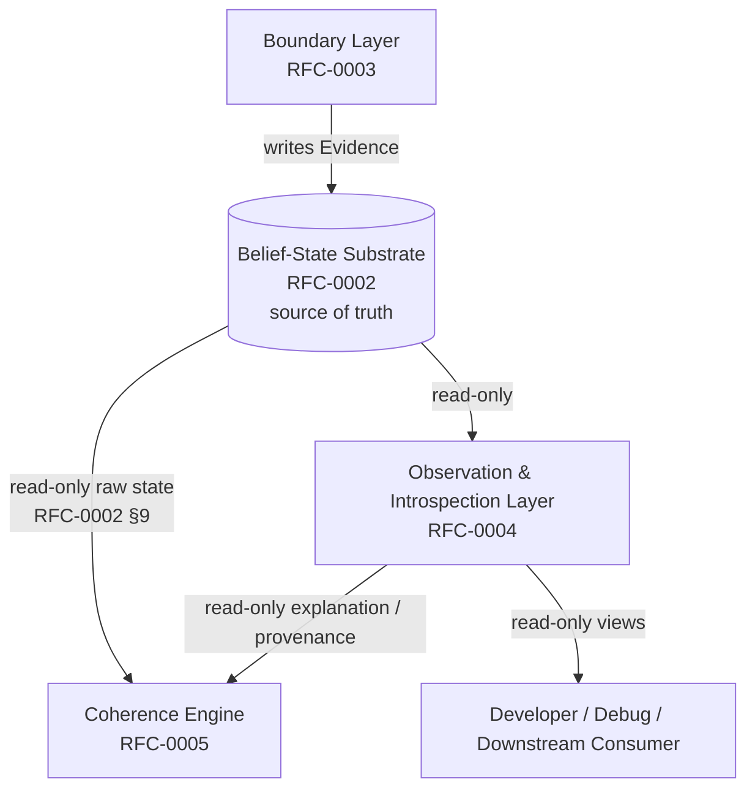
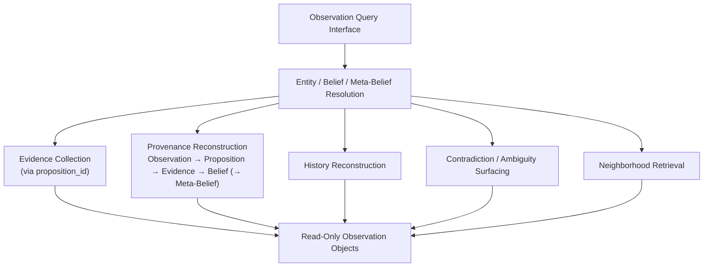
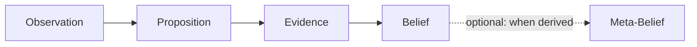

# RFC-0004: Observation & Introspection Layer

> **Cortex RFC Series**
> The read-only layer that exposes, reconstructs, explains, and inspects the epistemic chain held by the Belief-State Substrate — without ever modifying it.

| Property | Value |
|----------|-------|
| **RFC** | RFC-0004 |
| **Title** | Observation & Introspection Layer |
| **Version** | 2.0 |
| **Status** | Draft |
| **Author** | Nick Davidson |
| **Implements** | [RFC-0001: Computational Epistemology](./RFC-0001_Computational_Epistemology.md) |
| **Depends On** | RFC-0001, [RFC-0002: Belief-State Substrate](./RFC-0002_Belief-State_Substrate.md) |
| **Referenced By** | RFC-0005 |

---

## Table of Contents

**[Part I — Purpose & Boundaries](#part-i--purpose--boundaries)**
- [1. Purpose](#1-purpose)
- [2. Core Design Rule](#2-core-design-rule)
- [3. The Observation Object vs. the Observation & Introspection Layer](#3-the-observation-object-vs-the-observation--introspection-layer)
- [4. Ownership](#4-ownership)
- [5. Goals](#5-goals)
- [6. Non-Goals](#6-non-goals)

**[Part II — Architecture](#part-ii--architecture)**
- [7. Layer Position](#7-layer-position)
- [8. Read Path Overview](#8-read-path-overview)

**[Part III — Data Model](#part-iii--data-model)**
- [9. Module Organization](#9-module-organization)
- [10. Exceptions](#10-exceptions)
- [11. Observation Objects](#11-observation-objects)
  - [11.1 BeliefObservation](#111-beliefobservation)
  - [11.2 MetaBeliefObservation](#112-metabeliefobservation)
  - [11.3 EvidenceObservation](#113-evidenceobservation)
  - [11.4 PropositionObservation](#114-propositionobservation)
  - [11.5 ObservationSnapshot](#115-observationsnapshot)
  - [11.6 ProvenanceTrace](#116-provenancetrace)
  - [11.7 HistoryTraceEntry](#117-historytraceentry)
  - [11.8 ContradictionObservation](#118-contradictionobservation)
  - [11.9 AmbiguityObservation](#119-ambiguityobservation)
  - [11.10 CompetingBelief](#1110-competingbelief)
  - [11.11 NeighborhoodSnapshot](#1111-neighborhoodsnapshot)
  - [11.12 NeighborhoodBelief](#1112-neighborhoodbelief)
  - [11.13 ContradictionReport](#1113-contradictionreport)
  - [11.14 EntityObservation](#1114-entityobservation)
  - [11.15 EntitySummary](#1115-entitysummary)

**[Part IV — Provenance & History](#part-iv--provenance--history)**
- [12. Provenance vs. History](#12-provenance-vs-history)
- [13. Provenance Reconstruction Rules](#13-provenance-reconstruction-rules)
- [14. History Reconstruction Rules](#14-history-reconstruction-rules)
- [15. History Sort Key](#15-history-sort-key)

**[Part V — Interfaces](#part-v--interfaces)**
- [16. Query Guards](#16-query-guards)
- [17. observe_entity](#17-observe_entity)
- [18. observe_belief](#18-observe_belief)
- [19. explain_belief](#19-explain_belief)
- [20. observe_meta_belief](#20-observe_meta_belief)
- [21. explain_meta_belief](#21-explain_meta_belief)
- [22. trace_history](#22-trace_history)
- [23. trace_provenance](#23-trace_provenance)
- [24. report_contradictions](#24-report_contradictions)
- [25. get_neighborhood_snapshot](#25-get_neighborhood_snapshot)
- [26. Confidence Bands](#26-confidence-bands)

**[Part VI — Validation & Boundaries](#part-vi--validation--boundaries)**
- [27. Observation Failure Taxonomy](#27-observation-failure-taxonomy)
- [28. Integration Interface](#28-integration-interface)
- [29. Neighborhood Expansion (Future)](#29-neighborhood-expansion-future)
- [30. MVP Roadmap](#30-mvp-roadmap)
- [31. Test Harness Requirements](#31-test-harness-requirements)
- [32. Implementation Notes](#32-implementation-notes)
- [33. Open Questions / Phase 2](#33-open-questions--phase-2)
- [34. Ownership](#34-ownership)
- [35. Design Principle](#closing-principle)

---

# Part I — Purpose & Boundaries

> This Part establishes what the Observation & Introspection Layer is for, the single rule that governs everything it does, and the boundaries that separate it from the layers above and below. Every object and interface in Parts II–VI is constrained by the scope drawn here.

## 1. Purpose

The Belief-State Substrate ([RFC-0002](./RFC-0002_Belief-State_Substrate.md)) holds the epistemic chain — Observation, Proposition, Evidence, Belief, Meta-Belief — and moves confidence as Evidence arrives. It does not, on its own, explain *why* it holds what it holds, reconstruct *how* a Belief came to exist, or present its internal state in a form a developer or downstream consumer can inspect. That gap is the problem the Observation & Introspection Layer exists to solve.

The Observation & Introspection Layer is an **observer of the epistemic system**. Its input is the persisted state of the substrate. Its output is read-only objects that expose, reconstruct, explain, and inspect that state. It is responsible for:

- Explaining why a Belief or Meta-Belief is currently held.
- Exposing the Evidence supporting and contradicting a claim.
- Reconstructing the provenance chain — Observation → Proposition → Evidence → Belief, and the Meta-Belief derived from it when one exists — for any Belief or Meta-Belief.
- Reconstructing the history of a Belief or Meta-Belief over time.
- Aggregating everything the system knows about a single Entity.
- Surfacing contradiction and ambiguity already defined by the substrate.
- Returning belief neighborhoods for inspection.
- Providing implementation-level debugging visibility into the belief network.

> [!IMPORTANT]
> **Core Question**
>
> **How can the system's current understanding be seen without being disturbed?**

Not how Beliefs are stored, updated, or formed. Not whether the network is coherent. Only how the chain that already exists can be made legible to a human or a downstream consumer.

> [!IMPORTANT]
> **Architectural Role**
>
> The Observation & Introspection Layer is the canonical debugging interface for Cortex. Every subsystem that requires explanation or inspection should build on this layer rather than querying the substrate directly.

> [!NOTE]
>
> This principle is scoped to *explanation, inspection, and debugging*. A consumer that needs raw belief state for its own primary computation — most notably RFC-0005's coherence mathematics — reads the state the substrate exposes for that purpose (RFC-0002 §9). The rule above governs who owns explanation, not who may read state: when a subsystem wants to *understand or display* the network, it builds on this layer instead of re-deriving inspection logic against the substrate.

> [!NOTE]
>
> The Belief-State Substrate remains the source of truth. This layer reads from it and never writes to it. Where this document explains *why* a reconstruction behaves a certain way, that explanation is implementation rationale; the epistemology it serves is owned by RFC-0001, and the state it reads is owned by RFC-0002.

## 2. Core Design Rule

> [!IMPORTANT]
> **Design Rule**
>
> The Observation & Introspection Layer **explains** state.
>
> The Belief-State Substrate **determines** state.

No output of this layer may directly modify Beliefs, Meta-Beliefs, Evidence, confidence, source credibility, relation definitions, Propositions, or Entity records. Observation is read-only — including at the level of confidence itself: every query in this layer reads confidence via RFC-0002 §4.2's `compute_decayed_confidence`, the non-mutating decay accessor, and never via `apply_lazy_decay`. Prior versions of this document asserted read-only behavior while conceding that decay-on-access could still mutate `last_seen_at` as a side effect of a read ([§11.1](#111-beliefobservation)). That gap is closed: `apply_lazy_decay` is reserved for evidence ingestion (RFC-0002 §4.2) and this layer never calls it, directly or indirectly, including through retrieval ([§25](#25-get_neighborhood_snapshot); RFC-0002 §8).

> [!NOTE]
> **Philosophy**
>
> An observer that can change what it observes is no longer an observer. The value of this layer comes entirely from the guarantee that inspecting the system cannot alter it. A `BeliefObservation` is a photograph, not a handle. This is now a guarantee borne out by which accessor every query in this layer is specified to use, not an aspiration stated alongside a known exception.

The layer MAY flag contradiction and ambiguity that the substrate has already defined ([§24](#24-report_contradictions)). It MUST NOT assess belief-network coherence or detect Tensions — those are interpretive, cross-category judgments owned by the Coherence Engine ([RFC-0005](#)). The distinction is intentional and must not erode: this layer reports what the substrate computes; RFC-0005 interprets what the network means.

## 3. The Observation Object vs. the Observation & Introspection Layer

Two distinct things in the Cortex specification share the word *observation*. They must not be confused.

| Term | Defined In | What It Is |
|---|---|---|
| **Observation** (the object) | RFC-0001 §3.1 | The lowest-level epistemic object — a record that something was perceived. It is the head of the provenance chain and is created by the Boundary Layer (RFC-0003 §7.1). |
| **Observation & Introspection Layer** (this RFC) | RFC-0004 | The read-only layer that *observes the epistemic system itself* — exposing, reconstructing, and explaining the chain that runs from the Observation object through to Meta-Belief. |

> [!IMPORTANT]
>
> This layer **observes the system**. It does **not** define, create, or modify the Observation object. The Observation object is owned by RFC-0001 (definition) and produced by RFC-0003 (construction from raw input). When this RFC reconstructs an Observation as part of a provenance trace, it does so as a read-only [`ObservationSnapshot`](#115-observationsnapshot) — a view of an object that already exists, never a new one.

> [!NOTE]
>
> To keep the distinction visible in code, this RFC names the identifier of a read-model snapshot `snapshot_id`, never `observation_id`. The field `observation_id` refers exclusively to an RFC-0001 Observation object, and appears on only one read model — [`ObservationSnapshot`](#115-observationsnapshot). See [§11.1](#111-beliefobservation).

## 4. Ownership

This RFC implements the introspection portion of the epistemology defined in RFC-0001. It reads the state owned by RFC-0002 and reconstructs the chain produced by RFC-0003. It owns no storage, no dynamics, and no interpretation.

| RFC | Owns | Relationship to This Layer |
|---|---|---|
| **RFC-0001: Computational Epistemology** | Definitions of Observation, Proposition, Evidence, Belief, Meta-Belief; Confidence (definition); Provenance; Coherence (definition); Tensions (definition). | This layer exposes these objects; it never redefines them. |
| **RFC-0002: Belief-State Substrate** | Storage; belief and meta-belief dynamics; update mathematics; decay; exclusivity normalization; source credibility; retrieval; **provenance storage and propagation**. | This layer reads substrate state and reconstructs views from it. |
| **RFC-0003: Boundary Layer** | Observation construction; Proposition extraction; Evidence generation; validation before ingestion. | This layer reconstructs the chain RFC-0003 produced; it never produces Observations, Propositions, or Evidence. |
| **RFC-0004: Observation & Introspection Layer** (this document) | **Explanation; introspection; provenance reconstruction; history reconstruction; debugging views; read-only inspection.** | — |
| **RFC-0005: Coherence Engine** | Coherence assessment; Tension detection; interpretation across Belief Categories; guidance. | This layer surfaces substrate-level contradiction but never assesses coherence or detects Tensions. |

> [!IMPORTANT]
> **Boundary Enforcement**
>
> This layer MUST NOT write to the substrate. It MUST NOT compute confidence, apply decay, normalize exclusivity groups, or transition belief status — those are RFC-0002 dynamics. It MUST NOT extract Propositions or generate Evidence — those are RFC-0003 responsibilities. It MUST NOT assess coherence or detect Tensions — those are RFC-0005 responsibilities. These are ownership rules, not implementation guidelines.

## 5. Goals

The Observation & Introspection Layer MUST be able to:

- Answer "why do we believe this?" for any Belief or Meta-Belief.
- Answer "what does Cortex know about this Entity?" as a single aggregated view.
- Reconstruct a complete [`ProvenanceTrace`](#116-provenancetrace) along the canonical chain.
- Partition Evidence into supporting and contradicting sets.
- Reconstruct confidence and status history over time.
- Surface hard contradiction and soft ambiguity as defined by RFC-0002 §10.
- Return belief neighborhoods using the substrate's own retrieval ranking.
- Expose Meta-Beliefs — observing, explaining, and tracing their provenance — without altering their behavior.
- Integrate without requiring any substrate schema change for MVP.

## 6. Non-Goals

Version 1 of this layer intentionally excludes:

| Non-Goal | Owner / Disposition |
|---|---|
| Automatic belief correction, promotion, or rejection | RFC-0002 dynamics |
| Modifying confidence values or source reliability | RFC-0002 dynamics |
| Proposition extraction or Evidence generation | RFC-0003 |
| Coherence assessment and Tension detection | RFC-0005 |
| Interpretation across Belief Categories | RFC-0005 |
| Natural-language or narrative summarization of an Entity | RFC-0005 / a future Guidance Engine |
| Guidance, recommendation, or action selection | A future Guidance Engine (not yet owned) |
| Visualization UI / dashboards | Out of scope for MVP ([§30](#30-mvp-roadmap)) |
| Graph-database storage | Out of scope; reads relational substrate |
| Agentic planning behavior | Out of scope for the epistemology entirely |

---

# Part II — Architecture

> This Part describes where the layer sits relative to the substrate and the path a read request follows. It does not define how the data it reads is stored (RFC-0002) or how that data was produced (RFC-0003).

## 7. Layer Position



The layer is a pure consumer of substrate state. It sits beside the Coherence Engine, and the two own different questions: RFC-0004 owns *explanation and inspection*, RFC-0005 owns *coherence and Tension*.

> [!NOTE]
>
> RFC-0005 reads raw belief state directly from the substrate's exposed interface (RFC-0002 §9) for its own coherence computation. When RFC-0005 instead needs *explanation* — a provenance trace, a history reconstruction — it builds on this layer rather than re-deriving that logic, per the architectural role in [§1](#1-purpose).

## 8. Read Path Overview



> [!NOTE]
>
> Every branch in this path is read-only. Evidence is collected by following the Belief's Proposition reference — `belief.proposition_id → evidence.proposition_id` — per RFC-0002 §3.3 and §6. There is no `belief_evidence_link` table; that join was removed in RFC-0002 v4.0 and this layer does not use it.

---

# Part III — Data Model

> This Part defines every read-only object the layer returns. RFC-0001 owns what the underlying objects *mean*; RFC-0002 owns how they are *stored*; this Part owns how they are *presented for inspection*. Each object is a frozen snapshot: returning it makes no guarantee that the underlying substrate state will remain unchanged afterward. Fields that can be reconstructed from a [`ProvenanceTrace`](#116-provenancetrace) are not duplicated onto other objects unless required for legibility, in which case they are marked as denormalized-for-display and sourced from the canonical object.

## 9. Module Organization

All dataclasses defined in this Part live in the layer's model module. Return containers such as [`ContradictionReport`](#1113-contradictionreport), [`ProvenanceTrace`](#116-provenancetrace), and [`EntityObservation`](#1114-entityobservation) belong with the other observation models, not inside query-interface code.

```text
observation_layer/
  __init__.py
  models.py          # all dataclasses in §11
  exceptions.py      # §10
  queries.py         # observe_entity, observe_belief, explain_belief, observe_meta_belief, explain_meta_belief
  provenance.py      # trace_provenance, chain reconstruction
  history.py         # trace_history, history_sort_key, ordering helpers
  contradictions.py  # report_contradictions, severity computation, exclusivity-group analysis
  neighborhood.py    # get_neighborhood_snapshot, root validation
```

> [!IMPORTANT]
> **Import Rule**
>
> `queries.py` MAY import from `provenance.py`, `history.py`, `contradictions.py`, and `neighborhood.py`. The specialized modules MUST NOT import the public wrapper functions from `queries.py`, to avoid circular dependencies.

## 10. Exceptions

Observation-specific exceptions live in `observation_layer/exceptions.py`.

```python
class ObservationLayerError(Exception):
    """Base exception for observation-layer failures."""


class ObservationQueryError(ObservationLayerError):
    """Raised when an observation query is structurally invalid."""


class EntityNotFoundError(ObservationLayerError):
    """Raised when a requested Entity cannot be found."""


class BeliefNotFoundError(ObservationLayerError):
    """Raised when a requested Belief cannot be found."""


class MetaBeliefNotFoundError(ObservationLayerError):
    """Raised when a requested Meta-Belief cannot be found."""
```

> [!IMPORTANT]
> **Implementation Rule**
>
> - A structurally invalid query MUST raise `ObservationQueryError`.
> - A missing Entity lookup MUST raise `EntityNotFoundError`.
> - A missing Belief lookup MUST raise `BeliefNotFoundError`.
> - A missing Meta-Belief lookup MUST raise `MetaBeliefNotFoundError`.
> - The layer MUST NOT return a typed "not-found" observation object in place of raising.

> [!NOTE]
> **Design Rationale**
>
> A missing Belief is categorically different from a Belief with low confidence. Raising a specific exception keeps the query contract simple and prevents callers from accidentally treating absence as an `emerging`-band Belief.

## 11. Observation Objects

### 11.1 BeliefObservation

> A complete read-only explanation of one Belief.

**Purpose**

`BeliefObservation` is the core single-claim output of the layer: everything a consumer needs to understand why a single Belief is currently held, what supports and contradicts it, how it got here, and what surrounds it.

**Fields**

```python
@dataclass(frozen=True)
class BeliefObservation:
    snapshot_id: str                 # id of THIS read-model snapshot (see §3); NOT an RFC-0001 Observation
    belief_id: str
    proposition_id: str              # the Proposition this Belief derives from (RFC-0002 §3.4)

    subject: str
    relation: str
    object_entity: str | None
    object_value: str | None

    belief_category: str             # operational | identity | goal | preference | relationship | meta | historical
    current_confidence: float        # w ∈ [0, 1]
    confidence_band: str             # emerging | uncertain | committed (§26)
    status: str                      # active | superseded | rejected (RFC-0002 §3.7)

    supporting_evidence: tuple[EvidenceObservation, ...]
    contradicting_evidence: tuple[EvidenceObservation, ...]

    hard_contradictions: tuple[ContradictionObservation, ...]
    soft_ambiguities: tuple[AmbiguityObservation, ...]

    history: tuple[HistoryTraceEntry, ...]
    provenance: ProvenanceTrace | None
    neighborhood: NeighborhoodSnapshot | None

    notes: str | None
```

**Constraints**

- Exactly one of (`object_entity`, `object_value`) is non-null, mirroring RFC-0002 §3.4.
- `confidence_band` is derived from `current_confidence` per [§26](#26-confidence-bands); the layer displays it but never computes confidence.
- All collection fields are immutable tuples to prevent accidental downstream mutation.

**Design Notes**

- `snapshot_id` identifies the read-model snapshot, not an Observation object ([§3](#3-the-observation-object-vs-the-observation--introspection-layer)).
- `provenance` and `neighborhood` are optional and populated only when requested ([§18](#18-observe_belief)), because both can be expensive to reconstruct.
- The Belief's confidence is computed via RFC-0002 §4.2's `compute_decayed_confidence` — the decay-adjusted value at query time, reflecting elapsed turns since the belief's `last_seen_at`. This is a pure computation: it neither persists the recomputed value nor advances `last_seen_at`. Querying a Belief through this layer, no matter how many times, never changes what the substrate stores.

### 11.2 MetaBeliefObservation

> A complete read-only explanation of one Meta-Belief.

**Purpose**

A Meta-Belief is a Belief whose subject is one or more other Beliefs (RFC-0001 §3.5, RFC-0002 §3.5). `MetaBeliefObservation` exposes it without altering its behavior, including the Beliefs it relates and the Evidence about their joint behavior.

**Fields**

```python
@dataclass(frozen=True)
class MetaBeliefObservation:
    snapshot_id: str
    meta_belief_id: str

    referenced_belief_ids: tuple[str, ...]   # the Beliefs this Meta-Belief is about (RFC-0002 §3.5)
    relation: str                            # e.g. precedes, correlates_with

    belief_category: str                     # always "meta"
    current_confidence: float
    confidence_band: str
    status: str                              # active | superseded | rejected

    referenced_beliefs: tuple[CompetingBelief, ...]   # compact read-only views of the referenced Beliefs

    supporting_evidence: tuple[EvidenceObservation, ...]
    contradicting_evidence: tuple[EvidenceObservation, ...]

    history: tuple[HistoryTraceEntry, ...]
    provenance: ProvenanceTrace | None

    notes: str | None
```

**Constraints**

- `belief_category` is always `meta` (RFC-0002 §3.5).
- `referenced_beliefs` are presented using the compact [`CompetingBelief`](#1110-competingbelief) shape; they are views, not handles, and modifying them is impossible by construction.

> [!NOTE]
> **Design Rationale**
>
> A Meta-Belief inherits every behavior of an ordinary Belief (RFC-0002 §3.5), so its observation object mirrors `BeliefObservation` closely. The differences are structural, not behavioral: a Meta-Belief has no single `subject`/`object` tuple — it references a *set* of Beliefs — so `referenced_belief_ids` and `referenced_beliefs` replace the subject/relation/object fields. Its Evidence concerns the referenced Beliefs' joint behavior over time, reached through the synthetic Proposition described in RFC-0002 §3.5a; see [§13](#13-provenance-reconstruction-rules).

### 11.3 EvidenceObservation

> A read-only representation of one piece of Evidence attached to a Proposition.

**Purpose**

Presents a single Evidence record as the substrate stores it (RFC-0002 §3.3), with the source resolved to a human-readable name.

**Fields**

```python
@dataclass(frozen=True)
class EvidenceObservation:
    evidence_id: str
    proposition_id: str              # the Proposition this Evidence attaches to (RFC-0002 §3.3)
    observation_id: str              # the Observation this specific Evidence was produced from
                                      # (RFC-0002 §3.3; independent of the Proposition's own observation_id)

    support: float                   # s ∈ [-1, 1]
    reliability: float               # ρ ∈ [0, 1]
    source_name: str                 # resolved from sources.source_id
    source_reliability_estimate: float | None   # running estimate, RFC-0002 §4.4

    observed_at_turn: int | None
    observed_at_timestamp: str | None

    notes: str | None
```

**Support Semantics**

```text
support > 0  → supporting evidence
support < 0  → contradicting evidence
support = 0  → neutral / evidentially silent
```

> [!NOTE]
> **Design Rationale**
>
> Earlier drafts of this layer carried denormalized `subject`/`relation`/`object` fields on the Evidence view. Those are removed. Evidence references its Proposition directly via `proposition_id` (RFC-0002 §3.3); the `(subject, relation, object)` identity is reconstructable from the Proposition in the [`ProvenanceTrace`](#116-provenancetrace) and is not duplicated here. `source_reliability_estimate` is shown because it is the standing credibility of the source (RFC-0002 §4.4), which a reader inspecting Evidence frequently needs.

### 11.4 PropositionObservation

> A read-only view of one Proposition in the chain.

**Purpose**

The Proposition is the candidate claim a Belief derives from (RFC-0001 §3.2, RFC-0002 §3.2). Reconstructing provenance requires presenting it, because Evidence attaches to the Proposition rather than to the Belief directly.

**Fields**

```python
@dataclass(frozen=True)
class PropositionObservation:
    proposition_id: str
    observation_id: str                # the Observation that created this Proposition (RFC-0002 §3.2); always present

    subject: str
    relation: str
    object_entity: str | None
    object_value: str | None

    belief_category: str
    status: str                        # candidate | promoted | dormant (RFC-0002 §3.2)
    valid_from_turn: int | None
    valid_from_timestamp: str | None   # RFC-0002 §3.2a; the point this Proposition is asserted to hold

    notes: str | None
```

**Constraints**

- Exactly one of (`object_entity`, `object_value`) is non-null, mirroring RFC-0002 §3.2.
- `observation_id` is always present — RFC-0002 §6 makes Observation storage mandatory, and every Proposition carries exactly one `observation_id` set at creation. There is no longer an empty-tuple case for this field; see [§13](#13-provenance-reconstruction-rules) for what `complete` means now that this holds unconditionally.
- The `origin` field carried by earlier drafts of this object is removed, mirroring its removal from RFC-0002 §3.2. Its replacement is not `observation_id`/`ObservationSnapshot.source` — that field answers *what kind of perception this was* (`user_utterance`, `document`, `manual_entry`, `meta_inference`), a different question from the subsystem attribution `origin` used to carry. The subsystem question is answered by the Proposition's supporting [`EvidenceObservation.source_name`](#113-evidenceobservation) (RFC-0002 §3.3, §4.4) — reachable via [`ProvenanceTrace.evidence`](#116-provenancetrace) — not by this object directly.

### 11.5 ObservationSnapshot

> A read-only view of an RFC-0001 Observation object — the head of the provenance chain.

**Purpose**

When the substrate persists Observation objects as first-class rows (per RFC-0003 §7.1's representation), this object presents one. It is the read-only realization of the RFC-0001 Observation — never a new Observation.

**Fields**

```python
@dataclass(frozen=True)
class ObservationSnapshot:
    observation_id: str              # an RFC-0001 Observation object (see §3)
    raw_text: str | None             # may be None if not retained or redacted
    source: str | None               # e.g. user_utterance, document (RFC-0003 §7.1)

    captured_at_turn: int | None
    captured_at_timestamp: str | None

    notes: str | None
```

> [!NOTE]
>
> `observation_id` here, and only here among the layer's objects, refers to an RFC-0001 Observation object. Everywhere else, the identifier of a read-model snapshot is `snapshot_id` ([§3](#3-the-observation-object-vs-the-observation--introspection-layer)). The type is named `ObservationSnapshot` rather than `ObservationRecord` deliberately: it is a read model, consistent with `BeliefObservation`, `EvidenceObservation`, and `PropositionObservation`, not a persistence object.

### 11.6 ProvenanceTrace

> The provenance chain for one Belief or Meta-Belief.

**Purpose**

`ProvenanceTrace` is the central object of this layer's introspection responsibility. It answers RFC-0001's provenance question — *why does this exist?* — by reconstructing the chain back toward the Observation beneath it:



It reconstructs this chain by walking the substrate's stored references (RFC-0002 §4.5). It copies no data the substrate owns; it assembles read-only views of objects that already exist.

> [!IMPORTANT]
> **Meta-Belief is an optional extension, not a mandatory endpoint.**
>
> The mandatory provenance chain terminates at the Belief: Observation → Proposition → Evidence → Belief. A Meta-Belief is not the end of every chain — most Beliefs never participate in one. Meta-Beliefs are *derived from* Beliefs and form *over* the belief network rather than *after* it in a line, consistent with RFC-0001 §4. A `ProvenanceTrace` therefore includes a Meta-Belief only when its target is a Meta-Belief, or when an inspected Belief is referenced by one and the caller requested that extension.

**Fields**

```python
@dataclass(frozen=True)
class ProvenanceTrace:
    trace_id: str

    target_kind: str                 # "belief" | "meta_belief"
    target_id: str                   # belief_id or meta_belief_id

    observations: tuple[ObservationSnapshot, ...]    # head of chain; always non-empty for a valid trace
    propositions: tuple[PropositionObservation, ...]
    evidence: tuple[EvidenceObservation, ...]

    referenced_beliefs: tuple[CompetingBelief, ...]  # populated only when target_kind == "meta_belief"

    complete: bool                   # True iff every reachable Proposition and Evidence record
                                      # resolved to a persisted Observation
    notes: str | None
```

**Constraints**

- For `target_kind == "belief"`, the chain is `observations → propositions → evidence → belief`, and `referenced_beliefs` is empty.
- For `target_kind == "meta_belief"`, `referenced_beliefs` holds the Beliefs the Meta-Belief is about, and `evidence` holds Evidence about their joint behavior, reached through the synthetic Proposition of RFC-0002 §3.5a — including that Proposition's own mandatory Observation (RFC-0002 §6's no-exemptions rule; see [§13](#13-provenance-reconstruction-rules)).
- `complete` is `True` when every Proposition and Evidence record reachable from the target resolves to a persisted `ObservationSnapshot`. Under RFC-0002 §6's Observation storage rule, this is now the expected condition for any structurally valid trace, not a best-effort outcome.

> [!IMPORTANT]
> **Provenance Completeness**
>
> RFC-0001 §4 requires that no Belief point to support that does not, somewhere beneath it, terminate in an Observation. RFC-0002 §6 makes this enforceable rather than aspirational: `propositions.observation_id` and `evidence.observation_id` are both `NOT NULL`, so a Proposition or Evidence record lacking a valid Observation cannot be persisted in the first place. `complete = True` is therefore the expected result for any trace over a schema-conformant store.
>
> `complete = False` denotes one single neutral condition, **incomplete provenance**: at least one record the trace needed did not resolve to a persisted Observation. This layer does not distinguish *why* at the type level — a non-conforming store (Observation rows absent despite RFC-0002 §6), legacy data predating that rule's adoption, and any other cause an actual read encounters are all reported identically, through `complete = False`. `notes` MUST carry whatever the store actually revealed about the cause, as free text — this is not a closed, machine-checkable taxonomy of two named causes, and it was a mistake for earlier drafts of this document to describe it as one. A caller needing to act differently on different causes must parse `notes` or inspect the store directly; this layer's contract stops at reporting completeness honestly. The layer never synthesizes a missing Observation to make a trace appear complete.

### 11.7 HistoryTraceEntry

> A single reconstructed event in the life of a Belief or Meta-Belief.

**Purpose**

Where [`ProvenanceTrace`](#116-provenancetrace) answers *why does this exist?*, the history answers *what happened over time?* A `HistoryTraceEntry` is one event in that timeline.

**Fields**

```python
@dataclass(frozen=True)
class HistoryTraceEntry:
    trace_id: str

    target_kind: str                 # "belief" | "meta_belief"
    target_id: str

    event_type: str                  # see allowed values below
    turn: int | None
    timestamp: str | None

    confidence_before: float | None
    confidence_after: float | None

    evidence_id: str | None
    proposition_id: str | None
    source_name: str | None

    support: float | None
    reliability: float | None

    status_before: str | None
    status_after: str | None

    notes: str | None
```

**Allowed `event_type` values**

Each maps to a mechanism owned by RFC-0002. The layer reconstructs these events; it never causes them.

| `event_type` | Underlying Mechanism (RFC-0002) |
|---|---|
| `created` | Belief / Meta-Belief formation |
| `evidence_ingested` | Evidence Ingestion Interface (§3.8) |
| `confidence_updated` | Update Rule / smoothing (§4.1) |
| `decayed` | Lazy decay (§4.2) |
| `normalized` | Bounded exclusivity normalization (§4.3) |
| `superseded` | Status transition to `superseded` (§3.7) |
| `rejected` | Status transition to `rejected` (§3.7) |
| `reactivated` | `superseded`/`rejected` → `active` (§3.7) |
| `recategorized_historical` | `belief_category` set to `historical` on dormancy (§3.7) |
| `accessed` | `last_seen_at` update on access (§4.2) |

> [!IMPORTANT]
> **Reconstruction Rule**
>
> If the substrate does not persist event-level confidence transitions, the layer reconstructs best-effort history from belief/meta-belief timestamps, Evidence records (via `proposition_id`), and current state. When a transition cannot be reconstructed, the relevant fields are `None` and `notes` MUST indicate the limitation. See [§14](#14-history-reconstruction-rules).

**Example**

```text
event_type=evidence_ingested
target_kind=belief
turn=42
confidence_before=None
confidence_after=0.71
evidence_id=evidence-123
proposition_id=prop-007
source_name=boundary_layer
support=0.9
reliability=0.8
notes="confidence_before unavailable; reconstructed from evidence record via proposition_id"
```

### 11.8 ContradictionObservation

> A read-only report of one hard contradiction within an exclusivity group.

**Purpose**

Surfaces a hard contradiction as defined by RFC-0002 §10 — two or more `active` Beliefs in the same exclusivity group at or above the committed threshold. This is a substrate-level phenomenon the layer presents; it is not a coherence judgment.

> [!WARNING]
> **Surfaces provisional dynamics**
>
> This object reports RFC-0002 §10's hard-contradiction metric as-computed. RFC-0002 §10 itself carries a warning this layer inherits rather than repeats in full: RFC-0002A §2.3 states the prototype's contradiction dynamics MUST NOT be described as settled, and its zero-hard-contradiction result MUST NOT be cited as validation, because bounded normalization makes the predicate structurally unreachable. Do not harden downstream logic around the specifics of what this object reports.

**Fields**

```python
@dataclass(frozen=True)
class ContradictionObservation:
    contradiction_id: str
    exclusivity_key: str

    subject: str
    relation: str

    competing_beliefs: tuple[CompetingBelief, ...]

    severity: str                    # low | medium | high | critical (diagnostic display ordering)
    notes: str | None
```

**Definition (per RFC-0002 §10)**

```text
hard contradiction = two or more active beliefs in the same exclusivity group
                     with confidence w ≥ committed_threshold (0.65)
```

**Severity (diagnostic display ordering)**

Let `n_committed` be the number of competing `active` Beliefs in the group with `w ≥ committed_threshold`; let `top` and `second` be the two highest confidences in the group.

```text
critical: n_committed ≥ 3
high:     n_committed == 2 and top ≥ 0.80 and second ≥ 0.80
medium:   n_committed == 2 and top ≥ 0.70 and second ≥ 0.70
low:      all other hard-contradiction cases
```

> [!IMPORTANT]
>
> Severity is a presentation-level ordering to help a reader triage what the substrate already reports. It modifies no Belief, and it is **not** coherence assessment or Tension detection — those span Belief Categories and are owned by RFC-0005 ([§4](#4-ownership)). Contradiction here is confined to a single exclusivity group, exactly as RFC-0002 §10 defines it.

### 11.9 AmbiguityObservation

> A read-only report of one soft ambiguity within an exclusivity group.

**Purpose**

Surfaces a soft ambiguity as defined by RFC-0002 §10 — the two leading `active` Beliefs in an exclusivity group are close in confidence and neither has committed.

> [!WARNING]
> **Surfaces provisional dynamics**
>
> This object reports RFC-0002 §10's soft-ambiguity metric as-computed, which shares the executable-prototype status of the rest of RFC-0002 §4's dynamics. RFC-0002A (Review) may revise how ambiguity is diagnosed. Do not harden downstream logic around the specifics of what this object reports.

**Fields**

```python
@dataclass(frozen=True)
class AmbiguityObservation:
    ambiguity_id: str
    exclusivity_key: str

    subject: str
    relation: str

    competing_beliefs: tuple[CompetingBelief, ...]

    delta: float                     # |w_top - w_second|
    notes: str | None
```

**Definition (per RFC-0002 §10)**

```text
soft ambiguity = top two active beliefs in the same exclusivity group are within
                 delta_threshold (0.10), and neither has reached committed_threshold (0.65)
```

> [!NOTE]
>
> Soft ambiguity is expected during early belief formation and is low-to-medium severity by nature (RFC-0002 §10). The layer reports it; it does not attempt to resolve it.

### 11.10 CompetingBelief

> A compact read-only view of a Belief competing in an exclusivity group, or referenced by a Meta-Belief.

**Fields**

```python
@dataclass(frozen=True)
class CompetingBelief:
    belief_id: str

    subject: str
    relation: str
    object_entity: str | None
    object_value: str | None

    confidence: float
    confidence_band: str
    status: str
```

> [!NOTE]
>
> `CompetingBelief` is deliberately minimal. It appears inside [`ContradictionObservation`](#118-contradictionobservation), [`AmbiguityObservation`](#119-ambiguityobservation), and [`MetaBeliefObservation.referenced_beliefs`](#112-metabeliefobservation), where a full `BeliefObservation` would be redundant or recursive. A consumer needing the full explanation of a competing or referenced Belief calls [`observe_belief`](#18-observe_belief) on its `belief_id`.

### 11.11 NeighborhoodSnapshot

> A read-only snapshot of the Beliefs surrounding a root entity or Belief.

**Fields**

```python
@dataclass(frozen=True)
class NeighborhoodSnapshot:
    root_kind: str                   # "entity" | "belief"  ("meta_belief" reserved; see §29)
    root_entity: str | None
    root_belief_id: str | None

    max_hops: int
    top_k: int

    beliefs: tuple[NeighborhoodBelief, ...]

    generated_at_turn: int | None
    generated_at_timestamp: str | None

    notes: str | None
```

**Constraints**

- Exactly one of (`root_entity`, `root_belief_id`) is non-null, consistent with `root_kind`.
- `beliefs` are ranked using the substrate's retrieval formula (RFC-0002 §8); the layer does not define its own ranking.

> [!TIP]
> **Future Extension**
>
> `root_kind` carries `"entity"` and `"belief"` today, with `"meta_belief"` reserved for a future Meta-Belief neighborhood. No meta-belief neighborhood behavior is implemented in this version; the field exists so that adding it later requires no schema change. See [§29](#29-neighborhood-expansion-future).

### 11.12 NeighborhoodBelief

> One Belief returned as part of a neighborhood query.

**Fields**

```python
@dataclass(frozen=True)
class NeighborhoodBelief:
    belief_id: str

    subject: str
    relation: str
    object_entity: str | None
    object_value: str | None

    confidence: float
    confidence_band: str
    status: str

    hop_distance: int                # 0 = directly attached to the root
    retrieval_score: float           # from RFC-0002 §8 ranking formula

    last_seen_turn: int | None
    last_seen_timestamp: str | None
```

> [!NOTE]
>
> `retrieval_score` is the score the substrate's ranking formula assigned (RFC-0002 §8). The layer surfaces it for inspection; it does not recompute or re-rank.

### 11.13 ContradictionReport

> The container returned by [`report_contradictions`](#24-report_contradictions).

**Fields**

```python
@dataclass(frozen=True)
class ContradictionReport:
    hard_contradictions: tuple[ContradictionObservation, ...]
    soft_ambiguities: tuple[AmbiguityObservation, ...]

    subject_filter: str | None
    relation_filter: str | None

    generated_at_turn: int | None
    generated_at_timestamp: str | None

    notes: str | None
```

> [!NOTE]
>
> Hard contradiction and soft ambiguity are tracked separately, never collapsed into a single rate, mirroring RFC-0002 §10. They have different diagnostic meanings.

### 11.14 EntityObservation

> Everything the system currently knows about one Entity, aggregated into a single read-only view.

**Purpose**

`EntityObservation` answers the question a developer asks most often — *"tell me everything Cortex knows about Nick"* — far more frequently than *"explain Belief #417."* It is the headline aggregate of this layer: it gathers the Beliefs whose subject is the Entity, the Meta-Beliefs that reference those Beliefs, the Entity's neighborhood, its recent Evidence, the contradictions it participates in, and a structural summary. It composes the atomic objects defined above; it introduces no new state.

**Fields**

```python
@dataclass(frozen=True)
class EntityObservation:
    snapshot_id: str
    entity_id: str
    canonical_name: str
    entity_type: str | None          # person | organization | project | place | artifact | concept (RFC-0002 §3.1)
    aliases: tuple[str, ...]

    beliefs: tuple[BeliefObservation, ...]            # Beliefs whose subject is this Entity
    meta_beliefs: tuple[MetaBeliefObservation, ...]   # Meta-Beliefs referencing those Beliefs
    neighborhood: NeighborhoodSnapshot | None
    recent_evidence: tuple[EvidenceObservation, ...]
    contradictions: ContradictionReport | None

    summary: EntitySummary | None
    notes: str | None
```

**Constraints**

- `beliefs` contains the Beliefs whose `subject_entity_id` resolves to this Entity (RFC-0002 §3.4).
- `meta_beliefs` contains the Meta-Beliefs whose `referenced_belief_ids` intersect `beliefs` (RFC-0002 §3.5).
- `contradictions` is the result of [`report_contradictions`](#24-report_contradictions) scoped to this Entity as subject.
- `neighborhood` is the result of [`get_neighborhood_snapshot`](#25-get_neighborhood_snapshot) rooted at this Entity.
- `summary` is a structural roll-up only ([§11.15](#1115-entitysummary)).

> [!IMPORTANT]
> **Composition Rule**
>
> The `BeliefObservation` objects inside an `EntityObservation` are populated **without** nested `provenance` or `neighborhood` by default, to avoid combinatorial expansion when an Entity has many Beliefs. A consumer wanting the full provenance of a specific Belief calls [`observe_belief`](#18-observe_belief) or [`explain_belief`](#19-explain_belief) on that Belief directly. `EntityObservation` is an index into the Entity's knowledge, not a recursive dump of it.

> [!IMPORTANT]
> **Ownership Boundary**
>
> `EntityObservation` aggregates and indexes; it does not interpret. It MUST NOT compute a coherence assessment across the Entity's Beliefs, detect Tensions among them, or rank them by anything other than the substrate's own retrieval score. Any cross-category interpretation of what an Entity's Beliefs *mean together* is RFC-0005's responsibility. This object answers "what is known," not "what it implies."

### 11.15 EntitySummary

> A purely quantitative roll-up of an Entity's belief state.

**Purpose**

Gives a consumer an at-a-glance shape of what the system holds about an Entity without reading every Belief. It is structural and countable by design — it carries no narrative, no interpretation, and no coherence judgment.

**Fields**

```python
@dataclass(frozen=True)
class EntitySummary:
    total_beliefs: int
    active_beliefs: int
    superseded_beliefs: int
    rejected_beliefs: int

    beliefs_by_category: tuple[tuple[str, int], ...]   # (belief_category, count)
    beliefs_by_band: tuple[tuple[str, int], ...]       # (confidence_band, count)

    meta_belief_count: int
    hard_contradiction_count: int
    soft_ambiguity_count: int

    most_recent_evidence_turn: int | None
    most_recent_evidence_timestamp: str | None
```

> [!IMPORTANT]
>
> Every field here is a count or a timestamp derived directly from substrate state. `EntitySummary` MUST NOT contain a natural-language description, a coherence score, or any interpretive judgment about the Entity. A narrative or cross-category interpretation of an Entity is owned by RFC-0005 or a future Guidance Engine, not by this layer ([§6](#6-non-goals)).

---

# Part IV — Provenance & History

> This Part owns the two distinct reconstruction responsibilities of the layer and the rules that keep them honest. Provenance and history are related but answer different questions, and conflating them produces misleading inspection output. This Part draws the line and specifies how each reconstruction handles missing data.

## 12. Provenance vs. History

These are the layer's two reconstruction responsibilities. They are distinct and are documented separately.

| | **Provenance** | **History** |
|---|---|---|
| **Question** | *Why does this exist?* | *What happened over time?* |
| **Shape** | A structural lineage (a chain) | A temporal sequence (a timeline) |
| **Canonical form** | Observation → Proposition → Evidence → Belief; a Meta-Belief extends from Belief only when one was derived | Ordered [`HistoryTraceEntry`](#117-historytraceentry) events |
| **Examples** | The Observation a claim came from; the Proposition it was extracted as; the Evidence attached to it | Confidence changes; status transitions; decay; normalization; Evidence ingestion |
| **Object** | [`ProvenanceTrace`](#116-provenancetrace) | `tuple[HistoryTraceEntry, ...]` |
| **Source** | Reference-walking RFC-0002 §4.5 | Reconstruction from timestamps, Evidence, and current state |

> [!IMPORTANT]
>
> Provenance is about *lineage* and is largely static — a Belief's chain of origin does not change as confidence moves. History is about *change over time* — the same Belief accrues new history entries as Evidence arrives and decay applies. A reader asking "where did this come from?" wants provenance; a reader asking "how did this get to its current confidence?" wants history. The layer MUST NOT present one as the other.

## 13. Provenance Reconstruction Rules

The layer reconstructs a [`ProvenanceTrace`](#116-provenancetrace) by walking the substrate's stored references (RFC-0002 §4.5). It MUST follow these rules.

> [!IMPORTANT]
> **Rule P1 — Walk references; never copy or invent.**
>
> The chain is reconstructed by following stored foreign keys: `belief.proposition_id → propositions`, `evidence.proposition_id → propositions`, `propositions.observation_id → observations`, and `evidence.observation_id → observations`. Both of the latter two are unconditional under RFC-0002 §6 — there is no longer a "where persisted" qualifier on the Proposition → Observation or Evidence → Observation links. The layer assembles read-only views; it copies no substrate-owned data and fabricates no links.

> [!IMPORTANT]
> **Rule P2 — Evidence is reached through the Proposition.**
>
> A Belief's Evidence is collected via `belief.proposition_id → evidence.proposition_id`, per RFC-0002 §3.3 and §6. The layer MUST NOT rely on a `belief_evidence_link` table; that join was removed in RFC-0002 v4.0.

> [!IMPORTANT]
> **Rule P3 — Meta-Belief provenance uses the synthetic Proposition.**
>
> For a Meta-Belief, the trace populates `referenced_beliefs` with the Beliefs it is about (`referenced_belief_ids`, RFC-0002 §3.5) and collects Evidence about their joint behavior through the synthetic Proposition described in RFC-0002 §3.5a. The layer treats this exactly as the substrate stores it; it does not construct a parallel meta-evidence pathway. A Meta-Belief appears in a trace only when it is the target, or when a Belief's trace is explicitly extended to the Meta-Beliefs that reference it — never as a default endpoint ([§11.6](#116-provenancetrace)). Per RFC-0002 §6, the synthetic Proposition is itself backed by a real Observation (`source = "meta_inference"`, `raw_text` = the introspection output that triggered it) — it is not exempt from Rule P1, and its trace is expected to be `complete` exactly as any other Proposition's is.

> [!IMPORTANT]
> **Rule P4 — Mark incompleteness honestly.**
>
> `complete` is `True` when every reachable Proposition and Evidence record resolves to a persisted [`ObservationSnapshot`](#115-observationsnapshot), which RFC-0002 §6 makes the expected case throughout. `complete = False` is a single neutral **incomplete provenance** result, not a typed choice between named causes — it means at least one required record did not resolve, and `notes` MUST describe why in free text, covering whatever the store actually revealed (a non-conforming schema, legacy pre-migration data, or another cause not enumerated here). The layer MUST NOT synthesize a missing Observation to make a trace appear complete, and MUST NOT imply through its prose or its callers' expectations a machine-distinguishable branch between causes that the `complete` field itself cannot represent.

## 14. History Reconstruction Rules

The layer reconstructs history conservatively. It MUST follow these rules.

> [!IMPORTANT]
> **Rule H1 — Do not invent missing transitions.**
>
> If `confidence_before` or `confidence_after` is unavailable, it MUST be `None`, never an interpolated or assumed value.

> [!IMPORTANT]
> **Rule H2 — Preserve Evidence order.**
>
> Evidence-linked history is ordered by `observed_at_turn`, then `observed_at_timestamp`, then `evidence_id`. See [§15](#15-history-sort-key).

> [!IMPORTANT]
> **Rule H3 — Mark reconstructed records.**
>
> If an entry is reconstructed rather than read from a persisted event log, `notes` MUST say so.

> [!IMPORTANT]
> **Rule H4 — Prefer a persisted event log when available.**
>
> A dedicated `belief_events` table is a forward-compatible substrate extension (it is not part of the RFC-0002 MVP). If it exists, [`trace_history`](#22-trace_history) MUST prefer it over reconstruction.

> [!NOTE]
> **Design Rationale**
>
> The substrate MVP persists current state and append-only Evidence, not a full event log. History must therefore be reconstructed best-effort, and the reconstruction must be visibly marked as such so a reader never mistakes an inferred timeline for a recorded one.

## 15. History Sort Key

History reconstruction MUST use a sort key that tolerates missing turns or timestamps. Mixed `None` and `int` values MUST NOT be compared directly.

```python
def history_sort_key(entry: HistoryTraceEntry) -> tuple[int, int, str, str]:
    turn_missing = entry.turn is None
    safe_turn = entry.turn if entry.turn is not None else 10**12
    safe_timestamp = entry.timestamp or ""
    safe_trace_id = entry.trace_id or ""

    return (
        int(turn_missing),   # records with a known turn sort first
        safe_turn,
        safe_timestamp,
        safe_trace_id,
    )
```

For raw Evidence records, sort by the analogous key: `turn_missing` flag, then `observed_at_turn`, then `observed_at_timestamp or ""`, then `evidence_id`. This produces deterministic ordering without raising when some records lack turn values.

---

# Part V — Interfaces

> This Part owns the layer's public read interface. Every function here is read-only, keyword-only in signature, and raises rather than returning sentinel objects on failure. None of these functions modifies substrate state; their entire contract is to return the observation objects defined in Part III. The interface is ordered from the broadest aggregate ([`observe_entity`](#17-observe_entity)) down to the most specific reconstructions.

## 16. Query Guards

Structural guards are enforced at the start of the relevant functions. A guard failure raises `ObservationQueryError`.

**Entity Target Guard** — required by [`observe_entity`](#17-observe_entity). `entity` must be a non-empty string; resolution failure against the entities table raises `EntityNotFoundError`, not `ObservationQueryError`.

```python
def validate_entity_target(entity: str | None) -> None:
    if not entity or not entity.strip():
        raise ObservationQueryError("entity must be a non-empty canonical name.")
```

**Object Target Guard** — required by [`observe_belief`](#18-observe_belief), [`explain_belief`](#19-explain_belief), and [`trace_history`](#22-trace_history) when a Belief is addressed by tuple. Exactly one of `object_entity` or `object_value` must be provided.

```python
def validate_object_target(object_entity: str | None, object_value: str | None) -> None:
    if (object_entity is None and object_value is None) or (
        object_entity is not None and object_value is not None
    ):
        raise ObservationQueryError(
            "Exactly one of object_entity or object_value must be provided."
        )
```

**Neighborhood Root Guard** — required by [`get_neighborhood_snapshot`](#25-get_neighborhood_snapshot). Exactly one of `root_entity` or `root_belief_id` must be provided.

```python
def validate_neighborhood_root(root_entity: str | None, root_belief_id: str | None) -> None:
    if (root_entity is None and root_belief_id is None) or (
        root_entity is not None and root_belief_id is not None
    ):
        raise ObservationQueryError(
            "Exactly one of root_entity or root_belief_id must be provided."
        )
```

**Provenance Target Guard** — required by [`trace_provenance`](#23-trace_provenance). Exactly one of `belief_id` or `meta_belief_id` must be provided.

```python
def validate_provenance_target(belief_id: str | None, meta_belief_id: str | None) -> None:
    if (belief_id is None and meta_belief_id is None) or (
        belief_id is not None and meta_belief_id is not None
    ):
        raise ObservationQueryError(
            "Exactly one of belief_id or meta_belief_id must be provided."
        )
```

> [!NOTE]
> **Design Rationale**
>
> Each guard exists because the type signature permits a shape the contract forbids — both targets `None`, or both provided. The constraint is therefore runtime-enforced. Beliefs are addressable by their Proposition tuple because that tuple is their identity (RFC-0002 §7); Meta-Beliefs are addressable only by `meta_belief_id`, because they reference a *set* of Beliefs and have no single subject tuple (RFC-0002 §3.5); Entities are addressable by canonical name (RFC-0002 §3.1).

## 17. observe_entity

Returns everything the system knows about one Entity, aggregated into a single [`EntityObservation`](#1114-entityobservation).

```python
def observe_entity(
    *,
    entity: str,
    include_beliefs: bool = True,
    include_meta_beliefs: bool = True,
    include_neighborhood: bool = True,
    include_recent_evidence: bool = True,
    include_contradictions: bool = True,
    include_summary: bool = True,
    max_beliefs: int = 50,
    max_recent_evidence: int = 25,
    top_k: int = 20,
    max_hops: int = 1,
    include_inactive: bool = False,
) -> EntityObservation:
    ...
```

**Rules**

- The Entity Target Guard ([§16](#16-query-guards)) MUST run first.
- `entity` is resolved as a canonical Entity name against the entities table (RFC-0002 §3.1). If no Entity matches, raise `EntityNotFoundError`.
- Contained `BeliefObservation` objects are populated without nested `provenance` or `neighborhood`, per the Composition Rule in [§11.14](#1114-entityobservation).
- `meta_beliefs` are those whose `referenced_belief_ids` intersect the Entity's Beliefs.
- `contradictions` is computed by delegating to [`report_contradictions`](#24-report_contradictions) with `subject=entity`.
- `neighborhood` is computed by delegating to [`get_neighborhood_snapshot`](#25-get_neighborhood_snapshot) with `root_entity=entity`.
- `summary` is the structural roll-up of [§11.15](#1115-entitysummary).
- The function is read-only and performs no interpretation. Every confidence value it surfaces, directly or via `report_contradictions`/`get_neighborhood_snapshot`, is read through the decay-free accessor ([§2](#2-core-design-rule); RFC-0002 §4.2).

> [!NOTE]
> **Design Rationale**
>
> `observe_entity` is expected to be one of the primary entry points to the layer. Developers reach for "what does Cortex know about X?" far more often than "explain claim #N." Making this a first-class aggregate — rather than forcing callers to compose `observe_belief`, `report_contradictions`, and `get_neighborhood_snapshot` by hand — keeps the common case ergonomic while leaving the atomic interfaces available for the specific case. It is an index into an Entity's knowledge, not a substitute for the per-Belief explanations beneath it.

## 18. observe_belief

Returns a complete observation snapshot for one Belief.

```python
def observe_belief(
    *,
    subject: str,
    relation: str,
    object_entity: str | None = None,
    object_value: str | None = None,
    include_history: bool = True,
    include_evidence: bool = True,
    include_contradictions: bool = True,
    include_provenance: bool = False,
    include_neighborhood: bool = False,
    max_evidence: int = 10,
    max_history: int = 25,
    max_hops: int = 1,
    top_k: int = 20,
) -> BeliefObservation:
    ...
```

**Rules**

- The Object Target Guard ([§16](#16-query-guards)) MUST run first.
- If no matching Belief exists, raise `BeliefNotFoundError`.
- `include_provenance` and `include_neighborhood` default to `False` because both can be expensive; when `False`, the corresponding `BeliefObservation` field is `None`.
- The function is read-only, including its confidence read, which uses the decay-free accessor ([§2](#2-core-design-rule); RFC-0002 §4.2).

## 19. explain_belief

A convenience wrapper around [`observe_belief`](#18-observe_belief) tuned for the "why do we believe this?" question.

```python
def explain_belief(
    *,
    subject: str,
    relation: str,
    object_entity: str | None = None,
    object_value: str | None = None,
    max_evidence: int = 10,
    max_history: int = 25,
) -> BeliefObservation:
    ...
```

Equivalent to:

```python
observe_belief(
    subject=subject,
    relation=relation,
    object_entity=object_entity,
    object_value=object_value,
    include_history=True,
    include_evidence=True,
    include_contradictions=True,
    include_provenance=True,
    include_neighborhood=False,
    max_evidence=max_evidence,
    max_history=max_history,
)
```

> [!IMPORTANT]
> **Implementation Rule**
>
> `explain_belief` MUST pass its own defaults explicitly to `observe_belief`. It MUST NOT rely on `observe_belief`'s defaults remaining synchronized.

> [!NOTE]
> **Design Rationale**
>
> An explanation is the natural place to include provenance, so `explain_belief` requests it (`include_provenance=True`) where `observe_belief` does not by default. Passing defaults explicitly ensures that if `observe_belief`'s defaults change later, `explain_belief`'s behavior does not silently change with them. It inherits `observe_belief`'s non-mutating confidence read unchanged ([§18](#18-observe_belief)).

## 20. observe_meta_belief

Returns a complete observation snapshot for one Meta-Belief.

```python
def observe_meta_belief(
    *,
    meta_belief_id: str,
    include_history: bool = True,
    include_evidence: bool = True,
    include_provenance: bool = False,
    max_evidence: int = 10,
    max_history: int = 25,
) -> MetaBeliefObservation:
    ...
```

**Rules**

- A Meta-Belief is addressed only by `meta_belief_id` (RFC-0002 §3.5); there is no subject tuple.
- If no matching Meta-Belief exists, raise `MetaBeliefNotFoundError`.
- `referenced_beliefs` is always populated from `referenced_belief_ids`; the function reads each referenced Belief into a [`CompetingBelief`](#1110-competingbelief) view.
- The function is read-only and does not alter Meta-Belief behavior; every confidence value, including those on referenced Beliefs, is read through the decay-free accessor ([§2](#2-core-design-rule); RFC-0002 §4.2).

## 21. explain_meta_belief

A convenience wrapper around [`observe_meta_belief`](#20-observe_meta_belief), parallel to [`explain_belief`](#19-explain_belief).

```python
def explain_meta_belief(
    *,
    meta_belief_id: str,
    max_evidence: int = 10,
    max_history: int = 25,
) -> MetaBeliefObservation:
    ...
```

Equivalent to:

```python
observe_meta_belief(
    meta_belief_id=meta_belief_id,
    include_history=True,
    include_evidence=True,
    include_provenance=True,
    max_evidence=max_evidence,
    max_history=max_history,
)
```

> [!IMPORTANT]
> **Implementation Rule**
>
> As with `explain_belief`, `explain_meta_belief` MUST pass its own defaults explicitly. Explanation includes provenance; observation does not by default. It inherits `observe_meta_belief`'s non-mutating confidence read unchanged ([§20](#20-observe_meta_belief)).

## 22. trace_history

Returns only the confidence and status history for a Belief or Meta-Belief.

```python
def trace_history(
    *,
    subject: str | None = None,
    relation: str | None = None,
    object_entity: str | None = None,
    object_value: str | None = None,
    meta_belief_id: str | None = None,
    max_entries: int = 50,
) -> tuple[HistoryTraceEntry, ...]:
    ...
```

**Rules**

- The caller addresses **either** a Belief (via `subject` + `relation` + exactly one object target) **or** a Meta-Belief (via `meta_belief_id`), never both. A mixed or empty target raises `ObservationQueryError`.
- When addressing a Belief, the Object Target Guard ([§16](#16-query-guards)) MUST run.
- Entries are returned oldest-to-newest by default, ordered by the [history sort key](#15-history-sort-key).
- Missing historical fields MUST be `None`, not invented ([§14](#14-history-reconstruction-rules)).
- Reconstructing history is itself read-only; any current-confidence value included in a `HistoryTraceEntry` uses the decay-free accessor ([§2](#2-core-design-rule); RFC-0002 §4.2).

## 23. trace_provenance

Reconstructs and returns the [`ProvenanceTrace`](#116-provenancetrace) for a Belief or Meta-Belief.

```python
def trace_provenance(
    *,
    belief_id: str | None = None,
    meta_belief_id: str | None = None,
    max_observations: int = 25,
    max_evidence: int = 25,
) -> ProvenanceTrace:
    ...
```

**Rules**

- The Provenance Target Guard ([§16](#16-query-guards)) MUST run first.
- If the addressed Belief or Meta-Belief does not exist, raise `BeliefNotFoundError` or `MetaBeliefNotFoundError` respectively.
- The trace is reconstructed per the [Provenance Reconstruction Rules](#13-provenance-reconstruction-rules); `complete` and `notes` reflect how far the chain could be walked.
- A Belief trace terminates at the Belief; it does not append the Meta-Beliefs that reference it unless that extension is explicitly requested ([§11.6](#116-provenancetrace)).
- The function is read-only, including any confidence values surfaced alongside the trace, which use the decay-free accessor ([§2](#2-core-design-rule); RFC-0002 §4.2).

> [!NOTE]
>
> `trace_provenance` is the standalone entry point for the chain; [`observe_belief`](#18-observe_belief) and [`observe_meta_belief`](#20-observe_meta_belief) embed the same `ProvenanceTrace` when `include_provenance=True`. Both paths reconstruct identically.

## 24. report_contradictions

Reports hard contradictions and soft ambiguities the substrate has defined.

> [!WARNING]
> **Surfaces provisional dynamics**
>
> The metrics this function reports are RFC-0002 §10's, which is executable-prototype mathematics under revision by RFC-0002A (Review status). RFC-0002A §2.3 states these dynamics MUST NOT be described as settled, and the zero-hard-contradiction result they can produce MUST NOT be cited as validation. This function does not change that status by presenting the numbers through a typed object — it inherits it. Do not harden downstream logic around the specifics of what this function reports.

```python
def report_contradictions(
    *,
    subject: str | None = None,
    relation: str | None = None,
    include_soft_ambiguity: bool = True,
    committed_threshold: float = 0.65,
    delta_threshold: float = 0.10,
    limit: int = 50,
) -> ContradictionReport:
    ...
```

**Rules**

- If `subject` is provided, only contradictions involving that subject are returned.
- If `relation` is provided, only that relation is evaluated.
- Only `active` Beliefs participate, per RFC-0002 §3.7.
- Non-exclusive relations are ignored; hard contradiction and soft ambiguity are defined only within exclusivity groups (RFC-0002 §4.3, §8).
- `committed_threshold` and `delta_threshold` default to the substrate's values (RFC-0002 §10) and exist as parameters only to let a debugging caller inspect under alternate thresholds; changing them changes the report, never the substrate.
- Every confidence value compared against these thresholds is read through the decay-free accessor ([§2](#2-core-design-rule); RFC-0002 §4.2) — evaluating a report never itself changes which Beliefs are close to a threshold.

> [!IMPORTANT]
>
> This function surfaces the substrate-level contradiction metrics of RFC-0002 §10. It does **not** perform coherence assessment or Tension detection, which span Belief Categories and belong to RFC-0005 ([§4](#4-ownership)). The boundary is the same one RFC-0002 §10 draws: contradiction is a single-exclusivity-group phenomenon; Tension is cross-category and interpretive.

## 25. get_neighborhood_snapshot

Returns the belief neighborhood around a root entity or Belief.

```python
def get_neighborhood_snapshot(
    *,
    root_entity: str | None = None,
    root_belief_id: str | None = None,
    max_hops: int = 1,
    top_k: int = 20,
    include_inactive: bool = False,
) -> NeighborhoodSnapshot:
    ...
```

**Rules**

- The Neighborhood Root Guard ([§16](#16-query-guards)) MUST run first.
- `max_hops=0` returns only Beliefs directly attached to the root.
- `max_hops=1` MAY include Beliefs connected through object entities.
- Results use the substrate's retrieval ranking formula (RFC-0002 §8); the layer does not define ranking. As of RFC-0002 §8, that ranking formula is itself non-mutating for every caller, not only for this layer — so delegating to it introduces no side effect for this function to guard against.
- Inactive Beliefs are excluded unless `include_inactive=True`.

## 26. Confidence Bands

The layer displays the substrate's confidence bands (RFC-0002 §3.4). It MUST NOT compute confidence or recompute bands from a value of its own.

| Band | Condition |
|---|---|
| emerging | `w < 0.35` |
| uncertain | `0.35 ≤ w < 0.65` |
| committed | `w ≥ 0.65` |

> [!NOTE]
>
> Thresholds are tunable in the substrate (RFC-0002 §3.4). The layer reads the band the substrate assigns and displays it; if the substrate's thresholds change, the displayed bands change with them, with no edit to this layer.

---

# Part VI — Validation & Boundaries

> This Part owns the layer's failure handling, its integration surface against the substrate, its forward-compatible expansion points, the bar by which its MVP is judged complete, and the cross-RFC ownership recap. It documents what the layer does when reconstruction is partial and what it deliberately leaves for later.

## 27. Observation Failure Taxonomy

| Failure | Problem | Mitigation |
|---|---|---|
| **Missing Entity** | The requested Entity does not exist. | Raise `EntityNotFoundError`. |
| **Missing Belief** | The requested Belief does not exist. | Raise `BeliefNotFoundError`. |
| **Missing Meta-Belief** | The requested Meta-Belief does not exist. | Raise `MetaBeliefNotFoundError`. |
| **Incomplete Provenance** | At least one required Proposition or Evidence record did not resolve to a persisted Observation. Cause is unspecified at the type level — a non-conforming store, legacy pre-migration data, or something else the read actually encounters. | Return the trace with `complete = False` and a note describing the actual cause found ([§13](#13-provenance-reconstruction-rules)); never synthesize the missing head. |
| **History Gaps** | Confidence transitions cannot be fully reconstructed. | Use nullable fields and reconstruction notes ([§14](#14-history-reconstruction-rules)); never interpolate. |
| **Retrieval Flooding** | Too many weak Beliefs overwhelm a neighborhood or entity snapshot. | Top-K limits, confidence thresholds, and active-only filtering (RFC-0002 §8, §15.5). |
| **Contradiction Overreporting** | Weak fringe Beliefs make the system look more conflicted than it is. | Evaluate only `active` Beliefs and apply committed/soft thresholds (RFC-0002 §10). |

## 28. Integration Interface

The layer reads from the substrate's persisted state. For MVP it reads:

| Source (RFC-0002 §6) | Used For |
|---|---|
| `entities` | Resolving Entity targets, subject/object names, and neighborhood roots |
| `observations` | Provenance heads for both Propositions and Evidence — mandatory per RFC-0002 §6, not forward-compatible or optional |
| `propositions` | Proposition views; the Evidence join key; `observation_id` |
| `beliefs` | Belief state, confidence, status, category |
| `meta_beliefs` | Meta-Belief state and referenced Belief sets |
| `relations` | Relation names, exclusivity, class |
| `sources` | Resolving `source_name` and `reliability_estimate` |
| `evidence` | Supporting/contradicting Evidence, reached via `proposition_id`; `observation_id` |

Optional, forward-compatible source (not part of the RFC-0002 MVP):

| Source | Used For |
|---|---|
| `belief_events` | Persisted event log preferred over history reconstruction ([§14, Rule H4](#14-history-reconstruction-rules)) |

> [!IMPORTANT]
>
> The layer reaches a Belief's Evidence through `belief.proposition_id → evidence.proposition_id` (RFC-0002 §3.3, §6). There is no `belief_evidence_link` table; it was removed in RFC-0002 v4.0 and this layer does not reference it. `observations` moved out of the optional/forward-compatible list above because RFC-0002 §6 now requires it unconditionally — reading it is no longer a forward-compatible extension, it is baseline integration.

## 29. Neighborhood Expansion (Future)

[`NeighborhoodSnapshot`](#1111-neighborhoodsnapshot) is retained from prior versions and carries a `root_kind` field to leave architectural room for expansion. The following are reserved, not implemented:

| Neighborhood Kind | `root_kind` | Status |
|---|---|---|
| Entity neighborhood | `entity` | Implemented (RFC-0002 §8 ranking) |
| Belief neighborhood | `belief` | Implemented |
| Meta-Belief neighborhood | `meta_belief` | **Reserved** — no behavior implemented |

> [!TIP]
> **Future Extension**
>
> A Meta-Belief neighborhood — the Beliefs and Meta-Beliefs surrounding a given Meta-Belief — is a natural future expansion, since Meta-Beliefs relate sets of Beliefs and a reader may want to inspect that surrounding structure. The `root_kind` field reserves the slot so the addition requires no schema change. Until then, the Neighborhood Root Guard rejects any attempt to use it.

## 30. MVP Roadmap

| Phase | Scope |
|---|---|
| **Phase 1** | Dataclasses; `observe_belief`; `explain_belief`; Evidence partitioning into supporting/contradicting; basic `report_contradictions`. |
| **Phase 2** | `trace_provenance` and `ProvenanceTrace` reconstruction; `observe_meta_belief`; `explain_meta_belief`. |
| **Phase 3** | `trace_history` with best-effort reconstruction; explicit history-gap surfacing. |
| **Phase 4** | `get_neighborhood_snapshot` integrated with substrate retrieval ranking; `observe_entity` aggregate composed over the atomic interfaces; CLI debug commands. |
| **Phase 5** | Optional UI / dashboard (out of scope for the specification; see [§6](#6-non-goals)). |

## 31. Test Harness Requirements

The layer MUST include tests for:

- Observing an existing Entity, and a missing Entity (`EntityNotFoundError`).
- `observe_entity` aggregation: Beliefs scoped to the Entity, Meta-Beliefs intersecting those Beliefs, contradictions scoped to the Entity, and an `EntitySummary` whose counts match the contained objects.
- `observe_entity` Composition Rule: contained `BeliefObservation` objects carry no nested `provenance` or `neighborhood`.
- Observing an existing Belief, and a missing Belief (`BeliefNotFoundError`).
- Observing an existing Meta-Belief, and a missing Meta-Belief (`MetaBeliefNotFoundError`).
- Evidence partitioning into supporting and contradicting sets via `proposition_id`.
- Hard contradiction reporting and severity computation.
- Soft ambiguity reporting.
- Provenance reconstruction for a Belief against a store that cannot produce a complete chain (whether because it does not conform to RFC-0002 §6, or because it holds legacy pre-migration data): `complete = False` and `notes` is non-empty and describes the cause found. The test suite is not required to assert which named cause it is — `complete` and `notes` do not distinguish causes by type, per [§13, Rule P4](#13-provenance-reconstruction-rules).
- Provenance reconstruction for a Meta-Belief through the synthetic Proposition (RFC-0002 §3.5a).
- A Belief provenance trace terminates at the Belief and does not append referencing Meta-Beliefs by default.
- History reconstruction with missing `confidence_before` values.
- History sorting with mixed `None` and integer turns.
- Neighborhood snapshot return shape and ranking.
- `BeliefObservation.provenance is None` when `include_provenance=False`, and populated when `True`.
- `BeliefObservation.neighborhood is None` when `include_neighborhood=False`, and populated when `True`.
- Entity Target Guard: rejects empty entity name.
- Object Target Guard: rejects missing object target and rejects both object targets.
- Neighborhood Root Guard: rejects missing root and rejects both roots.
- Provenance Target Guard: rejects missing target and rejects both targets.
- Read-only behavior: no interface modifies substrate state.

## 32. Implementation Notes

**Wrapper Defaults.** Convenience wrappers ([`explain_belief`](#19-explain_belief), [`explain_meta_belief`](#21-explain_meta_belief)) MAY expose narrower defaults than the functions they wrap, but those defaults MUST be passed explicitly.

**Aggregate Composition.** [`observe_entity`](#17-observe_entity) composes the atomic interfaces — it delegates contradiction reporting to `report_contradictions` and neighborhood retrieval to `get_neighborhood_snapshot` rather than reimplementing them. This keeps a single definition of each behavior and prevents the aggregate from drifting away from the atomic results it summarizes.

**Optional Nested Objects.** `BeliefObservation.provenance` and `BeliefObservation.neighborhood` are the optional nested objects; `MetaBeliefObservation.provenance` is its analogue; each `include_*` flag on `observe_entity` is another. The test suite MUST cover both the excluded and included path for each.

**Snapshot Semantics.** Every observation object is a frozen snapshot. Returning one makes no guarantee about the underlying substrate state afterward; a consumer needing a fresh view re-queries.

## 33. Open Questions / Phase 2

| Open Question |
|---|
| Whether a persisted `belief_events` log should be specified as a substrate extension, removing the need for history reconstruction ([§14](#14-history-reconstruction-rules)). |
| Meta-Belief neighborhood semantics and ranking ([§29](#29-neighborhood-expansion-future)). |
| Whether `observe_entity` should optionally accept an `entity_id` in addition to a canonical name, for callers that already hold a resolved identifier. |
| Recursive provenance for Meta-Beliefs over Meta-Beliefs, once the substrate implements RFC-0001's recursion allowance (RFC-0002 §3.5, §12). |
| A read-only diff view between two snapshots of the same Belief over time, sitting between provenance and history. |

## 34. Ownership

This section restates the cross-RFC layering, per RFC-0001 §7.

| RFC | Role |
|---|---|
| **RFC-0001** | Defines the epistemic objects and philosophy: Observation, Proposition, Evidence, Belief, Meta-Belief; Confidence, Provenance, Coherence, Tensions (definitions). |
| **RFC-0002** | Owns storage; belief and meta-belief dynamics; update mathematics; decay; exclusivity normalization; source credibility; retrieval; provenance storage and propagation. |
| **RFC-0003** | Owns Observation construction; Proposition extraction; Evidence generation; validation before ingestion. |
| **RFC-0004** (this document) | Owns explanation; introspection; provenance reconstruction; history reconstruction; entity aggregation; debugging views; read-only inspection. |
| **RFC-0005** | Owns coherence assessment; Tension detection; interpretation across Belief Categories; guidance. |

> [!IMPORTANT]
>
> This layer never performs a responsibility owned by another RFC. It does not store or update (RFC-0002), does not extract or generate (RFC-0003), and does not assess coherence or detect Tensions (RFC-0005). It reads, reconstructs, aggregates, and explains — nothing more.

---

# Closing Principle

> [!IMPORTANT]
>
> State that cannot be inspected cannot be trusted.
>
> Explanation precedes optimization.
>
> The Observation & Introspection Layer exists so that developers and downstream consumers can watch the system think — following any Belief back through Evidence and Proposition to the Observation beneath it — without the observer ever becoming the thinker.